# WebTV Bridge

**Get a stock WebTV box back online, over WiFi, through its printer port.**

<p>
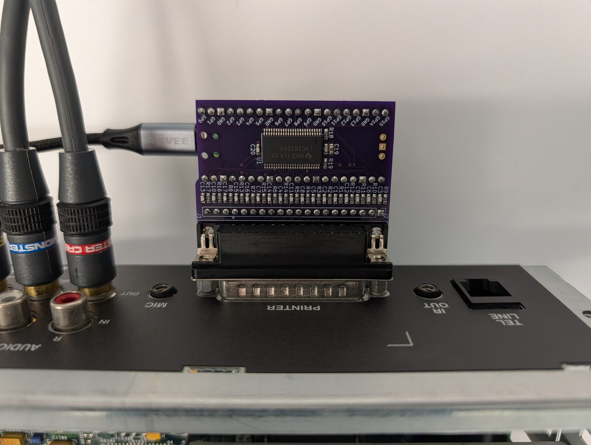
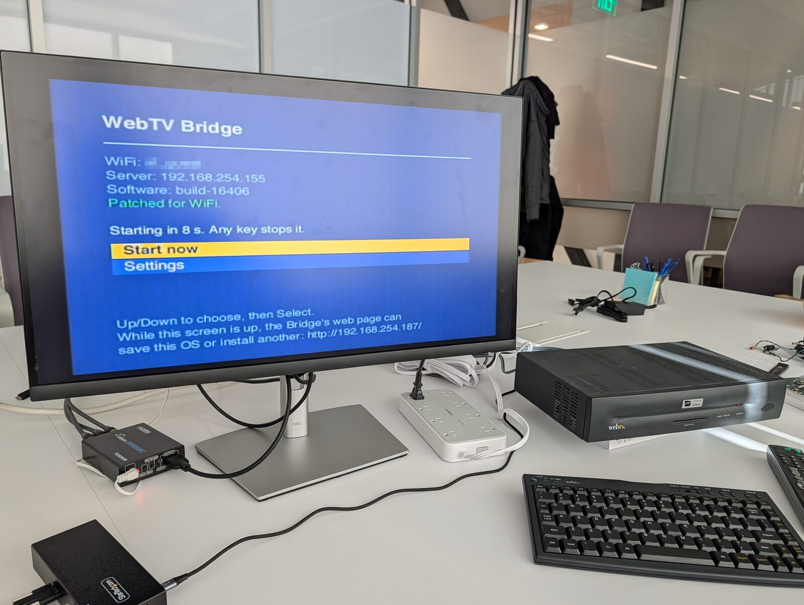
</p>

I wrote the boot ROM for these boxes back at WebTV. Over thirty years later, the dial-up service they were built for is long gone, and the modem in the box doesn't have much to plug into any more. But the community has rebuilt the service ([minisrv](https://github.com/zefie/zefie_wtvp_minisrv) and friends), so all a box really needs is a way to reach it. That's what this is.

The **WebTV Modem / Printer Bridge** ("Bridge") is a Raspberry Pi Pico 2 W on Tom Verbeure's [parallel2usb board](https://github.com/tomverbeure/fake_parallel_printer), plugged into the parallel Printer port of a WebTV Plus. You can power the Pico from a USB charger, or if you are using your computer to see the Pico's console, it will be powered by your computer. The WebTV OS code is patched to use this Printer port interface for modem traffic, debugging, and as a way to see and inject IR remote and keyboard codes. To the box, it's a modem. When the box dials, the Bridge picks up, runs PPP, and carries the box's connections out over WiFi to a WebTV service.

At every power-on the Bridge sneaks its own loader in through the boot ROM's factory diagnostics, reads the OS off the disk into RAM, patches it there to use the printer port as its modem, and starts it. You set up WiFi and pick your server right on the TV, with the remote or the IR keyboard.

This is all possible because the boot ROM checks for a diagnostic dongle on the Printer port at startup, and if found, enables some commands to test the box hardware. One of those commands is launching what are called "tier-3 diagnostics" from a partition on the disk. If you have a WebTV Plus with a production boot ROM and OS, you will need to pull out the disk and use a computer to write the special tier-3 diagnostics to the disk, so that the parallel2usb Pico can inject code to run and patch the OS. If you have debug boot ROMs, you don't need to do that -- the hooks for loading code are already there.

For development and testing, a **WebTV emulator** in JavaScript was written -- that's in this repo, too. The Bridge was developed inside it: the actual firmware, compiled to WebAssembly, plugs into the emulated box's printer port and gets driven pin by pin.

## Goals

1. **Get a stock LC2 box online again**, over WiFi, to today's WebTV services.
2. **Don't change the box.** No soldering, no flash writes, the OS on the disk untouched. (A box with a production boot ROM needs one exception, done once: the Bridge's loader written to a reserved diagnostics area of its disk.)
3. **Set it up from the couch.** WiFi and the server are chosen on the TV. After the first plug-in you don't need a computer.
4. **Make the box easy to hack on.** Its debug console, its state, its disk, its screen and its OS images, all reachable from a browser over WiFi, or from the USB serial port.

## Where it stands

It works on real hardware. My test box is an LC2 with a debug boot ROM, running build 16406 from a CF card: the Bridge gets in, patches the OS, and the box registers and logs in to minisrv and browses its Home page and services over WiFi, at about 12 KB/s. The Bridge catches every kind of reset (power pulls, crashes, the OS restarting itself) and brings the box back up. It knows 150 builds of the OS, and 114 of them can also take key presses from the Bridge's web page.

Boxes with a **production** boot ROM (like 2046) get in a different way, through the disk's tier-3 area, since there's no diagnostics prompt to type at. That path works in the emulator but I haven't run it on a real production box yet. [docs/bridge.md](docs/bridge.md#status) has the whole story.

## In action

| | |
|---|---|
| 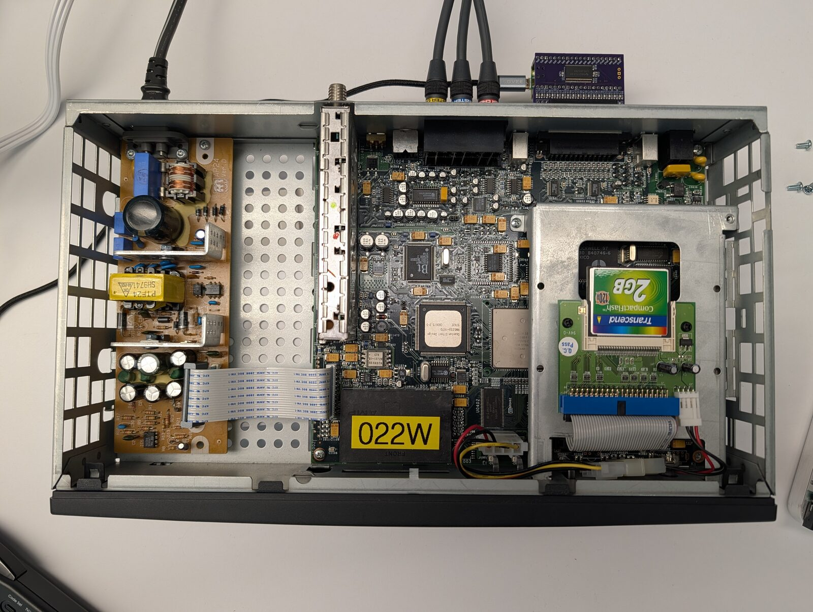 | 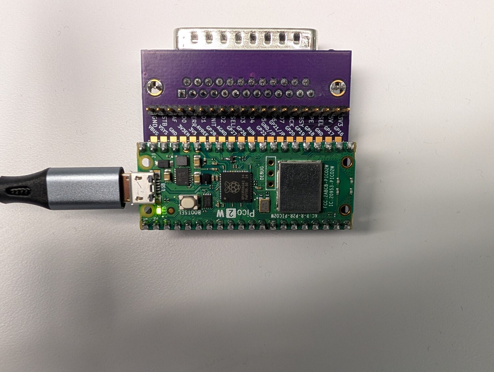 |
| The box, opened up: a CF card in place of its hard drive | The Bridge: a Pico 2 W on the parallel2usb board |
| 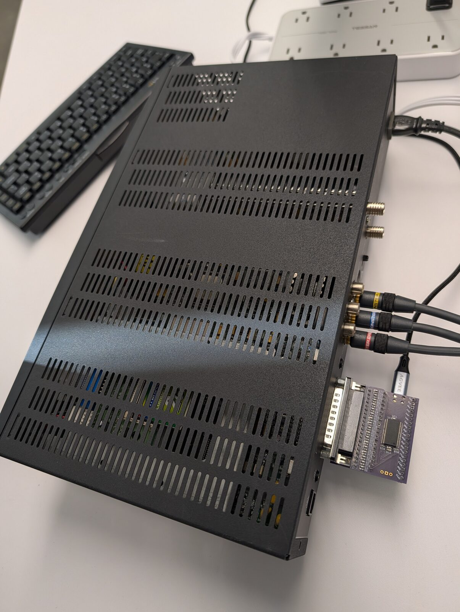 | 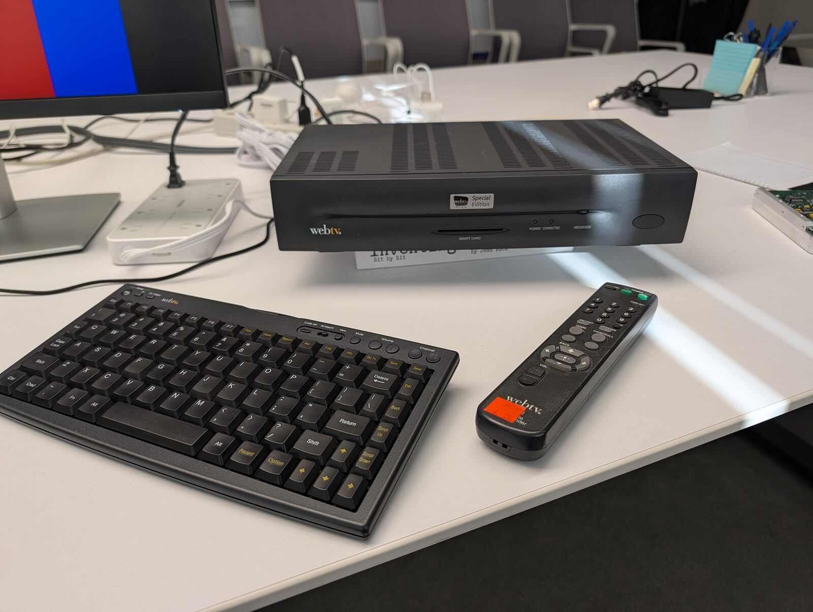 |
| On the back of the box, powered over USB | The box with its IR keyboard and remote |
| 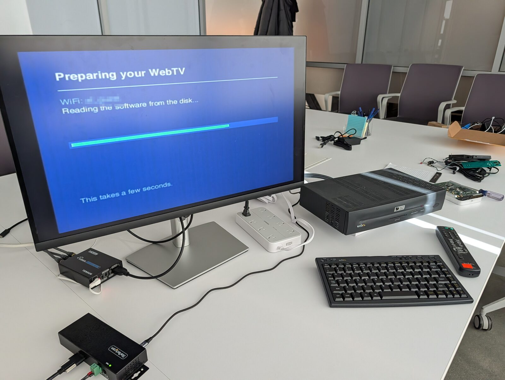 | 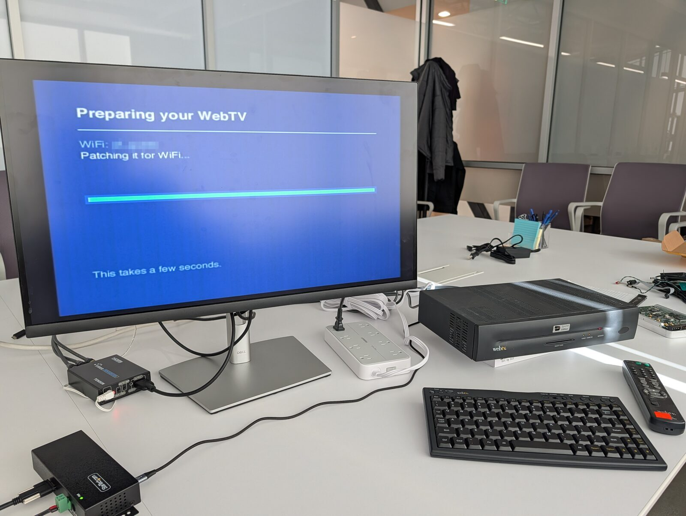 |
| At power-on, the Bridge reads the OS from the disk... | ...and patches it for WiFi, in RAM |
| 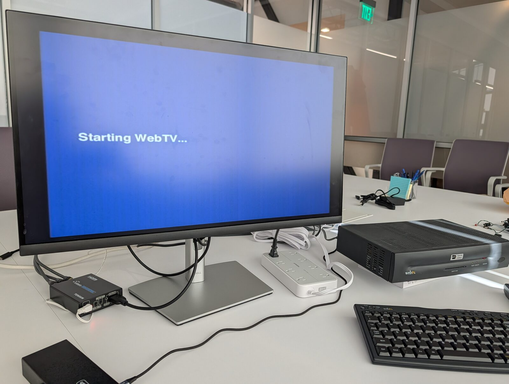 | 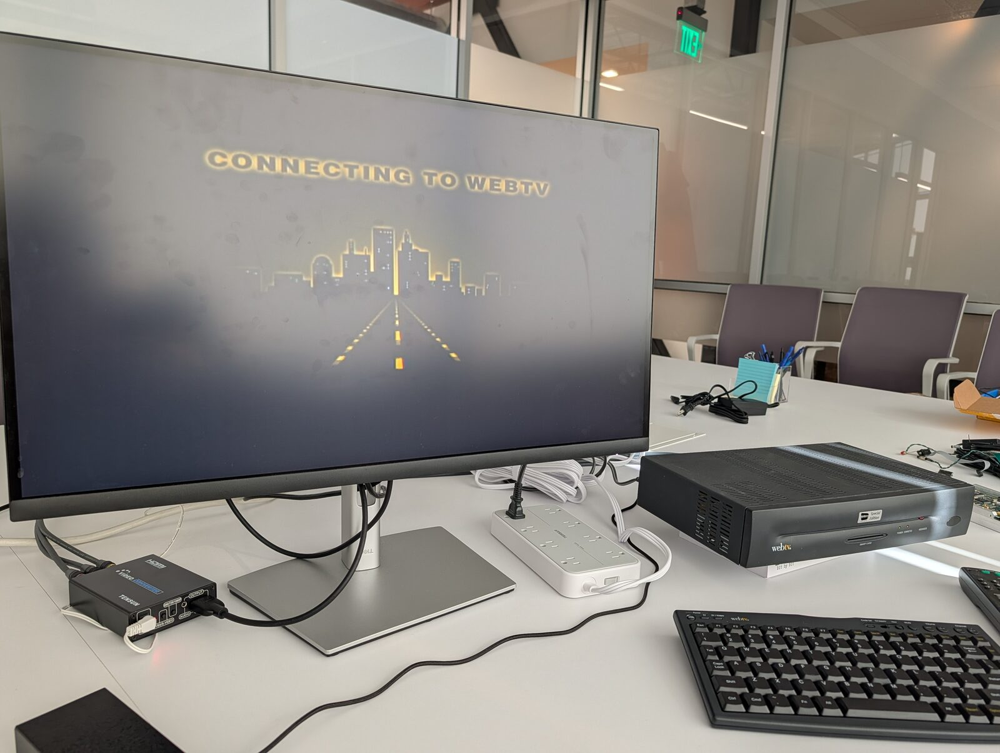 |
| Start: the patched OS takes over | It dials, and the Bridge answers |
| 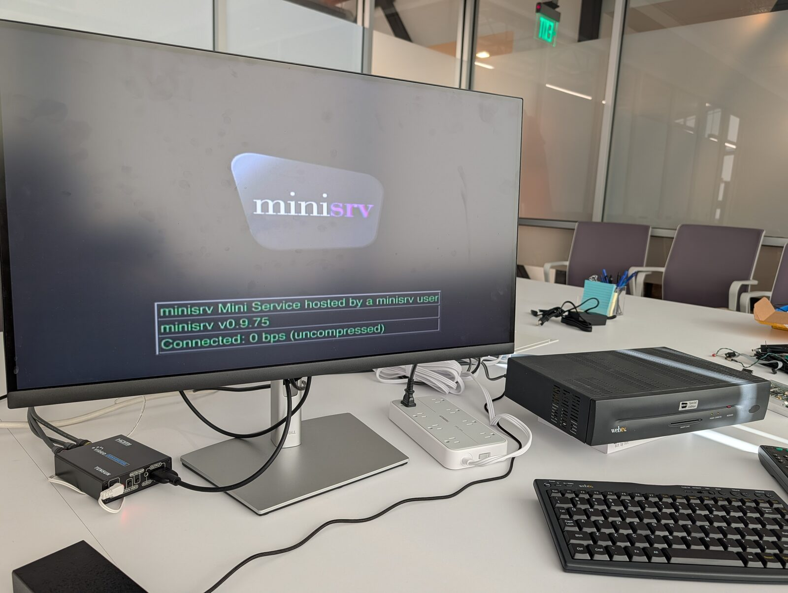 | 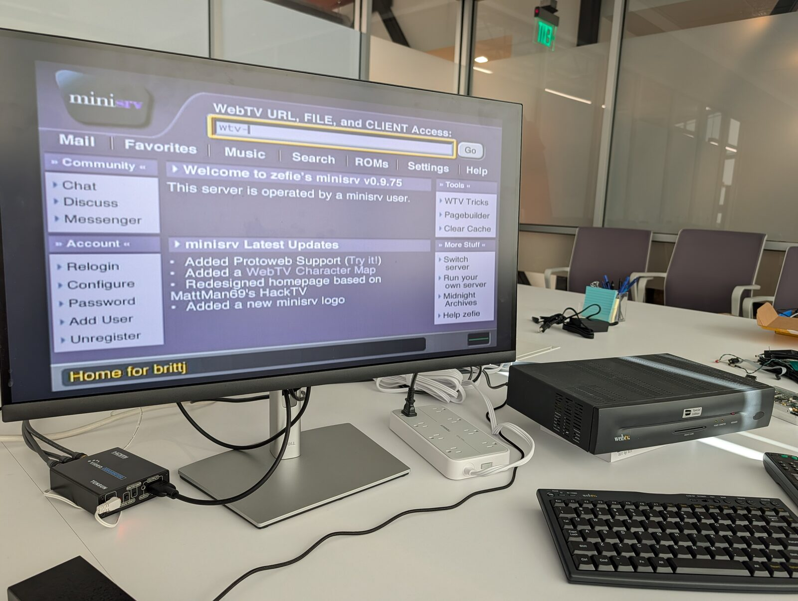 |
| Logged in to minisrv | Home! |

Here's that same Home page, captured from the running box by the Bridge's web page. The OS reads its own memory for the Bridge over the printer port, and the page puts the picture back together from the SOLO chip's display list, the same way the chip does:

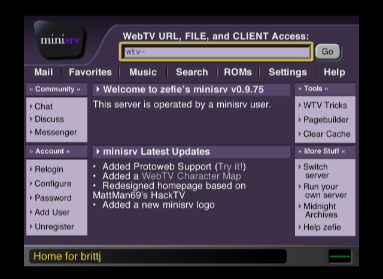

## How it works

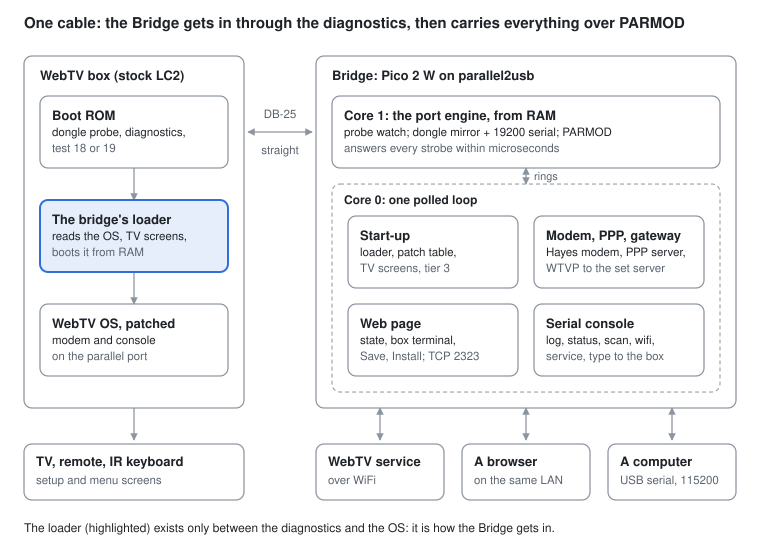

1. **Getting in.** Every LC2 boot ROM checks the printer port for a factory loopback dongle at power-on. The Bridge pretends to be that dongle, which drops the boot ROM into its diagnostics, and then types a tiny stage-0 program at the diagnostics prompt. Stage 0 pulls the Bridge's loader across the printer port in milliseconds. (A production boot ROM has no prompt to type at, so there the loader runs from the disk's tier-3 diagnostics area instead.)
2. **Patching in RAM.** The loader reads the OS off the disk into RAM. The Bridge figures out which build it is from its checksums, applies that build's patch from a table of 150, fixes up the header checksum, and has the boot ROM start it from RAM. The patch swaps the OS's modem driver for one that talks to the Bridge over the printer port.
3. **Online.** We multiplex **four virtual channels** over the printer port's pins using our own protocol, **PARMOD** (PARallel MODem): the modem, the box's debug console, a control channel for commands and status, and a channel the web page uses to read the box's memory and press its keys. When the OS dials, the Bridge's Hayes modem answers, its PPP server hands the box an address, and its gateway carries each TCP connection and DNS lookup out over WiFi.

One core of the Pico runs the port engine out of RAM and answers every strobe from the box within microseconds. The other runs everything else: the start-up, the modem, PPP, the gateway, the web page and the serial console.

## What you need

- **An LC2 WebTV box** (a WebTV Plus, like the Sony INT-W200), with its TV hookup and its remote or IR keyboard.
- **Tom Verbeure's parallel2usb board**, rev 2 (rev 1 works too). The KiCad files are in [tomverbeure/fake_parallel_printer](https://github.com/tomverbeure/fake_parallel_printer). Tom's board wasn't originally designed for this, but it works great!
- **A Raspberry Pi Pico 2 W** on it, in place of the plain Pico the board was designed for.
- **USB power** for the Pico: a phone charger, or a computer if you want the serial console. The printer port doesn't carry any power.
- **A 2.4 GHz WiFi network**, and a WebTV service: minisrv on a computer on the same network (see [services/README.md](services/README.md)), or a public one.
- **Production boot ROMs only:** a USB-to-IDE adapter and a computer, once ([docs/bridge.md, Reference](docs/bridge.md#writing-the-tier-3-loader-to-a-drive-macos)).

## Setting it up

**1. Build and flash the firmware.** You'll need CMake, Ninja, `arm-none-eabi-gcc` 14.x and pico-sdk 2.1 or later:

```sh
cd pico
cmake -B build -G Ninja -DPICO_SDK_PATH=/path/to/pico-sdk   # or -DPICO_SDK_FETCH_FROM_GIT=1
ninja -C build                                              # -> build/lptbridge.uf2
```

Hold BOOTSEL while you plug the Pico 2 W in, and copy `build/lptbridge.uf2` onto the `RP2350` drive (or use `picotool load -x -f build/lptbridge.uf2`). The generated sources in `pico/src/gen/` are checked in, so you don't need Node for this. [pico/README.md](pico/README.md) has the rest.

**2. Start a WebTV service.** For minisrv on your own computer, see [services/README.md](services/README.md). Debug builds of the OS need one small patch to it.

**3. Plug the Bridge into the box's printer port, power it up, and switch the box on.** The TV flashes magenta for a moment (that's the diagnostics), then the Bridge's screens come up. The first time through:

<p>
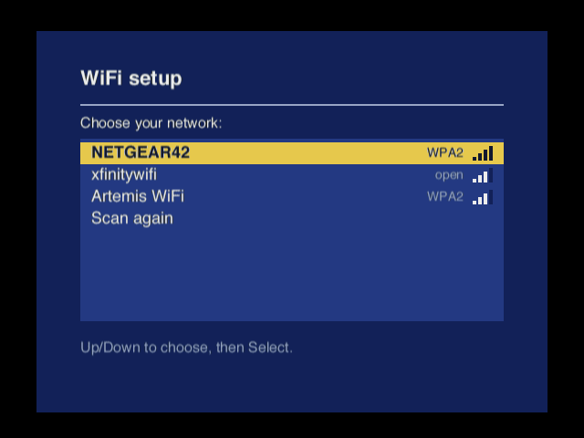
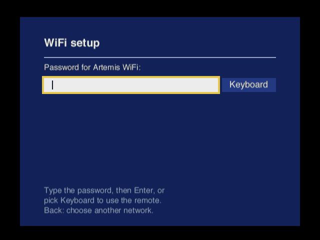
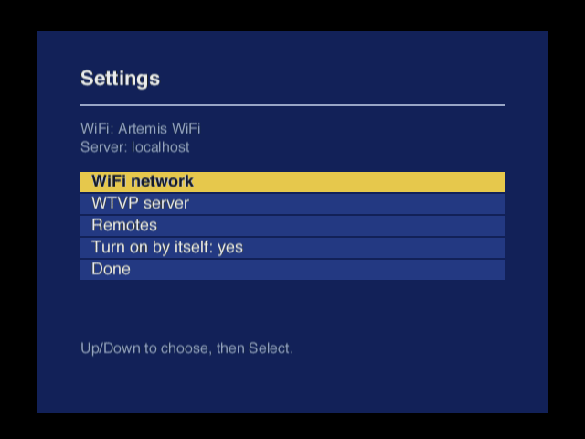
</p>

- pick your network and type its password with the remote or the IR keyboard (there's an on-screen keyboard too);
- under **Settings → WTVP server**, type the address of the computer running minisrv.

From then on, every power-on shows the **WebTV Bridge** screen with a 10-second countdown, and then the box starts up just like it always did. Press any key to stop the countdown. **Settings** has the WiFi network, the WTVP server, which remotes the OS listens to, and whether it turns on by itself.

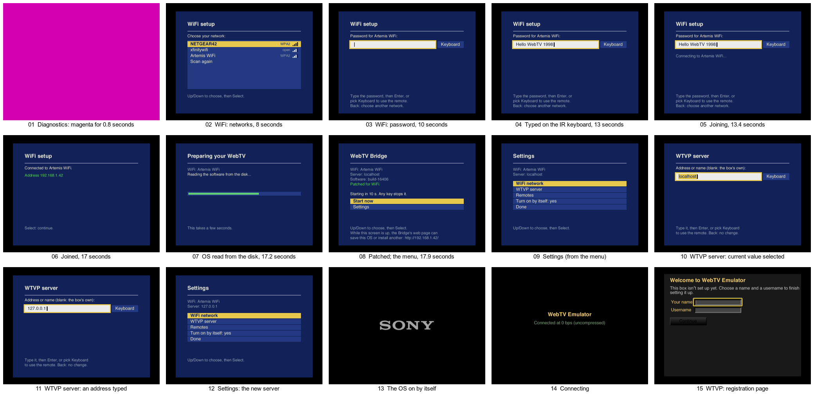

## Using it

**On the TV**, it's just a WebTV. The Bridge stays out of the way once the OS is up. Turning the box off and on from the remote, or an update that restarts the OS, comes straight back without the countdown.

**The web page.** Once it's on your WiFi, the Bridge serves a page at `http://<its address>/` (the TV and the WebTV Bridge screen both show the address):

| Tab | |
|---|---|
| Box Console | the box's own console, and you can type to it (on a debug build, that's its shell) |
| Box & Bridge Info | the firmware, the box's boot ROM and OS, the settings, and what the Bridge is up to |
| Server Settings | the WTVP and DNS servers |
| Box OS | save the OS on the box's disk, or install another build into its other slot |
| Screenshot | grab what's on the TV, straight from the box's memory, as a PNG or raw YUV |
| Box Filesystem | the disk's partitions and the files in its filesystems: download, upload, delete |
| Remote | the remote's buttons, your computer's keyboard as the IR keyboard, and a key "monkey" for stress testing |

<p>
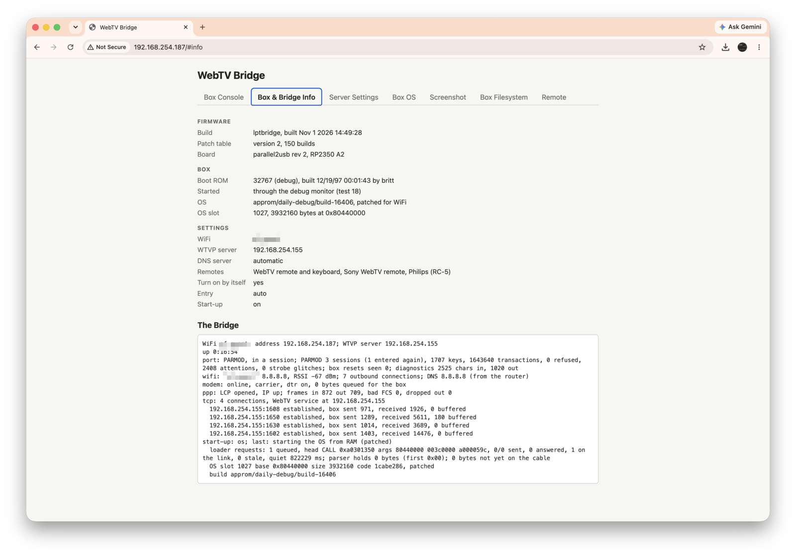
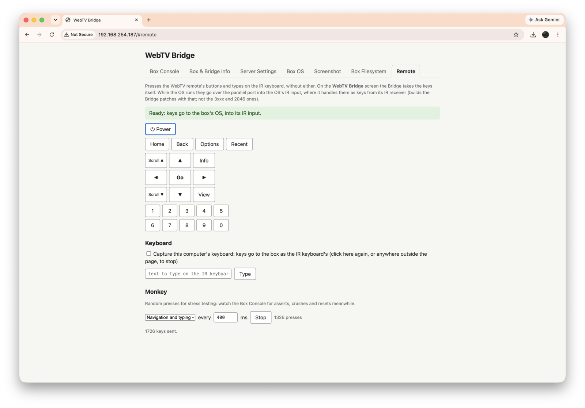
</p>
<p>
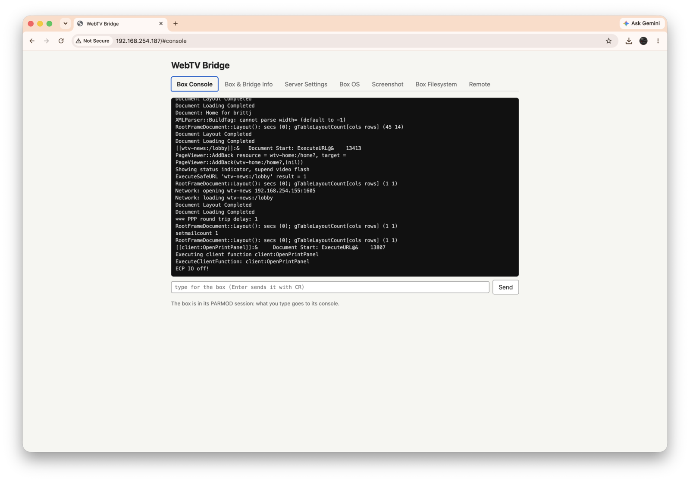
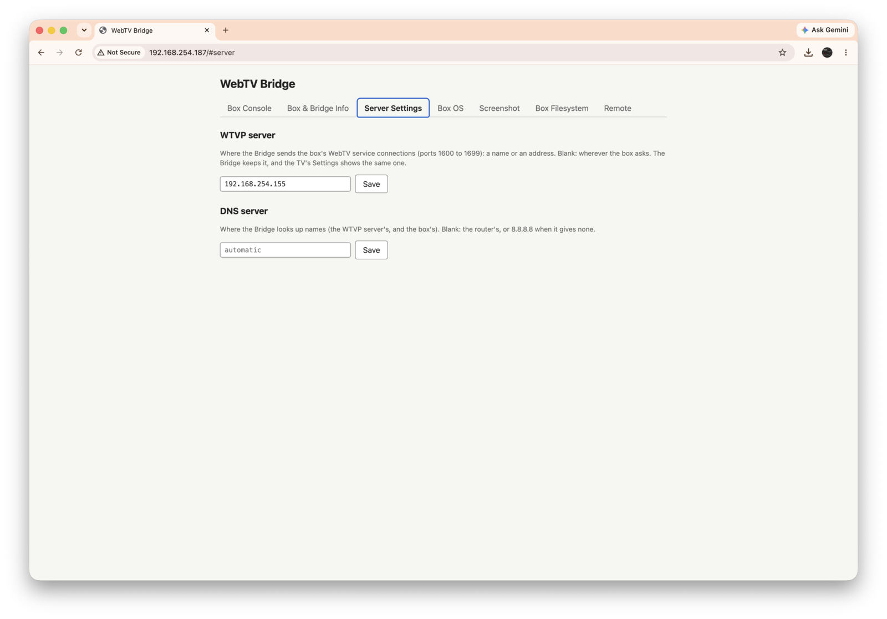
</p>

Box OS and Box Filesystem go through the Bridge's loader, so they work while the TV is showing the WebTV Bridge screen; everything else works any time. The page has **no password yet**, so anyone on your network can use it.

**The serial console.** The Pico's USB serial port (115200) shows the Bridge's log, including the box's console lines as `[pmcon]`, and takes commands: `status`, `scan`, `wifi "My Network" password`, `service 192.168.1.20`, `type "..."` and more ([pico/README.md](pico/README.md#setup)).

## The emulator

The Bridge grew up inside a WebTV Plus emulator I wrote for this project, in plain JavaScript: the LC2 board, the SOLO1 ASIC with its video, audio and IR, the modem, the IDE disk and the parallel port. It runs real boot ROMs and OS builds, in the browser or in Node, and the Bridge's own firmware, built to WebAssembly, plugs into its printer port.

```sh
npm start                          # the emulator in the browser, http://localhost:8080/web/
node tools/bridgesim.mjs           # nine scenarios with the Bridge's firmware on the emulated port
```

See [docs/emulator.md](docs/emulator.md). `tools/bridgesim.mjs` takes the emulated box from power-on to minisrv through every path the Bridge handles: first-time WiFi setup, power-offs, a crash, settings, screenshots, disk access, Save and Install, and keys.

## Bring your own ROMs

WebTV boot ROMs, OS builds and disk images aren't in this repo. The emulator and the tools expect them under `data/` (which git ignores): a boot ROM image, a disk image, and a collection of OS builds (`data/rom-collection/...`) for building the patch table. The patch table and the signature database the firmware needs are checked in, so you can build and flash the Bridge without any of them.

## Documentation

- [docs/bridge.md](docs/bridge.md): the Bridge from the user's side on down: the web page, what the TV shows, how it works, the hardware, where things stand, and step-by-step reference.
- [WEBTV_LPT_BRIDGE.md](WEBTV_LPT_BRIDGE.md): the full engineering spec: the parallel port, the boot ROM's probe and diagnostics, PARMOD, the OS patch, the patch table, and why everything is the way it is.
- [docs/appendix.md](docs/appendix.md): assembler listings of the OS patch, stage 0, the loader and the tier-3 stub.
- [pico/README.md](pico/README.md): the firmware: its files, building, setup, the console.
- [docs/emulator.md](docs/emulator.md): the emulator.
- [tools/saleae/README.md](tools/saleae/README.md): capturing and decoding the cable with a Saleae.

## What's where

| Path | |
|---|---|
| `pico/` | The Bridge's firmware (C, pico-sdk): the port engine, the start-up, modem, PPP, gateway, web page and console; `pico/sim/` builds it to WebAssembly |
| `src/lptmodem/` | The OS patch: the PARMOD driver in MIPS assembly, the patcher, code signatures |
| `src/stockbox/` | The loader, stage 0, the tier-3 image, the patch table |
| `src/machine/`, `src/cpu/`, `src/net/`, `src/wtvsrv/` | The emulator: the LC2, the SOLO, the MIPS CPU, a built-in WebTV service |
| `web/` | The emulator's browser front end, plus modules the Bridge's page shares |
| `tools/` | bridgesim, the patch table and signature builders, disk tools, the dev server |
| `services/` | How to set up minisrv, and our patch for it |
| `docs/` | The docs, screenshots, photos and diagrams |

## Thanks

- [Tom Verbeure](https://github.com/tomverbeure), for the parallel2usb board ([write-up](https://tomverbeure.github.io/2023/01/24/Fake-Parallel-Printer-Capture-Tool-HW.html)).
- [zefie](https://github.com/zefie), for minisrv, the WebTV service the box talks to.
- [wtvemac](https://github.com/wtvemac), whose MAME driver's IR keyboard model the emulator's is ported from (BSD-3-Clause).
- The Raspberry Pi folks for the [pico-sdk](https://github.com/raspberrypi/pico-sdk), plus lwIP and the CYW43 driver.

And to Steve, Bruce, Phil (we miss you), and everyone in the amazing WebTV family. WebTV was one of the most fun experiences of my life!

Built by Joe Britt, with Claude.

## License

MIT; see [LICENSE](LICENSE). minisrv is GPL-3.0 and lives in its own repository.
