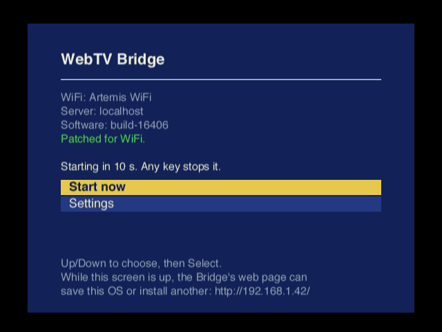
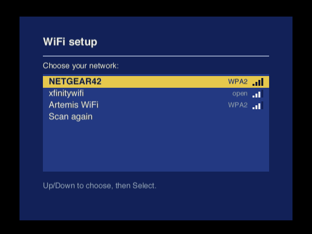
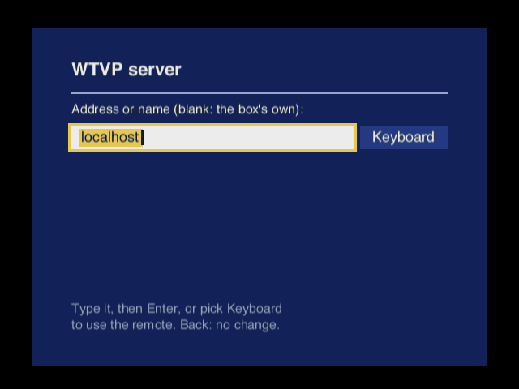
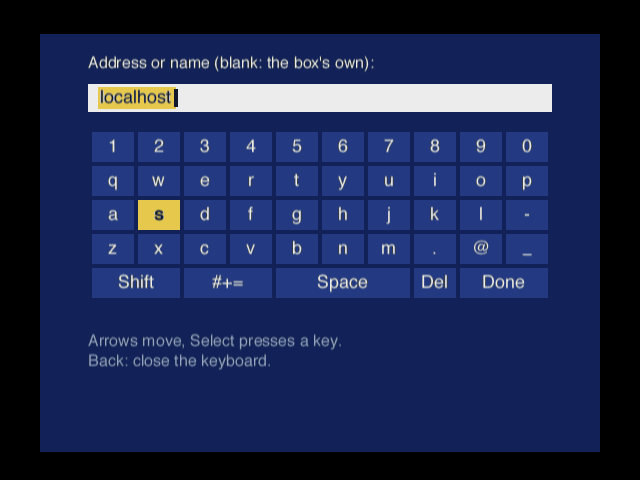
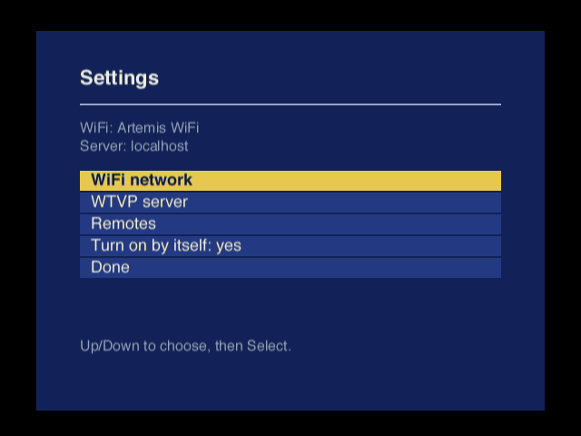
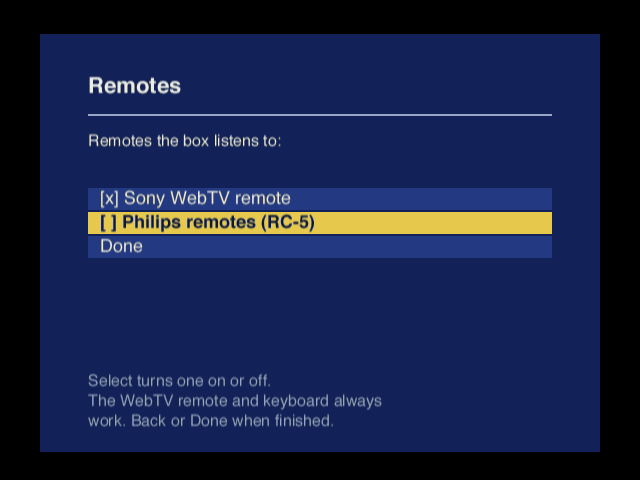
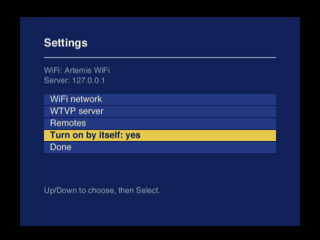

# WebTV LPT ↔ WiFi Bridge: Project Handoff

Handoff spec for a Claude Code instance starting work on both sides of this project:
the **Pico 2 W bridge firmware** and the **WebTV-side driver**, a patch to stock WebTV OS
builds. Updated 2026-10-12: the bridge now presents a modem (§1). The box-side patch and an
emulated bridge exist and work in the emulator (§5, §6). The Pico firmware is in `pico/`; it
builds and is tested on a computer against the emulator (§7). Updated 2026-10-25: the first
board is built and passes its loopback tests (§2.5); §10 is the plan for bringing it up on a
real box.
Put this file in the repo root (or `docs/`) and treat it as the source of truth until
superseded. Items marked **VERIFY** are unconfirmed; do not build on them without checking.

---

## 1. Goal

Real WebTV boxes (owner: Joe Britt, one of the original WebTV developers) will run new
firmware and disk code. Their only networking was a dial-up modem, which is impractical
today. Every WebTV box has a 1284-capable parallel (LPT) port. We will build a small
peripheral that plugs into that port and gives the box modern networking over WiFi.

**Architecture decision (2026-10-12): the bridge is a modem with PPP behind it.** A small
patch to a stock WebTV OS build replaces the bottom of its hardware-modem driver with a
parallel-port driver (§6). Everything above that is unchanged: TellyScript dials with AT
commands, and the box's own PPP, TCP/IP and WebTV service login run as they always did.
The bridge answers like a Hayes modem, "connects" when the box dials, terminates PPP and
carries the box's TCP connections and DNS over WiFi (§5).

- No new network stack on the box, and any build with a symbol table can be patched.
- TLS stays off the box *and* off the bridge for normal use: the box talks WTVP to a WebTV
  service (minisrv or similar), which fetches the web over HTTPS on its behalf.
- The earlier design, **socket offload** (open/send/recv/close commands plus TLS on the
  bridge), remains an option for future custom firmware. The link layer (§4) can carry it
  later as additional channels.

## 2. Hardware

### 2.1 Bill of materials (rev A)

| Item | Part | Notes |
|---|---|---|
| MCU + WiFi | Raspberry Pi **Pico 2 W** (RP2350 + CYW43439) | A4 stepping preferred (marked RP2350A4; needs **pico-sdk ≥ 2.1.0**), but A2 works. A2's erratum E9 (an input with its internal pull-down enabled can latch high) doesn't affect this board: the 161284 actively drives every Pico input, and nothing relies on an internal pull-down. The firmware supports both steppings and prints which one it's on (`pins`, boot banner). |
| Level shifter / 1284 transceiver | **TI SN74LVC161284** | Purpose-built IEEE 1284 transceiver: 17 signals in correct directions, bidirectional data with DIR, HD (high-drive) control. Logic side (Vcc) 3.3V, cable side (Vcc_Cable) 5V from VBUS. Checked against the datasheet in §2.3. |
| Connector | DB-25 **male** | Plugs straight into the WebTV's female DB-25 (or use a straight-through cable). |
| Series resistors | 22 Ω on all 17 signals | Per Sharp AR-PK11 reference design used by Tom Verbeure. |
| Caps | 100 pF to GND on all 17 signals | Footprints only; populate if signal integrity needs it. |
| Power | Pico USB 5V (VBUS) | **The LPT port has no +5V pin.** |
| Debug | 2×10 header mirroring DB-25 signals; UART header | For logic analyzer. |

### 2.2 Why not wire the RP2350 directly?

RP2350 digital GPIOs are 5V-tolerant **only while IOVDD = 3.3V is present**. With two
separately powered boxes, the WebTV can drive 5V into an unpowered bridge, which can
damage it. Outputs are still 3.3V max. The WebTV-side port has 4.7 kΩ pull-ups to +5V
(see §3.4), so lines idle at 5V. Use the 161284.

### 2.3 The board: Tom Verbeure's parallel2usb

**tomverbeure/fake_parallel_printer** (KiCad 6, RP2040 Pico + 74LVC161284 + DB-25 male):
- Repo: https://github.com/tomverbeure/fake_parallel_printer
- Write-up: https://tomverbeure.github.io/2023/01/24/Fake-Parallel-Printer-Capture-Tool-HW.html
- Rev 1 is 4 layers with the Pico on top; rev 2 is 2 layers with the Pico underneath. The
  pin assignments differ (§2.4).
- Used as is, with a Pico 2 W in place of the Pico. It has the same footprint and pinout, and
  the board leaves GP23/24/25/29 unconnected, which the Pico 2 W keeps for the wireless chip.
- The firmware tells the revisions apart the way his firmware does: GP28 with a pull-up reads
  1 on rev 1 (floating) and 0 on rev 2 (strapped to GND).
- J2 (2×10) mirrors every cable signal for a logic analyzer; see `tools/saleae/README.md`.
- 22 Ω series resistors on all 17 signals; the 100 pF caps are optional. DIR and HD have
  4.7 kΩ pull-downs, so until the firmware runs, the data lines are inputs and the outputs are
  open drain.
- Vcc_Cable is the Pico's VBUS (+5 V), so the bridge must be powered over USB.

**SN74LVC161284 (checked against TI SCAS583J):**
- Nothing is inverted.
- **DIR = 1: A1–A8 → B1–B8** (the Pico drives the cable); DIR = 0 is B → A.
- A9–A13 → Y9–Y13 are the five peripheral outputs: Select, PError, Busy, nAck, nFault.
  C14–C17 → A14–A17 are the four host inputs: nSelectIn, nInit, nAutoFd, nStrobe. Neither
  group depends on DIR.
- **HD = 1:** the B/Y outputs are totem pole (14 mA).
- **HD = 0:** they are open drain, with the 1.4 kΩ cable-side pull-ups. Every cable pin has
  those pull-ups except HOST LOGIC IN and PERI LOGIC OUT.
- Delays: A↔B is ≤ 40 ns; DIR→A enable is ≤ 50 ns; B is released in ≤ 50 ns.
- PERI LOGIC and HOST LOGIC are unused on the board.

### 2.4 Pin map (Tom's boards as built)

| Signal (DB-25 pin) | Rev 2 | Rev 1 | Dir (Pico) | ECP role (IEEE 1284) |
|---|---|---|---|---|
| D0–D7 (2–9) | GP3–GP10 | GP11–GP4 (reversed) | bidir | data |
| nStrobe (1) | GP11 | GP15 | in | HostClk |
| nAutoFd (14) | GP0 | GP14 | in | HostAck |
| nInit (16) | GP1 | GP13 | in | nReverseRequest |
| nSelectIn (17) | GP2 | GP12 | in | 1284Active |
| nFault (15) | GP12 | GP22 | out | nPeriphRequest |
| nAck (10) | GP13 | GP21 | out | PeriphClk |
| Busy (11) | GP14 | GP20 | out | PeriphAck |
| PError (12) | GP15 | GP19 | out | nAckReverse |
| Select (13) | GP18 | GP18 | out | XFlag |
| 161284 HD | GP16 | GP17 | out | drive strength |
| 161284 DIR | GP17 | GP16 | out | bus turnaround |
| console UART | UART1: GP20 TX, GP21 RX | UART0: GP0 TX, GP1 RX | | |
| debug strobes | GP26 (dbg0), GP27 (dbg1) | same | out | |
| board-rev strap | GP28 (GND) | GP28 (floating) | in | |

The firmware (`pico/src/bridge_config.h`) carries both tables and picks one at boot.

- On rev 1 the data bits are reversed (D0 on GP11, D7 on GP4); the link engine reverses them
  with a single `rbit`.
- Free pins: rev 2 has GP19, GP22, GP26 and GP27. Rev 1 has GP0–GP3, but GP1 is the
  diagnostics jumper.

For PIO and ECP (§4.2):
- On rev 2, D0–D7 and nStrobe are contiguous (GP3–GP11), so `in pins, 9` captures the data
  and HostClk together.
- The other handshake lines aren't contiguous, so side-set can't cover nAck, Busy and DIR
  together. PIO would drive them with `set`/`out` or a second state machine.
- If ECP needs that, a re-pinned fork of the board is the fallback.

### 2.5 Board bring-up without a box: loopback tests

The console's `loop` command checks every signal and solder joint with jumper wires on J2 (pinout
in `tools/saleae/README.md`) and nothing on the DB-25. `loop` alone lists the jumpers. The
bridge pauses its link engine for the test, then carries on; take the jumpers off before
running `walk` or connecting a box.

**Loops 1-3: every line as a receiver.** The five drivers (the status lines nAck, Busy, PError,
Select, nFault) each go to one receiver. The receivers, in order, are nStrobe, nAutoFd, nInit,
nSelectIn, D0-D7. Loop 1 takes the first five, loop 2 the next five, loop 3 the last two:

| J2 | nAck (6) | Busy (5) | PError (4) | Select (3) | nFault (16) |
| --- | --- | --- | --- | --- | --- |
| loop 1 | nStrobe (19) | nAutoFd (18) | nInit (14) | nSelectIn (12) | D0 (17) |
| loop 2 | D1 (15) | D2 (13) | D3 (11) | D4 (10) | D5 (9) |
| loop 3 | D6 (8) | D7 (7) | | | |

With DIR = 0, the test reads all twelve receivers with every driver high, then with each driver
low in turn. Each receiver must follow its own driver and nothing else. It does this with HD =
0 (open drain, the 161284's 1.4 kΩ pull-ups) and again with HD = 1 (push-pull). A failure names
the receiver and its J2 pin ("went low" is a short, "stayed high" an open). If the readings
match another mode's jumpers, it says so.

**Loops 4 and 5: turning the data bus around.** Four data lines go to the four control inputs,
which are the only lines the Pico can read while it drives the bus. The status lines drive the
other four data lines:

| J2 | nStrobe (19) | nAutoFd (18) | nInit (14) | nSelectIn (12) | nAck (6) | Busy (5) | PError (4) | Select (3) |
| --- | --- | --- | --- | --- | --- | --- | --- | --- |
| loop 4 | D0 (17) | D1 (15) | D2 (13) | D3 (11) | D4 (10) | D5 (9) | D6 (8) | D7 (7) |
| loop 5 | D4 (10) | D5 (9) | D6 (8) | D7 (7) | D0 (17) | D1 (15) | D2 (13) | D3 (11) |

The test steps through receive (DIR = 0, each status line low), drive (DIR = 1, all high, a zero
across each line, all low) and release (back to DIR = 0, the bus floats high). Then it makes
1000 round trips (drive, release, receive) with changing patterns, with interrupts off, and
prints the worst settling time of each step, measured with SysTick. Push-pull is only tried
after open drain passes: with the wrong jumpers the bridge's data outputs would fight its
status outputs.

Loops 1-4 cover every joint, since each data line uses the same pins, resistor and connector
pins in both directions. Loop 5 adds D4-D7 driving the cable (the drivers inside the Pico and
the 161284), so it's worth running once per new board.

**Results (2026-10-25):** Joe's first board (rev 2, detected from the GP28 strap; Pico 2 W,
RP2350 A2) passed loops 1-5, open drain and push-pull. With loop 2 run on loop 1's jumpers, the
test named all ten mismatches and recognised loop 1's wiring.

## 3. WebTV side: SOLO ASIC parallel port

Source: `webtv_parallel_port.pdf` (excerpt of the SOLO1 ASIC spec, 980-03004-F50,
chapter 5.2.8.19–5.2.8.32) in Joe's Google Drive `WebTV` folder. The full spec is
`SOLO1_ASIC_Spec.pdf` (~210 MB). The excerpt has handwritten margin notes; they are
recorded below because some contradict the printed spec.

### 3.1 Capabilities

- 1284-compliant port. **Hardware modes:** Compatibility FIFO (forward-only, hardware
  handshake) and **ECP** (bidirectional, hardware handshake). Other 1284 modes in software.
- 16-byte FIFO with threshold interrupt.
- **ECP must be negotiated in software** (IEEE 1284 negotiation) with the interface in
  ECP forward idle phase *before* setting P_CNFG.Mode = ECP.

### 3.2 Register map

Printed base addresses below. **Base resolved:** the registers are at SOLO devUnit + 0x200,
i.e. **0xA400_4200** (KSEG1), as the margin note says. The OS's own driver
(`SoloParallelHWIntf`) and the MAME driver both use 0x4200–0x422C. All the annotated
offsets, including CNFG, CLRINT and ENABLE, match the code.

| Printed addr | Annotated offset | Register | Fields |
|---|---|---|---|
| 0x0400_40C0 | 0x4200 | **DATA** | [7:0] PP_DATA. Mode 0: direct pin access (write drives if Dir=out; read samples if Dir=in). Modes 1/2: writes push 16-byte FIFO; ECP reverse: reads pop FIFO. |
| 0x0400_40C4 | 0x4204 | **CTRL** | [5] PP_ECPCMND: in ECP, 1 drives nAutoFd=0 (command byte: channel address or RLE count). [4] **PP_DIR**: printed "1 = SOLO→printer, 0 = printer→SOLO", and that is right (§3.7; the "Spec SWAPPED!" margin note is about the STAT table). Not overridden by any mode. [3] PP_SELECTIN_N: drives nSelectIn; never overridden. [2] PP_AUTOFD_N: drives nAutoFd; overridden in ECP. Margin note: only controls AutoFd in FORWARD mode; the state machine controls it in REVERSE. [1] PP_INIT_N: drives nInit in modes 0/1. In ECP it sets handshake direction (1 = forward, 0 = reverse) and **toggling it flushes the FIFO**. Margin note: overridden, but the state machine verifies it matches the desired direction. [0] PP_STB_N: drives nStrobe in mode 0; hardware-controlled in modes 1/2. |
| 0x0400_40C8 | 0x4208 | **STAT** (RO) | Printed: [4] PP_ACK_N (pin 10), [3] PP_SEL (pin 13), [2] PP_ERR, [1] PP_FAULT_N (pin 15), [0] PP_BUSY (pin 11). **The OS's printer driver reads it differently** (its SOLO→PC status table): [4] PError (pin 12), [3] Select, [2] nError = nFault (pin 15), [1] nAck (pin 10), [0] Busy. We use the OS's layout (`src/lptmodem/link.js`), which the excerpt's handwritten pin numbers and the 1997 link code confirm (§3.7). Raw pin states; PC-style BUSY inversion is **not** documented. |
| 0x0400_40CC | 0x420C | **CNFG** | [1:0] PP_MODE: 00 software-only, 01 Compatibility FIFO, 10 ECP, 11 reserved. |
| 0x0400_40D0 | 0x4210 | **FIFOCTRL** | [5] PP_FIFORESET (W1 resets pointers, data lost). [4:0] PP_FIFOTHRES: interrupt when available entries == thresh (modes 1/2; only for hardware transfers to/from the port). |
| 0x0400_40D4 | 0x4214 | **FIFOSTAT** | [5] PP_TIP "termination in progress": after setting Mode=0, wait for clear. [4:0] PP_FIFOAVAIL. |
| 0x0400_40D8 | 0x4218 | **TIMEOUT** | [0] W1: abort a stalled ECP forward cycle. |
| 0x0400_40DC | 0x421C | **STAT2** (RO) | Logical levels of control lines: [3] SELECTIN_N, [2] AUTOFD_N, [1] INIT_N, [0] STB_N. |
| 0x0400_40E0 | 0x4220 | **IEN** | [4] CFIFOEXCP, [3] ACKDONE, [2] ECPREVERSE, [1] reserved, [0] THRESH. |
| 0x0400_40E4 | 0x4224 | **IST** (RO) | Same bits. CFIFOEXCP: peripheral asserted error/fault in Compat FIFO mode. **ACKDONE: in software mode, peripheral drove nACK low→high.** **ECPREVERSE: in ECP, peripheral requests a reverse transfer by asserting nFault.** THRESH: FIFO threshold reached. |
| 0x0400_40E8 | 0x4228 | **CLRINT** (WO) | W1 to clear the matching IST bit. |
| 0x0400_40EC | 0x422C | **ENABLE** | [0] W1 enable port, W0 disable. Margin note suggests disable/enable to recover a hung port. |
| 0x0400_4800 | — | DEV_DIAG | [5:4] XFRSTATE, [3] reverse pop, [2] pop, [1] reverse push, [0] push (pport diag mode). |

The annotated offsets for CNFG, CLRINT and ENABLE were partly illegible in the scan; the OS
code confirms them (0x420C, 0x4228, 0x422C).

### 3.3 Margin notes on driver procedure

- Set DIR and P_INIT correctly for the direction before each transfer.
- Flush the FIFO when reversing.
- Use TIMEOUT abort to kill a stuck transfer; disable/enable the port if hung.
- If Select (XFlag) drops (1284 no longer active), abort the current op and resync.
- Known failure: "sync stuck when WTV is in WTV→PC mode". Design the resync path for this.

### 3.4 Board-level notes

**Production LC2** (`old_docs/LC2_Schematic.pdf` rev 7.0, sheets 26-27 "P_PORT"):
- **Bus switches.** The SOLO's pins reach J1501 through two 74FST3384 bus switches, gated from
  +5 V through a diode, which clamps what the 3.3 V SOLO sees.
- **Lines the box drives** (data, nStrobe, nAutoFd, nInit, nSelectIn) have 22 Ω in series.
- **Every line** has a **1.2 kΩ pull-up to +5 V and 470 pF to ground**.
- **PP_DIR isn't used on the board** (test point only); the direction is set inside the SOLO.

With the adapter's 161284 (1.4 kΩ pull-ups, 22 Ω, optional 100 pF), each line has about 650 Ω
of pull-up and 470-570 pF. A released line rises with τ ≈ 0.35 µs. J1501 is the standard
DB-25 pinout; Joe confirmed by eye that the adapter's J1 matches it pin for pin, straight through.

**Debug serial** (sheet 24): the SOLO UART (UART_TXD/RXD/RTS_N/CTS_N, 10 kΩ pull-ups to 3.3 V)
goes through an LTC1385 RS-232 transceiver (U1005) to J1008, a 2×5 header with +5 V and ground.
Both are marked EMPTY: fitted on dev boxes only, and Joe's box is one. The levels are RS-232,
not TTL. The pin numbers are unreadable in the scan, so check them on the board.

**1996 dev board** (Pekoe/SHASTA II, in the SOLO excerpt): an EMI filter on every line and
4.7 kΩ pull-ups.

### 3.5 Historical precedent: 1997 PC↔WebTV ECP debug link (from the margin notes)

WebTV engineers ran a bidirectional PC↔WebTV link over this port:
- **Crossover cable** (host-to-host): 1↔10 (nStrobe↔nAck), 2–9 straight (data),
  14↔11 (nAutoFd↔Busy), 16↔15 (nInit↔nFault), 17↔13 (nSelectIn↔Select), 12↔12 (PError;
  "16 ties to 12 on both sides"). The **WebTV was the ECP host** and the PC emulated the
  peripheral in software through its control lines.
- **Sync:** PC sends `$69`, reverses the bus, waits for an echo of `$96`. On timeout, retry.
- **Commands are fixed 9 bytes long, and every command is echoed back.**
- Simpler fallback: in SPP mode, each `getchar`/`putchar` always sends one char then receives
  one char (send 0 if nothing to send). This works with Mac SPP cards too.

**Found (2026-10-12):** debug builds still contain this link: `InitParPort`,
`SyncWithHost` (sends `0x69`, expects `0x96`), `ParPutString`/`ParGetString`, used by
`UploadDiskECP`, `DownloadFlashROMECP` and `VFAT_parallelDL` and by the debugger. Non-debug
builds don't have it. Debug builds also have an ECP debug console (`InitECPCharIO`, selected
by `SetCharIO` flag 0x10), which the patch moves to the SUC serial port (§6).

**Our design uses a straight-through cable with the bridge as a true 1284 peripheral**,
not the crossover.

### 3.6 What the OS code tells us (2026-10-12)

201 builds in the ROM collection ship `symbols.sym`, so the OS can be read by name.
Addresses below are for daily-debug 16406.

- **Parallel port interrupt:** devUnit interrupt bit 4 (DEV_INT_PARPORT), OS interrupt
  number **0x1D** in `RegisterIntHandler`/`EnableInterrupt` terms. The OS's interrupt table
  holds 16 bytes per source: mask, status-clear register, enable register, disable register.
  The modem is 0x16 (RIO device 0).
- **Modem stack:** the UART is at 0xBE000000, stride 4. C code reaches it only through
  `ReadModemReg`/`WriteModemReg` (two instructions each). The interrupt handler
  `ModemIntHandler` is hand-written assembly that fills 4 KB receive/transmit rings
  (`modemRcvData`/`modemXmtData`, heads and tails in `modemRcvHead`…`modemXmtTail`). It wakes
  the PPP task (`pppInterruptHandler`) on every 0x7E byte. Above that:
  `putchar_modem`/`putbuf_modem`/`getbuf_modem`/`ModemFIFOCount`/`ModemGetCD`/`ModemSetDTR`,
  then `Serial*`, then PPP and TellyScript (`SI_*`).
- **The rings are allocated after `InitModem` runs,** and TellyScript's modem-firmware
  download (AT**) runs before it. A replacement driver must work from zeroed state.
- **Printer:** `main` calls `InitParallelPort`, which creates `SoloParallelHWIntf` and the
  `ParallelDriver` (`gParallelDriver`). Printing code checks `gParallelDriver` for NULL;
  returning 0 from `InitParallelPort` is the OS's own "no printer" path.
- **DIR polarity (settled 2026-10-25, §3.7):** bit 4 = 1 means the SOLO drives D0-D7, as the
  printed spec says. `IsParallelInitialized` only checks that the bit sticks; the printer
  driver's `SetDataDirection(1)` sets it to print, and the 1997 debug link sets it before
  every byte it sends. The driver had it the other way round until DRIVER_VERSION 2.

### 3.7 The 1997 ECP download link, as the code does it (2026-10-25)

Read from daily-debug 16406 (base 0x80440000) and the SOLO excerpt's handwritten pages. Debug
builds start an OS shell on the debug serial port by themselves ("Cranking up the shell...",
prompt `shell % `). Three commands pull data in over the parallel port. `dde` belongs to the
WTV debugger (`dbug` at `shell % `, prompt `app>`, `g` resumes; its extra commands come from
`extraCmdTable`) and `pardl` to the VFAT shell:

| Command | Function | Writes |
| --- | --- | --- |
| `dde` | `DownloadDiskECP` → `DD_ECP` mode 4 | a whole OS build, through `WriteBrowserStorage`, then `ToggleBrowserSelect`: an OS install |
| `dde <partition>` | `DD_ECP` | a raw partition, block by block through its partition driver |
| `dde t3` / `dde id` | `DD_ECP` modes 10 / 11 | tier-3 diagnostic storage / `WriteDiskSpecial(0xb)` |
| `pardl <file>` (VFAT shell) | `VFAT_parallelDL` | a file in the current FAT directory |

The shell also has `goto <url>`, so `goto client:boota?partition=…` boots a partition from the
serial console, and `newpart`/`showparts` manage partitions.

**Where the shell's console is.** Nothing on the port is auto-detected:
- At boot, `InitDebugIO` reads the saved Debug Terminal Setup (`gDebugTermSetup`) and calls
  `SetCharIO`. Its flags are 0x01 Smart Card port, 0x02 Pekoe UART, 0x08 SOLO UART (J1008)
  and 0x10 the parallel port ("ECP IO", `Xfer2Bytes` per character).
- With no valid setup in secondary NV, `LoadDebugTermSetup` defaults to Serial Port at 115200
  plus Parallel Port, and saves that. An unconfigured debug box already has the parallel console on.
- The shell's `ecpio on|off` changes it.
- So does the page `file://ROM/DebugOnly/DebugTermSetup.html` (rows Serial Port, Smart Card,
  Parallel Port; "Save settings for future sessions?" writes NV; Ok applies at once). Its client
  URL is `client:DebugTermSetup`. To reach it without a console (debug builds only; verified
  in the emulator with 16406):
  1. Put the box in standby.
  2. Wait about 10 s without pressing anything.
  3. Type 1 9 2 0 0 on the keyboard. The code has no remote number, so the remote can't enter it.
  4. Press Power. The box starts on the page.

  The secret-code matcher (`SecretCode_StartAtDebugTermSetup`, keyboard number 119200, counter
  starts at 1) only runs in the standby input loop. While browsing, the keys never reach it.
- Printing a page turns the parallel console off ("ECP IO off!").

So the serial header isn't strictly needed: with "Parallel" set, the bridge could be the shell's
terminal too. That needs an unpatched debug build, since our patch moves an ECP console to the
SOLO UART.

**The parallel console exchange** (`Xfer2Bytes`; emulated by `src/machine/lptconsole.js`).
Every console char is one swap in software mode, with nStrobe from the box, nAck from the host,
and a 1 s timeout on each box wait:
1. Ready: the host drives 0xA5 on D0-D7 with nAck low. If nAck is high, the box skips the swap.
2. Box nStrobe low: the host releases the data lines and raises nAck.
3. Box drives its char, nStrobe high: the host latches it and lowers nAck.
4. Box releases the bus, nStrobe low: the host drives its char and raises nAck.
5. Box reads it, nStrobe high: the host drives 0xA5 and lowers nAck again.

Rules for the host:
- **NULs:** the box sends NUL when it only wants input, and the host sends NUL when nobody has
  typed; both are dropped.
- **Bit 7:** a host char with bit 7 set ends the swap early, so the host sends 7-bit chars only.
- **When to hand over typed chars:** the box keeps a char received during an output swap only
  until the next swap, so the host hands typed chars over only in swaps where the box sent NUL.

**Uploads to the PC** (debugger commands, the mirror of `dde`):

| Command | Sends |
| --- | --- |
| `ud [name]` (`UploadDisk`) | the selected Browser slot's OS image, whole (`ReadBrowserStorage`; default name "uploaded_app.o") |
| `udr <name> <startblk> <endblk>` (`UploadDiskRaw`) | raw disk blocks, hex block numbers |
| `dumpdisk <area> [numsect] [offset]` | NV, secondary NV and Browser areas as hex on the console |
| `dm <start> <length>` | any memory as hex on the console, the boot ROM included |

`UploadDiskECP_Prologue` sends the request byte 0x88 through `Xfer2Bytes`, turns the parallel
console off for the transfer (the epilogue restores it), then runs `InitParPort` and
`SyncWithHost` as for a download. In forward ECP the box then sends:
1. a 4-byte name length;
2. the name, NUL-terminated;
3. a 4-byte data length;
4. the data in chunks of up to 128 KB.

Before each chunk the box waits for nFault low, and Select low aborts.

**Protocol** (box side; the PC is the peripheral). All of it is in ECP hardware mode except the
request byte:
1. **Request byte (software mode).** `ECPCharIOOut(0x81)` (0x83 for `dde id`, 0x85 for
   `dde t3`; `pardl` sends 0x81 too) through `Xfer2Bytes`, the debug-console exchange. It goes
   only if a PC is there: if STAT bit 1 (nAck) reads high, `Xfer2Bytes` returns at once. A PC
   that wants it holds nAck low with 0xA5 on the data lines; the box then strobes the byte
   across. A bridge that keeps nAck high just skips this step.
2. **`InitParPort`:** ENABLE = 1, CTRL = 0x0d (nInit low = reverse direction, DIR = 0,
   nSelectIn high = 1284 active), CNFG = 2 (ECP).
3. **`SyncWithHost`:**
   1. The box waits for STAT bit 2 (nFault) high.
   2. It reads bytes from the reverse FIFO until it gets 0x69.
   3. It waits for nFault low.
   4. It sets CTRL = 0x1f (forward, DIR = 1) and writes 0x96 into the FIFO.
   5. It waits for nFault high, then sets CTRL = 0x0d (reverse).

   So nFault is the PC's "I'm sending" flag: high while the PC sends, low while it listens.
4. **`ParGetString`:** one type byte (ignored), then a 4-byte big-endian length, then that many
   bytes. `DD_ECP` takes them in chunks of up to 128 KB and writes each chunk before asking for
   the next, so the transfer stalls (no HostAck) while the disk writes. Bulk reads wait for the
   FIFO to be full (FIFOAVAIL = 0 free entries) and take 16 bytes. The tail goes one byte at a
   time (FIFOAVAIL ≠ 16). Bytes pack big-endian into words, so the image goes over in file order.
5. **Abort:** `CheckAbort` treats Select (STAT bit 3, XFlag) low as "the host gave up". The box
   waits for Select high, then disables and re-inits the port and returns. Select must stay
   high for the whole transfer.

**The 1997 cable** (the excerpt's crossover table, 1997-08-31 and 09-11), box side → PC side.
This is exactly what a 1284 peripheral is, so our board on a straight cable takes the PC's
place:

| Box pin (role) | PC | Bridge equivalent |
| --- | --- | --- |
| nStrobe 1 (HostClk) → | nAck 10 | reads nStrobe |
| nAck 10 (PeriphClk) ← | nStrobe 1 | drives nAck |
| nAutoFd 14 (HostAck) → | Busy 11 | reads nAutoFd |
| Busy 11 (PeriphAck) ← | nAutoFd 14 | drives Busy |
| nInit 16 (nReverseRequest) → | nFault 15 | reads nInit |
| nFault 15 (nPeriphRequest) ← | nInit 16 | drives nFault (the "I'm sending" flag) |
| PError 12 (nAckReverse) ← | box's own nInit 16 ("16 ties to 12 on both sides") | drives PError = nInit, as IEEE 1284 asks |
| nSelectIn 17 (1284Active) → | Select 13 | reads nSelectIn |
| Select 13 (XFlag) ← | nSelectIn 17 | drives Select high (low = abort) |

The ECP handshakes are IEEE 1284's:
- **Forward** (box → bridge): the box drives data with nAutoFd high (data) or low (command)
  and takes nStrobe low. The bridge raises Busy. The box raises nStrobe. The bridge drops Busy.
- **Reverse** (bridge → box): with nInit low, the bridge drives data with Busy high (data,
  not command) and takes nAck low. The box raises nAutoFd. The bridge raises nAck. The box
  drops nAutoFd.

How the SOLO's state machine behaves at the edges (setup times, whether it checks PError) is
**VERIFY** with the Saleae. Joe remembers the link as a little flaky, but it was good enough to
bootstrap code into a box.

## 4. Link layer

### 4.1 PARMOD: modem and console on one link (designed 2026-10-25; built and stress-tested 2026-10-26)

PARMOD stands for PARallel MODem: to the box's OS the bridge is its modem, and the parallel
port is the wire. (Until 2026-10-27 it was called LPTM-2; the entry signature and the patched-
build marker are still the bytes 'L' 'P' 'T' '2'.) It is the bridge's only link: the patched OS,
the bridge's loader and stage 0 all speak it (§10.7). It carries the modem and the debug console at the same time, and
the bridge tells it apart from the 1997 console and ECP transfers by itself (no `lptmode`).
Rationale and diagrams are in the web doc (§12, "PARMOD"). A link that gave each control
line one fixed meaning couldn't share the port with the 1997 console: `Xfer2Bytes` writes
CTRL = 0x01 at every swap, which holds nInit, nAutoFd and nSelectIn low.

**Codes** on (nSelectIn, nInit, nAutoFd), 1 = high, sampled by the bridge only at nStrobe's
falling edge. Legacy code strobes only at 000 (1997 console), 111/110 (ECP forward) and
probably 011 (printer), so the entry command uses 101.

| Code | Name | Data from |
|---|---|---|
| 111 | IDLE (between bursts, no strobes) | — |
| 101 | CTRL_OUT: commands, entry signature | box |
| 100 | CTRL_IN: command replies, else the status byte | bridge |
| 011 | MODEM_OUT | box |
| 010 | MODEM_IN | bridge |
| 001 | CON_OUT | box |
| 110 | CON_IN | bridge |
| 000 | never used (the 1997 console's) | — |

**Transaction** (box, interrupts off throughout):
1. Require CNFG = 0 and Busy low.
2. Write CTRL: code, nStrobe high, DIR out for `_OUT` or in for `_IN`. For `_OUT`, write DATA.
3. If the code changed since the last transaction, wait 2 µs for the lines to settle.
4. nStrobe low; wait for Busy high (200 µs timeout).
5. Read STAT (Select = result); for `_IN`, read DATA.
6. nStrobe high. At the end of a burst, code 111 with DIR in.

Bridge: on nStrobe low (two consecutive reads), latch code and data. The Pico (`port.c`
`pm_step`) checks nStrobe once more after its sample delay, on both edges, and ignores a
glitch (counted: "strobe glitches" in `status`). It sets up D0–D7 and Select
`LINK_DATA_SETUP_CYCLES` before raising Busy. A strobe glitch on the real box had cost one
byte, and the loader then waited forever mid-command with nFault high ("Preparing" stuck
about 1/8 of the way). Both of `bridge_config.h`'s link delays are 150 cycles (1 µs) for now,
generous; to be trimmed.
- `_OUT`: Select high = accepted, low = channel full.
- `_IN`: turn the 161284 toward the box and drive the next byte with Select high, or the status
  byte with Select low.
- Then raise Busy. On nStrobe high: release the bus, then dequeue, then drop Busy.
- It drives D0–D7 only between nStrobe low on an `_IN` code and dropping Busy.

**Status lines in a session:** Busy = ack; Select = result (valid while Busy is high);
PError low = session up (high = none, and unplugged); nFault low = something waiting for the
box; nAck low pulse ≥ 1 µs = attention (ACKDONE).

**Status byte:**
- bit 0: modem bytes waiting
- bit 1: console input waiting
- bit 2: command reply waiting
- bit 3: carrier
- bit 4: modem input full
- bit 5: console client attached
- bit 6: PEEK: the four reply bytes just given are an address to read (only on CTRL_IN's
  status byte; see Peeks below)
- bit 7: KEY: the four reply bytes just given are a key for the OS's IR input (only on
  CTRL_IN's status byte; see Keys below)

**Commands (CTRL_OUT):**
- `'L' 'P' 'T' '2'` = ENTER. PError goes low and a version/capabilities reply is queued. It
  doesn't touch the modem, except when it comes inside a session the bridge thinks is still
  going: then the box's OS has started over without the bridge seeing the reset (out of its
  debugger, or a reset the probe watch missed). The bridge hangs up, as MODEM_RESET does, so
  the new OS finds the modem in command mode; the console's `status` counts these ("entered
  again"). Found 2026-11-01 on the real box: a restart left the modem "online" from the old
  session, the new OS's download request (`AT**`) went into the dead PPP link, and its
  watchdog fired four minutes later.
- 0x01 MODEM_RESET (from `InitModem`)
- 0x02 / 0x03 DTR on / off
- 0x04 rq LEGACY_ECP (suspend the session for a 1997 transfer; rq = 0x81, 0x83, 0x85 or 0x88)
- 0x05 EXIT
- 0x06 REBOOT: the OS is about to reset itself (`SafeReset`); the bridge starts it again
  without its countdown (§10.7)
- 0x07 n words…: PEEK's answer: n (1 or 16), then 4n bytes, big-endian. In a session the bridge
  never reads these bytes as commands.
- 0x10… GET / SET bridge settings (later)

**Peeks (2026-11-01): box memory read by the patched OS, for the web page's screenshot.** The
bridge queues an address (core 0, `port_pm_peek`). On CTRL_IN it gives the four address bytes
as replies (only once all four are queued), then the status byte with bit 6. The box's pump
(`pm_ch_peek`, after `pm_ch_status` each round) takes the last four reply bytes as the address
and answers on CTRL_OUT: 0x07, the count, the words. Low bit 1 asks for one word, else sixteen.
`0xa400xxxx` reads the SOLO's registers; anything else is read as RAM through kseg0, masked to
8 MB and word-aligned, so no address the bridge sends can fault. When the box takes a PEEK
status and more peeks are queued, the bridge pulses nAck: the port interrupt clears ACKDONE
before pumping, so the next pump follows, and a screenshot keeps flowing past a pump's round
limit. The routine adds 296 bytes; all 179 patchable builds still patch (the tightest has
2,144 bytes to spare).

**Keys (2026-11-01): the remote and the IR keyboard, from the web page.** The OS decodes IR into a
ring, `irDataBuf`: 64 entries of 8 bytes, written at `(irHead + 1) & 63` (full when that is
`irTail`), then `irHead` advanced; `IRIdle`, on every pass of the system idle loop, takes them.
An entry is a word, then the time (`Now()`, `gSystemTicks`, 60 a second): the IR keyboard's is
0x94 (make) or 0xd4 (break), the scancode, 0, 0 (to `ParseIRKBData`); a remote's is 0, 0, its
maker, its code (0x03 the WebTV remote, to `HandleEchoStarIR`; 0x1a Sony's). Found by pressing
keys in the emulator and reading the ring. A key from the bridge is queued with the peeks
(`port_pm_key`; a side ring says which four bytes are which) and given the same way, with status
bit 7. The box's `pm_ch_key` takes the four bytes, and with interrupts off puts them in the
ring as the decoders do (`ValidateSonyData` in 16406): the word, `gSystemTicks`, `gLastIRTime`,
then `irHead`. From there the OS handles it as a key from its receiver (repeat, modifiers).
Nothing goes back; a full ring drops it, as the OS does.

The patch puts keys in only where the ring is 16406's: `IRIdle` taking an entry's halfword at 2,
`irHead` right after the 512 bytes and `irTail` after it. That is 114 of the 150 table builds
(the patch table's flag, entry flags bit 1); the 3xxx builds keep the ring unnamed in BSS and the
2046-era ones lay entries out otherwise, so they take none (their `pm_ch_key` only uses the
bytes up). `irDataBuf`, `irHead`, `irTail`, `gSystemTicks` (through `Now`) and `gLastIRTime`
(through `ValidateSonyData`) are learned as signatures like the other names; `lptsigs test` is
unchanged (170 identical, the same 6 failing as before). The routine adds 228 bytes; all 179
patchable builds still patch (the tightest has 1,916 bytes to spare).

Console output is always accepted (the bridge drops its oldest bytes when full). Modem output
can be refused; the bridge pulses nAck when it has room again.

**Box side:**
- One transaction routine serves the modem functions, the interrupt handler and the console.
- `InitECPCharIO`, `ECPCharIOOut` and `ECPCharIOIn` are patched to CON_OUT and CON_IN, and
  `SetCharIO` flag 0x10 stays the parallel console (no move to the SOLO UART).
- `ECPCharIOOut` of 0x81, 0x83, 0x85 or 0x88 sends LEGACY_ECP.
- No transaction while CNFG ≠ 0; the interrupt handler only clears ACKDONE then.
- With PError high, the driver re-enters at most once a second and drops console output.

**Bridge modes:**
- AUTO: PError high. Offers the 1997 console (0xA5 and nAck low) only while the code is 000;
  acks strobes at 101 only.
- SESSION is entered by ENTER. It leaves on EXIT, or when the code is held at 000 for 20 ms
  with no strobe (an unpatched debug build or a powered-off box).
- ECP_XFER is entered from a 1997 console request byte, or from LEGACY_ECP. It always ends in
  AUTO.

Core 1 demuxes by code into six queues; 1997 console swaps feed the same console queues.

**VERIFY:**
- CTRL at reset, and the line levels while ENABLE = 0
- that the 1997 transfers restore CNFG = 0
- whether ACKDONE fires during ECP
- the printer driver's codes
- how the 161284 reads an unpowered box
- how long an uncached SOLO parallel-port read takes (it sets the box's share of each
  transaction; the emulator charges nothing for it)
- that a CTRL write reaches the pins before the following STAT read (the R4640 write buffer:
  if it doesn't, the box may read Busy before its own nStrobe edge is out; the fix would be a
  read of CTRL back before polling)

**Memory (no new buffers):**
- **Code:** `parmod.js` is 2,216 bytes of code (the transaction, session entry, claim and
  release, command queue, console calls, and the pump in seven pieces), plus the OS glue in
  `driver.js`. On 16423 the whole PARMOD patch places 3,876 bytes. It goes (§6) into
  the bodies of the modem-driver functions the patch replaces, and of the dead
  printer driver's methods. On 16423 that is 5,956 bytes in 43 pieces. (A first estimate on
  2026-10-27 said 3,808 bytes with 2,176 spare; that misread the report, which gives the
  total. The real total then was 2,176 bytes, because the printer driver's methods were
  mostly missed; see §6.)
- **Modem rings:** the OS's own (`modemRcvData`/`modemXmtData`, 4 KB each, and their heads
  and tails). The layers above them don't change.
- **State:** the 428-byte `PM_VARS` block: reply ring 16, console out 256, console in 64,
  command queue 16, plus counters and the claim flags. Until DRIVER_VERSION 4 it was assembled
  into the code. On the real box that crashed the OS at its first write ("FENCE ERROR! cause :
  J2Write"): `ProtectMemory` points the SOLO's J2 write fence (BUS_J2FENCE, 0xa40000b8 / 0xbc,
  4 KB granularity) at the whole image, from `gMaxiBrowserBase` for `gMaxiBrowserSize`. The
  emulator doesn't model the fence. Since version 4 the patch puts `PM_VARS` in the "beoj" /
  "joeb" filler after the code, at the code's end rounded up to 64 KB (0x80760000 in 16406,
  whose filler runs 0x8075220c–0x8078263c), zeroed. It finds the store of the fence's top by
  code (`lui rX, 0xa400; ori rX, rX, 0xbc; sw rS, 0(rX)`) and replaces the `addu` that makes
  it with `lui rS, top`, so the fence still covers the code and stops below the block.

**Throughput (calculated, not measured; the emulator doesn't charge for bus waits):**

| | Estimate |
|---|---|
| Box side of a transaction | ~60 instructions + 6–7 port accesses: ~1–1.5 µs at 167 MHz |
| Bridge side | two answers (nStrobe falls, rises), ~0.3–0.5 µs each from a polling loop on core 1, plus ~0.1–0.2 µs through the '284 and cable |
| Per byte | ~2–3 µs |
| One channel streaming | ~330–500 KB/s (same code each time: no 2 µs settle) |
| All channels busy | ~10% less: 4–5 code changes (~10 µs) per round of 32-byte bursts (~100 µs) |
| Most a pump call moves | 16 rounds × 32 bytes per channel |
| Longest stall | 200 µs, when the bridge doesn't answer |

PPP at 56k needs ~7 KB/s, so the link has 50× headroom or more. In practice the limit is how
often the OS calls the pump. The stress campaign's ~66 KB/s average is not a capacity figure:
its answers were delayed at random by up to 150 µs, and its traffic was rate-limited.

**Built (2026-10-26):**
- **Box side,** `src/lptmodem/parmod.js`: `pm_xfer` (one transaction), `pm_enter` (the
  signature plus the version reply), `pm_pump` (all four channels), `pm_cmd`. It uses the
  OS's modem rings and its own console rings (256 out, 64 in) and reply ring.
  - Waits are timed with CP0 Count: 200 µs for an answer, 2 µs settle on a code change.
    Polling loops were too short in the emulator and would vary with bus speed on hardware.
  - After a timeout, STAT is read once more before giving up (DRIVER_VERSION 5; both the
    idle wait and the ack wait). Found on the real box: an OS interrupt taken between
    reading STAT and checking Count made a wait that had succeeded look timed out. The byte
    was then sent again on MODEM_OUT (the bridge got it twice) and lost on MODEM_IN. PPP saw
    bad FCSs ("ppp: checksum error"; a 583-byte frame where 582 were sent, one `78`
    doubled), and logging in took ~30 s instead of ~5. The emulator has no interrupt
    latency, so it never showed. Worth adding to `parmodstress`: interrupts between the reads.
  - A pump round reads the status (command replies come first, with Select high). It then
    moves up to 32 bytes on each channel in the order modem in, console in, modem out (skipped
    while the status says modem input is full), console out. An IN transaction that finds
    nothing returns the status byte. Rounds repeat while anything moved, at most 16 a call,
    and the burst ends at IDLE with DIR in. A transaction with no answer drops the session,
    and the next pump enters again.
- **Bridge side,** `src/machine/parmodhost.js`: a peripheral with plain queues and callbacks at
  its ends, so the modem and console, or the stress test, plug in. Answer delays can be
  injected on both Busy edges.
- **Stress test,** `tools/parmodstress.mjs`: the real MIPS on the emulated CPU, no ROM or OS,
  against the emulated bridge.
  - Monkeys at both ends produce and consume four seeded byte streams at random rates and
    moments: modem and console, each way. The bridge's modem side refuses bytes at random
    limits (1–512), the box's receive rings fill, the box sends DTR commands and the bridge
    toggles carrier. ~30% of answers are delayed by up to 150 µs on either Busy edge.
  - Every byte is checked on arrival: no loss, duplication, reordering or channel mix-up.
  - It also checks: commands in order, the box's last carrier equal to the bridge's, no
    unanswered transactions, and console output never waiting more than 40 ms behind the
    modem. The worst seen is ~14 ms with the modem saturated.
  - Seeds replay failures; `--trace` prints the transactions before one, and
    `DEBUGWIN=from,to` single-steps the box.
- **Protocol bug found by it** (seed 139): a command sent before the session existed was lost.
  A bridge in AUTO answered every CTRL_OUT with Select high (that is how it acknowledges the
  signature), then dropped the byte. Now in AUTO only signature bytes are taken; anything
  else gets Select low. `pm_cmd` enters the session first, as `pm_pump` does, and reports
  whether the command was taken.
- **Campaign:** 40 seeds × 3 s: ~8 M bytes checked over ~8.2 M transactions, all pass.
- **Emulator bug found by it:** compiled code read CP0 Count with the whole block's cycles
  already charged, and early block exits gave cycles back. Time read mid-block could run
  backwards, so a wait saw "time out" at once. `mfc0` in compiled code now reads time at its
  own instruction, as the interpreter does.

**In the OS (2026-10-27):** `patch.js` with `link: 2` (§6). What it took beyond the link
layer:
- **The port is claimed.** The pump now runs from three places: task level (the modem calls,
  port interrupt masked), the port's interrupt, and console output, which can come from
  anywhere (another interrupt, another thread, the debug monitor with interrupts off). Each
  claims the port with a test-and-set, interrupts off for those few instructions. One that
  finds it taken leaves word (PEND) and returns. The owner goes round once more before
  letting go, at most 4 passes a call. Transactions themselves run with interrupts on: a
  wait reads Busy before it checks the time, so an interrupt in the middle only stretches it.
- **Commands queue** (16) and go out at the start of the next pump, after entering the
  session. `pm_cmd` is queue + pump.
- **Hands off during 1997 ECP transfers:** no transaction while CNFG ≠ 0.
- **A session can vanish** (bridge reset or unplugged, an ECP transfer in between): PError
  high at the start of a pump means enter again.
- **No bridge:** entry is tried at most once a second (Count). Console output keeps
  overwriting the oldest bytes of its 256-byte ring, so the last of it goes out once the
  bridge appears.
- **The console channel:**
  - Debug builds have the 1997 parallel console (SetCharIO flag 0x10, `Xfer2Bytes`).
    `InitECPCharIO`, `ECPCharIOOut` and `ECPCharIOIn` are hooked to `pm_portinit`,
    `lm_ecpout` and `pm_conin`, so the flag now means the bridge's console channel, from early
    boot. Their bodies and `Xfer2Bytes` become free space.
  - `ECPCharIOOut` of a 1997 transfer's request byte (0x81 `dde`/`pardl`, 0x83 `dde id`, 0x85
    `dde t3`, 0x88 `ud`/`udr`) sends LEGACY_ECP and the byte instead. The emulated bridge
    only logs it for now: it has no 1997 ECP host.
  - Builds without that console (production 16423): `putchar` copies to the channel (LF →
    LF CR, as the OS does for its serial ports) while gCharIOSelect has 0x10, and
    `SetCharIO` always sets 0x10. 16423 printed nothing during boot and sign-up.
- **Frames:** the driver's functions keep O32 frames (8-byte aligned, 16 bytes for a callee's
  arguments), since they call OS code (PPP's wake-up, RegisterIntHandler).
- **The emulated bridge** (`LptBridge`) waits for a build's entry, a CTRL_OUT strobe (nInit
  low) carrying 'L', and serves its session with its modem on the modem channel.

Results:
- **16423:** modem firmware download, dial, PPP and the registration page over PARMOD.
- **16406:** the same, and its whole debug console arrives on the console channel (574 lines
  during boot, the same as the OS printed). Typed input reaches the shell (`help`, `dbug`) and
  the WTV debugger (`dm`, `g`). The debugger polls the console with interrupts off, and that
  works too.
- **Infomercial** (no symbols, patched by signature): online over PARMOD.

Bugs found on the way:
- TellyScript's firmware download polls the virtual 16550's LSR before InitModem has run. LSR
  read the last status byte, which nothing refreshed, so the box never saw the modem's `OK`.
  LSR and MSR reads now pump first.
- The stress test's loop ended right after the producing phase, so its drain check (every
  byte in flight must arrive) never ran. Now it does.

The stress campaign, rerun on the final driver with the drain enforced (seeds 100–139, 3 s each): 40/40 pass, 8.2 M bytes checked over 8.4 M transactions.

### 4.2 IEEE 1284 ECP (future speed-up)

Kept from the original plan. The bridge would be a true ECP peripheral, with hardware FIFO
transfers and the ECPREVERSE interrupt. PARMOD would remain the bring-up and fallback mode.

#### Signal roles

| Direction | Signal | ECP name |
|---|---|---|
| host → periph | nStrobe | HostClk |
| host → periph | nAutoFd | HostAck |
| host → periph | nInit | nReverseRequest |
| host → periph | nSelectIn | 1284Active |
| periph → host | nAck | PeriphClk |
| periph → host | Busy | PeriphAck |
| periph → host | PError | nAckReverse |
| periph → host | Select | XFlag |
| periph → host | nFault | nPeriphRequest |

#### Phases (implement against IEEE 1284-1994; **VERIFY event-level details against the spec**)

1. **Negotiation** (in bridge firmware, timed with PIO or a tight core loop). The host drives
   extensibility byte **0x10 (ECP)** with 1284Active high and nAutoFd low. The peripheral
   responds per spec and accepts ECP via XFlag. Reject 0x30 (ECP+RLE) or accept and never
   expect RLE; the WebTV driver must **never send RLE**.
2. **Forward transfer:** the host drives data and HostAck (high = data, low = command) and
   drops HostClk. The bridge latches and raises PeriphAck (Busy). The host raises HostClk.
   The bridge drops Busy.
3. **Reverse request:** the bridge drops nPeriphRequest (nFault). On SOLO this raises
   **IST.ECPREVERSE**, the "bridge has data" interrupt.
4. **Turnaround:** the host drops nReverseRequest (nInit) and stops driving data. The bridge
   drops nAckReverse (PError) and only then flips the 161284 DIR and drives data.
5. **Reverse transfer:** the bridge drives data and PeriphAck (high = data, low = command) and
   drops PeriphClk (nAck). The host raises HostAck. The bridge raises nAck. The host drops HostAck.
6. **Back to forward:** the host raises nReverseRequest. The bridge **releases the bus
   (DIR → host→device) first**, then raises nAckReverse.
7. **Termination / reset:** 1284Active low means abort, resync, back to compatibility mode.

**Bus contention rule:** the bridge must never drive D0–D7 unless nReverseRequest is low and
it has already asserted nAckReverse. On a re-pinned board DIR could share a side-set with
the handshake to enforce this in PIO; on Tom's boards (§2.4) software sequences it.

#### PIO plan (Pico)

- **SM0 forward-rx:** wait HostClk low → sample GP0–GP9 (data + HostClk + HostAck) → side-set
  Busy high → wait HostClk high → side-set Busy low → push 9-bit word (bit 8 = command flag).
  DMA → RX ring buffer.
- **SM1 reverse-tx:** pull 9-bit word → drive data and Busy per command flag → side-set nAck
  low → wait HostAck high → side-set nAck high → wait HostAck low. DMA from TX ring.
- **Negotiation / turnaround / termination:** core-1 C code watching nReverseRequest and
  1284Active (GPIO IRQ), enabling/disabling SM0/SM1 and switching pindirs + DIR.
  Never let SM1 run while the host drives the bus.
- Timeouts on every wait. Expose counters (bytes, CRC errors, timeouts, resyncs) on the debug UART.
- **Core 1:** link layer. **Core 0:** cyw43 + lwIP + mbedTLS + service layer.
- The firmware runs PARMOD in a RAM-resident C polling loop on core 1
  (`pico/src/port.c`) instead of PIO. The handshake is interlocked and the box allows
  milliseconds per edge, so sub-microsecond polling is ample. PIO is still the plan for ECP.

#### Bring-up ladder (do these in order)

1. **Software-only mode (P_CNFG=00):** PARMOD (§4.1). Done on the box side, in the
   emulator and in the firmware; next is hardware.
2. **Compatibility FIFO (01)**, forward only, WebTV → bridge. Proves the 161284 path and
   gives throughput numbers.
3. **ECP (10)** full duplex-by-turnaround with negotiation, channels and ECPREVERSE interrupt.

## 5. The bridge: a Hayes modem with PPP behind it

The emulator's `LptBridge` (`src/machine/lptbridge.js`) is the reference implementation:
PARMOD's modem channel → `Modem` (`src/machine/modem.js`) → `createNetworkLine` (`src/net/line.js`,
PPP server + TCP gateway). The Pico firmware should behave the same way.

### 5.1 Command mode (what TellyScript sends)

Observed from stock builds through the bridge:

| Box sends | Bridge answers |
|---|---|
| `AT**` | Rockwell firmware-download mode: `OK`, then accept S-records until S7/S8/S9. A short image (< 512 bytes) is the "NULL loader": go back to command mode. Otherwise answer `Download Modem Firmware ..` after the loader and `Modem Firmware Successfully Loaded` after the firmware. Discard the data. |
| `AT&D2V1E0`, `ATS…`, `AT…X4…&P1` | `OK` (accept and ignore the settings; track E, V, Q and S registers) |
| `ATI3` | a version string (any text, then `OK`) |
| `ATDT<number>;` | `OK` after ~1 s (dial, stay in command mode) |
| `ATD` | go off-hook. Bring up the network side, then answer `CONNECT 57600` (with V0: `18`) and enter data mode. |
| `+++` with guard time | back to command mode (`OK`) |
| `ATH`, `ATZ`, `ATO` | as usual |

DTR off (the DTR_OFF command) while connected hangs up with `NO CARRIER`; MODEM_RESET resets.
Carrier (bit 3 of the status byte) goes up with `CONNECT` and down on hang-up.

### 5.2 Data mode: PPP server and gateway

- **PPP:** LCP as a server, asking the box for PAP, as its TellyScript expects; any login is
  accepted. IPCP gives the box 10.0.0.2 with gateway and DNS 10.0.0.1.
- **TCP:** terminate the box's connections on the bridge and open matching connections over
  WiFi (a slirp-style splice, as `src/net/ip.js` does). This avoids NAT patches in lwIP. MSS
  536, window ~4 KB per connection is what the box offers.
- **DNS:** answer queries by resolving over WiFi, replying from whichever server address the
  box asked (its TellyScript picks the name servers; minisrv's default is 10.0.0.50 and 8.8.8.8).
  The bridge's own lookups (these, and the WTVP server's name) go to the server in the `dns`
  setting; empty (`dns auto`, the default) means the one the router hands out with the
  bridge's address (DHCP), or 8.8.8.8 when the router gives none. `net_lwip.c` keeps lwIP's
  server 0 in line with that on every pass, so a DHCP renewal can't undo a set server. Set it on
  the serial console (`dns 1.1.1.1`, `dns auto`, then `save`) or on the web page (saved at
  once). Names ending in `.local` need mDNS, which the bridge doesn't do.
- **WebTV service:** stock boxes connect to WebTV's old addresses (207.79.34.x and 10.0.128.x,
  ports 1600–1699, from NVRAM and ROM). Redirect every connection to a WTVP port to the
  configured service host (a minisrv instance or a community service). The dialed number
  could select between services.
- **Flow control:** keep a ~4 KB buffer towards the box. Hold Busy high when the buffer from
  the box is full.

### 5.3 WiFi settings

The WiFi network is set on the TV during the start-up (§10.7: a scan, then the password on the
IR keyboard or the on-screen keyboard), or on the serial console (`scan`, `wifi <ssid>
<password>`, `save`). Joins are simulated in the firmware's emulator build, `pico/sim` (3 s; a
password starting with `bad` fails, a network name starting with `nonet` isn't found).

The scan list (`pico/src/scanlist.c`): the radio reports a network once per access point, often
more than once, in channel order. Each report is merged by name, keeping the strongest signal;
hidden networks are left out; once the 32 slots are full a stronger network replaces the weakest.
The TV shows the strongest 24, eight rows at a time, scrolling with Up/Down ("more" below the
list while there is more), then "Scan again". A hidden network can only be joined from the serial
console. `run.mjs --pico-scan-crowd N` makes the simulated radio hear N more reports, as in a
crowded building.

Until 2026-10-27 the OS patch also turned the box's ISP Settings pages into WiFi Settings, and
the box sent the network name and password as its PAP login. That is gone: the TV set-up does
the job, and dropping the pages cut the patch table from 1343 KB to 866 KB.

### 5.4 The loader

WiFi provisioning can also be done over the USB console (`wifi`, `save`). A loader channel
for pushing OS images to the box (WiFiStation's WSLoader, https://jcs.org/wifistation) can
be added as extra PARMOD commands later. Until then `client:boota` and the disk image tools
cover it. §10.2 has the plan: the 1997 ECP download link in debug builds, then boota.

### 5.5 Socket offload (future, custom firmware)

The original service protocol draft, kept for firmware that does not use PPP (it would run
over ECP channels, §4.2):

- **Channels:** ECP command bytes with bit 7 = 1 carry a 7-bit channel address.
  - Channel 0 = control.
  - Channel 1 = loader/debug.
  - Channels 2–127 = sockets.
  - A channel-address command selects the channel for subsequent data bytes in that direction.
- **Framing per channel:** `[type u8][len u16 BE][payload][crc16 BE]`. Big-endian to match the
  WebTV MIPS (**VERIFY endianness** of LC2).
- **Control messages (channel 0):**
  - `HELLO` / `VERSION`: capability bits and max frame size.
  - `WIFI_STATUS`
  - `DNS_RESOLVE name`
  - `TCP_OPEN host port → chan`
  - `TLS_OPEN host port [sni] → chan`
  - `CLOSE chan`
  - `EVENT`: async notifications (data available, closed, error, WiFi down).
  - `HTTP_GET url → chan`: convenience.
- **Socket channels:** raw payload frames both directions. Flow control via a per-channel
  credit window advertised in `EVENT`.
- **Loader channel:** push code/images to the box for fast iteration (inspired by WiFiStation's
  WSLoader, https://jcs.org/wifistation). Also accept uploads to the bridge over WiFi/HTTP or
  USB-CDC, then relay them to the box.
- **TLS:** mbedTLS on RP2350. SRAM is the constraint; cap at 1–2 concurrent TLS sessions.
  Ship a CA bundle; allow pinning.
- **WiFi provisioning:** USB-CDC AT-style console and/or AP-mode setup page. Store in flash.
  RetroConsoleBridge Duo (https://github.com/kuwatay/RetroConsoleBridge-Duo) is a Pico W
  reference for provisioning and an AT surface.

## 6. The OS patch

`src/lptmodem/patch.js` (CLI: `node tools/lptpatch.mjs <_approm.o> [symbols.sym] [-o out.o]`)
patches a build. It finds what it needs by name: from the build's `symbols.sym`, or, for a
build without one, from the code itself by signature (§6.1). It refuses anything it does not
recognise.

- **Link:** PARMOD (§4.1: modem and debug console on one link). Driver version 3
  (2026-10-27): the idle puts 0xFF on the bus before releasing it (§10.7, the probe watch). A
  patched build carries the marker `LPT2`, then the driver version (`lptPatchInfo`).
- **Driver:** MIPS source assembled by `src/lptmodem/asm.js` (a small two-pass assembler, so
  the patcher is pure JS and also runs in the page).
  - `src/lptmodem/driver.js` is the modem API: InitModem, putchar/putbuf/getbuf_modem,
    ModemFIFOCount, ModemGetCD, ModemSetDTR/GetDTR, Read/WriteModemReg (a virtual 16550 for
    TellyScript), Enable/DisableModemInterrupts, and the interrupt handler. ModemGetCTS and
    ModemSetRTS become two-instruction stubs. The rings and everything above them are kept.
    It sits on `src/lptmodem/parmod.js`, whose link-specific parts are init (MODEM_RESET), carrier (the
    status byte), DTR (commands) and LSR/MSR (which pump first, since TellyScript's firmware
    download polls LSR before InitModem has run).
  - The console hooks (`consoleSource`, §4.1) come too.
- **Placement:** the driver goes into the bodies of the functions it replaces and of the dead
  printer driver. Each replaced entry becomes `j replacement; nop`. Each `ParallelDriver`
  method keeps a `return -1` stub, for the debug monitor's unguarded "test printer". Every
  assembled unit must fit one piece of free space, so PARMOD's pump is split into
  subroutines; its largest unit is now the 428-byte state block.

  | Build | Free space | The patch uses |
  |---|---|---|
  | 16423 production | 5,956 bytes in 43 pieces | 3,876 |
  | 16406 daily-debug | 7,168 bytes in 47 pieces | 3,856 |

  (Until 2026-10-27 the printer driver's member list stopped at the first symbol that wasn't
  one of its members. Builds like 16423 have four stray symbols, `CodeName`, `MinorVersion`,
  `Name`, `Version`, inside `InitDevice`, so only 2 of 32 methods were found and the free
  space was 2,176 bytes, too little for PARMOD. The list now steps over such a group.)
- **Function ends:** where a function ends is the next symbol, except that a symbol can only
  start a function where the code before it ends one: a `jr`, `j`, `b` or `break` whose
  delay slot is the word before, or a `nop` that isn't a delay slot. Symbols that point into
  the middle of a function (the four above; `owServiceVersionOverrides_read/write` inside
  16422's InitParallelPort) are skipped.
- **State:** the virtual 16550's IER/LCR/MCR/SCR live in `modemRcvBufDelta`, and an interrupt
  count in `modemXmtBufDelta`: two words every build has and nothing else uses. The link's
  own state is in `PM_VARS` (§4.1). All-zero state is valid, so the driver works
  before InitModem.
- **Interrupts:** `InitModem` resets the bridge (the MODEM_RESET command), registers the handler for the parallel port interrupt (found from
  the OS's interrupt table, or the standard 0x1D when the table isn't readable in the image)
  and enables ACKDONE. `ModemReset` uses the same interrupt.
- **Printing off:** `InitParallelPort` returns 0 ("no printer").
- **Debug console:** the parallel console is the bridge's console channel.
- **Checksum:** recomputed.

**The recipe is data.** `patch.js` names what it needs (`FUNCS`, `DATA`, `OPTIONAL`), what
it hooks (`HOOKS`, `OPTIONAL_HOOKS`, `ECP_CONSOLE`), what it stubs and where free space
comes from (`CAVES`, the `ParallelDriver` members, and on a debug build,
`ECPCharIO*` and `Xfer2Bytes` once nothing else calls it). It reads names only through a
**symbol source** (`has`, `addr`, `end`, `members`): `symbolSource()` for `symbols.sym`,
`recoverSymbols()` (§6.1) for a bare image. Another OS version, or another patch, only needs
the lists changed; the signatures for any new name are learned with `lptsigs.mjs build`.

### 6.1 Signatures: patching builds without symbols (2026-10-27)

`src/lptmodem/sigs.js` learns what the patch's functions look like from the builds that have
symbols, and finds them again in a build that has none.

- **A signature** is a function's body (start to next symbol), with the fields that change
  from build to build masked out:
  - `j`/`jal` targets;
  - kseg0 addresses (`lui 0x80xx` plus a `%lo` in an `addiu`, `daddiu`, `ori`, load or store);
  - words that are addresses in the build's code (jump tables).

  Which register holds such a `lui` is followed along the control flow, because compilers
  share one `lui` between paths. Branch targets get what any path into them has, calls
  clobber the caller-saved registers, a register add (`daddu v1, v1, a0`, table indexing)
  keeps the hi half, and code reached only through a jump table starts fresh. Every masked
  field also records what it pointed at, by name (the callee, or the data and offset).
  Registers, branch offsets, constants and hardware addresses must match exactly.
- **The database** (`src/lptmodem/sigdb.json`, `node tools/lptsigs.mjs build`): 60
  functions (the patch's own, plus the printer driver's 32 methods) in 257 distinct
  variants, learned from 176 builds, 232 KB. It also holds the data names' offsets to each
  other where every build agrees (`modemRcvBufDelta` is always `modemXmtTail + 4`). A build
  whose symbols don't fit its code (daily-debug 3833) is left out.
- **Recovery,** in rounds until nothing new turns up:
  1. One pass over the code finds every variant, keyed on one exact word of it.
  2. A function found at one place is located (**signature**). One found at several places
     (two-word methods, `jal X; li a0, 0x16` wrappers) is settled by what it calls
     (**calls**: EnableModemInterrupts calls EnableInterrupt, DisableModemInterrupts
     DisableInterrupt), or else by its neighbours' learned distances (**neighbours**: one
     address, or a clear majority).
  3. A function not found at all may still be a **near match** where its neighbours say it
     should be: a body of at least 8 words that starts like a function and differs in at
     most 1 word in 8 (at most 4). This catches 16406's InitModem, which loads interrupt
     0x16 where the learned ones load 0x14.
  4. The references inside located functions name the rest (**reference**): the modem rings,
     `gCharIOSelect`, callees such as RegisterIntHandler. Unreferenced data follows from the
     learned offsets (**data layout**).
  5. Every reference must agree with what was located, or the name is dropped and reported.
     The patcher then refuses as usual if it needs that name.
- **Tests** (`node tools/lptsigs.mjs test`). Each build with symbols is
  recovered with a database learned from all the others (every build with an identical image
  left out too). Its names are compared with its `symbols.sym`, and it is patched both ways
  and the images compared byte for byte.

  | Link | Identical to the symbol patch | Refused | Patched, but differently |
  |---|---|---|---|
  | PARMOD | 173 of 176 | 16406, 3857 | 16250 (ECPCharIOIn not found, so the console uses the `putchar` hooks) |

  Across all of them, **no address was wrong**: a name is either right or not found.
  16406 and 3857 schedule their modem code differently from every other build (putchar_modem
  differs in 32 of 52 words), so nothing that was learned fits them. With the full database
  they patch, since they are in it.
- **Coverage with the full database:** 180 of the collection's 181 OS images, against 176
  with `symbols.sym`. Newly patchable:
  - daily-debug 3833 (its `symbols.sym` doesn't match its image);
  - `special-case/infomercial` (Feb 1998, no symbols). It went online in the emulator over
    PARMOD with signatures alone;
  - two internal debug builds kept in `bootrom/dbg-int-4m-solo-ram` (3426, 3454).

  Not patchable:
  - 3063 from that folder: InitModem not found;
  - the two builds on the project's own disk (`data/debug_webtv_w200_7.bin`, base
    0x80400000, not in the collection): 49 names found, but not InitModem, putchar_modem,
    getbuf_modem, the interrupt handler or InitParallelPort.
- **Where it is used:** `lptpatch.mjs`, `run.mjs --lpt`, `lptdisk.mjs`
  (`--patch` on a disk whose builds aren't in the collection) and the emulator page all fall
  back to signatures when there is no `symbols.sym`, and the report says so (counts by
  method). `tools/lptsigs.mjs recover <_approm.o>` lists what is found and how.

**Coverage (symbols):** 176 of the 177 collection builds with symbols patch, including the 1998 `TIMN`-format symbol files. The refusal (daily-debug 3833) has
symbols that don't match its image; signatures patch it.

Booted in the emulator through the emulated bridge:

| Link | Builds | Result |
|---|---|---|
| PARMOD | 16423, 16406, 7181, infomercial (by signature) | online (PPP up), registration page; 16406's debug console and shell over the console channel |

**Using it:**
- **Emulator page:** Box state → Install an OS build → tick **Patch it for the LPT modem
  bridge**. Collection builds bring their `symbols.sym`; for a local
  file, pick `_approm.o` and `symbols.sym` together, or the `_approm.o` alone to patch by
  signature. The emulated bridge serves the build's PARMOD session when it enters one
  (§7).
- **Headless:** `node tools/run.mjs --install-os …/_approm.o --lpt --net builtin …`
  (the console channel shows as `[pmcon]` lines).
- **Real box:** `tools/lptdisk.mjs` patches a disk image, which you then write to the box's
  disk with dd. It writes both OS slots ("Browser 0" at LBA 1027, "Browser 1" at 17411), keeps
  the image's byte order (normally byte-swapped, ATA order) and reads everything back.
  - `node tools/lptdisk.mjs disk.bin` shows what each slot holds and finds the build in the
    ROM collection by checksum.
  - `… --patch -o out.bin` patches the builds already installed, using their `symbols.sym`,
    or signatures for builds the collection doesn't have.
  - `… --build _approm.o -o out.bin` installs a collection build, patched.
  - `--no-patch` installs a build as is, which undoes a patch.

  Tested: 16423 installed into the project disk unpatched, patched on the disk, then booted
  from that disk in the emulator. It reached registration over the parallel port, and the
  internal modem stayed offline.

## 7. The emulator as test rig

The emulator models the SOLO parallel port (`src/machine/solo_pport.js`: software mode at pin
level, nAck edges → ACKDONE, FIFO-mode writes handed to the peripheral). It always has the
emulated bridge on the port (`src/machine/lptbridge.js`), wired to the same network as the
internal modem, so a patched build goes online through the parallel port, and an unpatched
one uses its modem as before. The emulated bridge answers every edge at once; the real one
must answer within the timeouts in §4.1.

It waits for a build's PARMOD entry, then serves the session (`src/machine/parmodhost.js`) with its
modem on the modem channel. The console channel goes to the log as `[pmcon]` lines; with `--lpt`
it can also be served (`--lpt-console-listen PORT`) and answered (`--con-answer 'prompt=reply'`).
`--lpt-stats` prints the link's transaction counts at the end. `tools/parmodstress.mjs` tests the link
alone: the box's MIPS on the emulated CPU, no ROM or OS (§4.1).

The bridge firmware runs in the emulator as it is (`pico/sim`, `src/machine/picosim.js`,
`run.mjs --pico`): both cores' C built to WebAssembly and attached to the emulated parallel port
pin by pin. Every change the box makes to its lines goes straight to core 1's `port_step()`,
every line the firmware drives comes straight back (an nAck pulse is an edge the box sees), and
both run on the box's emulated clock, core 0 every 250 µs of it. Only the platform underneath
is simulated: pins, clock, the flash sector (a file), the radio (a scan, 3 s joins) and TCP (the
emulator process's sockets, so the firmware's web page is on 127.0.0.1:8080). With `--net
builtin --wtv-listen --pico-service 127.0.0.1` the firmware's connections reach the emulator's
built-in service. That runs §10.7 end to end with the real firmware: power-on, the dongle, the
diagnostics, the loader, WiFi setup on the TV, the patch, the OS, dialing, PPP and WTVP
(pico/README.md has the command).

`pico/host`'s `make test` runs `port_test`: core 1 alone at pin level against a simulated box
in threads (the dongle probe and mirror, the diagnostics serial at 19200 both ways, a PARMOD
session as `parmod.js` drives it, and no false probe with the watch on).

For entering settings headless, run.mjs has `--type cycles:text` (typed one key per 30M
cycles; faster loses keys), `--key cycles:Tab`, `--press cycles:button` and
`--png-at cycles:file.png`.

On hardware, `tools/saleae/lptscope.py` drives a Saleae analyzer through Logic 2's automation
API. It captures the cable at J2 and decodes PARMOD (sessions, transactions, the modem and
console channels, commands, the answer and release times, violations), the boot ROM's dongle
probe (whether the mirror answered, how fast, and any probe-like byte beside the idle code) and
the 19200 diagnostics console, and talks to the bridge's USB console, so one command can start a
capture and have the bridge act. The bridge's `walk` command pulses each output line its own
number of times; the capture of that checks the pin mapping, polarity and DIR before a box is
attached. See `tools/saleae/README.md`. Without an analyzer, the `loop` tests (§2.5) check
the same things with jumper wires on J2.

## 8. Repo layout

```
WEBTV_LPT_BRIDGE.md   this file
src/lptmodem/         box side: port definitions, MIPS driver, assembler, OS patcher (patchbuild.js: with signatures)
  driver.js           the modem API in MIPS (the OS glue on parmod.js), console hooks
  parmod.js          PARMOD link layer (transaction, session, claim, pump, console)
  patch.js            the patcher: recipe, symbol sources, placement, hooks
  sigs.js, sigdb.json signatures for builds without symbols (sigdb.js loads it in Node)
tools/lptsigs.mjs     learn / test / use the signatures: build | test | recover <_approm.o>
tools/parmodstress.mjs PARMOD stress test (box MIPS on the emulated CPU against the emulated bridge)
src/stockbox/         what the firmware carries, built in JS (tools/picogen.mjs): loader.js (MIPS: screen, link,
                      memory, disk, TEXT2/VFILT), font.js (the 5x7 fallback), strike.js (the boot ROM's font
                      strikes, the reference for sb_font.c and TEXT2), tier3.js, patchtable.js + patches.json.gz. And the emulator's
                      own JS take on the loader session, for tools/boxshell.mjs: session.js (diagnostics ->
                      loader), protocol.js, boxmem.js, irdecode.js, shell.js. The start-up itself (the TV
                      flow, OS into RAM, the screens) is C only: pico/src/sb/ (the JS reference, startup.js,
                      ramboot.js, wifiui.js, textentry.js and tools/stockbox.mjs, was retired 2026-10-31)
tools/fontsheet.mjs   a test sheet of the boot ROM's 24 font strikes (out/fontsheet.png)
tools/lptpatchtable.mjs   the bridge's patch table from the collection
tools/bridgesim.mjs   the whole start-up, the firmware itself on the emulated port (nine scenarios; --rom, --tier3)
src/machine/romfs.js  the build's ROM filesystem (tools/romfs.mjs: ls, get, put)
tools/asmlist.mjs     commented listings of the patch, stage 0, the loader, the tier-3 stub (address, words, source)
tools/lptpatch.mjs    patch a build: node tools/lptpatch.mjs <_approm.o> [symbols.sym] -o out.o
tools/lptdisk.mjs     patch the OS slots of a disk image for dd: node tools/lptdisk.mjs disk.bin --patch -o out.bin
tools/symdis.mjs      disassemble a build by symbol (names calls, globals, strings): node tools/symdis.mjs <build dir> SyncWithHost
src/machine/solo_pport.js, src/machine/lptbridge.js   emulator: SOLO port + emulated bridge
src/machine/parmodhost.js  emulator: PARMOD, bridge side
pico/                 bridge firmware (pico-sdk, CMake): see pico/README.md
  src/port.c          core 1's port engine: idle, dongle + diagnostics serial, PARMOD, the probe watch
  src/link.c          the board's pins, core 1's start, pin bring-up tests
  src/portglue.c      core 0's turn at the port: modem on PARMOD, commands, console, start-up
  src/sb/             the start-up (C port of src/stockbox/): session, loader protocol, RAM boot, patch, IR, TV screens
  src/gen/            loader, stage 0, tier-3 image, patch table as C (tools/picogen.mjs)
  src/web.c           the bridge's web page (tabs: console, info, server settings, OS, screenshot, filesystem) and the box's console on TCP 2323
  web/                the page's source (page.html, page.css, page.js), built into src/gen/web_page.c by tools/webgen.mjs
  src/modem.c ppp.c gw.c   Hayes modem, PPP server, IP gateway (ports of the emulator's JS)
  src/net_lwip.c      WiFi (scans, joins) + lwIP: outbound, listening, DNS
  sim/                both cores built to WebAssembly for the emulator (main_sim.c, net_sim.c, sim_lib.js)
  host/               port_test: core 1 at pin level against a simulated box
src/machine/picosim.js   emulator: the firmware on the parallel port (run.mjs --pico)
tools/picogen.mjs     src/stockbox -> pico/src/gen
tools/webgen.mjs      pico/web + web/wtvdisk.js -> pico/src/gen/web_page.c (the page, gzipped)
tools/saleae/         Saleae Logic 2 capture + PARMOD / probe / diagnostics decoder + bridge console (lptscope.py)
/hw                   none: Tom Verbeure's parallel2usb board is used as is (§2.3)
```

## 9. Milestones and acceptance criteria

| # | Milestone | Done when |
|---|---|---|
| M0 | Firmware skeleton on Pico 2 W | UART console, WiFi join, lwIP ping, USB-CDC config. **Written (2026-10-12):** `pico/` builds `lptbridge.uf2` with the console, WiFi/lwIP, the link engine and the full modem/PPP/gateway. **Running on hardware (2026-10-25):** boots, USB console, `pins`, `loop`; WiFi not yet tried. |
| M1 | Fake-host test rig | **Emulator side done (2026-10-12):** the emulator models the port and the bridge, and patched builds go online through it. Still to do: a second Pico (or the emulator driving GPIO) as the host for bridge firmware tests. |
| M2 | Board rev A fabbed | All 17 signals verified; HD/DIR behave. **Done (2026-10-25)** with the loopback tests (§2.5): every line both ways, open drain and push-pull, 1000 bus turnarounds per half. |
| M3 | PARMOD with a real box | Patched build: AT commands answered, 1 MB through PPP with zero link errors (the driver counts them in modemXmtBufDelta). **Online (2026-10-31, §10.8):** a stock box started through the bridge, the OS patched in RAM, registered and logged in to minisrv over PPP; bad FCS 0, link errors 0 after the fixes. The 1 MB soak is still to do. |
| M4 | Modem + PPP on the bridge | Real box dials, gets IPCP, reaches a minisrv over WiFi |
| M5 | Registration and browsing | Real box registers and loads pages through the service |
| M6 | ECP (optional) | Measured win over PARMOD; turnaround soak test 24 h, no bus contention |
| M7 | Loader | New box firmware pushed to the box without moving its disk and booted: first over ECP from the Mac (§10.2), later over WiFi (§10.5) |

## 10. Bring-up plan for the real box

**The current path (2026-10-27): §10.6 and §10.7.** The bridge gets its loader into a stock box
through the boot ROM's diagnostics and patches the OS in RAM at every start. It needs no serial
header, no debug build and no ECP download; nothing on the disk changes except, on a production
boot ROM, the tier-3 area, written once (the bridge keeps it current after that). Hardware
bring-up order: the board alone (`loop`, `walk`), the probe and the mirror on a real box
(`lptscope.py`), the diagnostics console, the full start-up on the debug-ROM box, then a
production box. §10.1 to §10.5 below are the 2026-10-25 plan through a debug build's ECP
download and the serial header, kept for working with debug builds.

**The constraint (2026-10-25):** the only way to put code on the box is to dd a disk image from the Mac, then
move the disk back into the box. Each round trip is slow and wears the IDE connector. So the plan
has two aims:
- Get code in over the parallel port as early as possible. The 1997 ECP download link does this
  with no network and no new box code, so it comes first.
- Get the most out of the few disk swaps that remain.

### 10.1 What the emulator and the builds already tell us (2026-10-25)

- **No fallback slot.** The boot ROM boots the OS slot named by the select block (LBA 33795)
  and doesn't fall back to the other slot. Tested with boot ROM production-nondebug 2046 and
  16423 in both slots:
  - Corrupting Browser 1 changed nothing, because this disk's select block picks Browser 0.
  - Corrupting Browser 0 started the boot ROM's own minimal client, "Connecting to WebTV"
    with a message about updating. It dials for a new OS over the internal modem.

  So a main build that is broken, by a bad patch or a bad checksum, needs a disk swap. The
  plan keeps a known-good build in the OS slots and tests new builds from a partition.
- **Debug builds can load code over the parallel port** (§3.7):
  - `dde <partition>` writes a raw partition; `dde` alone installs an OS build.
  - `pardl <file>` writes a FAT file.
  - The shell runs on the debug serial port, and Joe's dev box has the connector.
  - The shell's `goto client:boota?partition=…` boots a partition, and a reboot returns to the
    main build.
- **The stock OS can install code from the network** once the bridge carries PPP. This is for
  non-debug builds and boxes without a serial port. 16423 and 16406 have both mechanisms:
  - `client:boota` with `action=create` copies an image file from FAT into a raw partition.
    minisrv's `wtv-disk` DiskMaps install You Don't Know Jack this way.
  - `<upgradeblock>` is the OS's own upgrade (minisrv `wtv-flashrom`, `get-lc2-page`).
- **Two VERIFY items closed** (§11 items 2 and 3):
  - DIR = 1 means the SOLO drives. The driver had it backwards; that's fixed.
  - The STAT layout is the one the driver already uses.

### 10.2 The bootstrap: debug build + ECP download

**Main build:** daily-debug 16406, LPT-patched (DRIVER_VERSION 2) in both OS slots. Patched
16406 boots to Home through the emulated bridge. It's the only build that has to arrive by
disk swap.

**Loop for each new build:**
1. On the serial console: `dde LPTTEST`. The partition is made once, with `newpart` or by
   `lptdisk`.
2. On the Mac: `tools/ecppush.mjs build.o`, which streams the image through the bridge's USB.
3. On the console: `goto client:boota?partition=LPTTEST`.
4. Test. Power-cycle to get back to 16406.

**What it needs:**
1. **An ECP peripheral mode in the bridge firmware.** The bridge switches to it by console
   command (later perhaps automatically, when the box sets nInit low with nSelectIn high).
   Core 1 runs it like the PARMOD engine:
   - Hold Select high and nAck high, which skips the request byte.
   - Make PError follow nInit (nAckReverse = nReverseRequest).
   - Raise nFault and send 0x69 with the reverse handshake.
   - Lower nFault, take the 0x96 with the forward handshake, then raise nFault.
   - Send the type byte, the 4-byte big-endian length and the image, with Busy high (data).
   - Pace the image from a ring filled over USB CDC.
   - Pulling Select low aborts.

   The `loop` tests have already proved the board's DIR turnaround (§2.5).
2. **`tools/ecppush.mjs`** pushes an image to the bridge over USB, with progress.
3. **The emulator as rehearsal.** All of this can run before the box arrives:
   - `solo_pport.js` gets ECP mode: the reverse/forward handshakes, the 16-byte FIFO and
     FIFOAVAIL.
   - `lptbridge.js` gets the bridge's ECP mode in JS.
   - `run.mjs` types `dde LPTTEST` and the `goto` at the `shell % ` prompt (`--answer`).

   Done when `dde LPTTEST` + boota boots a patched build in the emulator, and `pardl` and
   `dde` (OS install with `ToggleBrowserSelect`) behave. **VERIFY there:**
   - where `dde <partition>` puts the image relative to the partition header (boota expects it
     at partition start + 32 sectors);
   - which slot `WriteBrowserStorage` writes.
4. **The serial console on the Mac.** A USB to **RS-232** adapter on J1008 (§3.4), if U1005 is
   fitted. Otherwise there are two alternatives:
   - Tap the SOLO UART at 3.3 V with the bridge's UART1 (GP20/GP21).
   - Set the console to "Parallel" and have the bridge speak `Xfer2Bytes` (§3.7), so one USB
     cable does both.

### 10.3 The first disk swap

**What goes on the disk:**
- 16406, LPT-patched, in both OS slots.
- A `LPTTEST` raw partition (`lptdisk` learns to add one).
- Stock 16423 in a second partition, as a known-good control.

**First session, in order.** Capture each step with the Saleae on J2:
1. **Boot.** The serial console shows the shell, and the bridge's `status` counts the PARMOD
   reset pulse from `InitModem`.
2. **ECP, smallest first:** `pardl test.bin` with a few KB, compared on the box (the VFAT
   shell's `dump`). This proves the sync, both handshakes and the length format on real
   hardware.
3. **`dde LPTTEST`** with stock 16423, then boota. This proves the loop.
4. **PARMOD:** reboot into 16406 and let it connect through the bridge (M3/M4): AT commands,
   PPP, minisrv.

From here, builds arrive by step 3; the disk moves only if the main build breaks.

### 10.4 PARMOD bring-up aids

Less critical now that DIR and STAT are settled and builds can be reloaded quickly, but cheap:
- **A banner over the link.** At `InitModem` the driver sends
  `AT$PARMOD=<patch version>,<build>,<link errors>`, and the bridge logs it.
- **Recording on the bridge.** A timestamped ring of every edge, dumped on demand, plus the
  Saleae (`lptscope.py capture --trigger nInit:falling`).
- **Fixed-variant builds** are only worth making if the first PARMOD session shows something odd.

### 10.5 Later: code over the network

For non-debug builds, or boxes without a serial port:
- **minisrv's `wtv-disk`** puts a build in FAT, and `client:boota?…&action=create` copies it to
  a partition and boots it.
- **`<upgradeblock>`** promotes a build to the OS slots. VERIFY in the emulator first which
  slot it writes, and that wtv-flashrom parts can be made from a patched image. 16406's
  collection folder already has its `part*.rom` files to compare against.
- **A loader channel in the PARMOD driver** (sector writes over PARMOD commands) is only worth
  building if a box needs to load code over the link without a debug build or a network.

### 10.6 A stock box: the boot ROM's diagnostics console (2026-10-26)

Non-debug OS builds (16423) have no parallel-port console. Every LC2 boot ROM seen (3475, 2046)
does, in its factory diagnostics:

- **Dongle.** At cold boot (check at 0x9fc01358 in 3475, and again at 0x8022a178 in boot main)
  the ROM drives D0–D3 one at a time and wants D0→nAck, D1→Busy, D2→PError, D3→nFault+Select.
  With that loopback it skips the OS and enters "LC2 Tier2 Diagnostics", console on the port.
- **Serial line.** Bit-banged 19200 8N1, LSB first, idle high. Box TX on nSelectIn (CTRL bit 3,
  char out at 0x80226170); box RX on D7 with DIR in (char in at 0x80226244). The box times bits
  from CP0 Count (52 µs). It listens only inside char in, which polls D7 for a start bit for 1 ms
  then returns; every char out starts with 520 µs of idle line. A host must not send while the
  box may be about to echo: send one char, then wait until both lines have been quiet for
  ~1.5 ms (≈3 ms a char, ≈27 ms a 32-bit word in hex).
- **Prompt** `Parallel in>` takes `<test#> <params>`. Test 18 (EnterDebugger) runs
  `Debugger()` (break 0x1c800 at 0x80228660), which enters the **WTV debug monitor** on the same
  console (`app>` prompt): `sl <addr> <words…>` (64 words a line work), `dm`, `dsl`, `sb`/`sh`,
  `il`, `<reg> <value>` (e.g. `epc 80400000`), `g`, `rb`, `help`. The `fc`/`find`/`dd`/`dpp`
  commands are not at either prompt.

So the install path (doc: "Setting up an unmodified box") is: be the dongle → `18` → `sl` a
loader into RAM (write through kseg1, `a04…`, so nothing sits in the D-cache) → `epc` → `g`.
A 2 KB loader is ~512 words ≈ 14 s. VERIFY on hardware whether `g` needs an I-cache flush when
the loader runs cached, and whether a soft power-on (not a cold plug-in) runs the dongle check.

In the emulator, `--lpt-diag` makes the bridge be the dongle and the serial host
(`src/machine/lptdiag.js`); `--debugger` lets `Debugger()` breaks into the monitor (the emulator
skips them by default). Script it with `--con-answer`, or serve it with `--lpt-console-listen`:

```
node tools/run.mjs --lpt-diag --debugger --con-answer 'Parallel in>=18\r' \
  --con-answer 'app>=sl a0400000 08100000 00000000\r' --con-answer 'app>=epc 80400000\r' \
  --con-answer 'app>=g\r' --cycles 7000000000      # ends with pc=80400000
```

**The loader** (`src/stockbox/`, built and run in the emulator 2026-10-26). 3 KB of MIPS
(assembled by `src/lptmodem/asm.js`), typed in as 22 `sl` lines of 32 words, ~18 s. It runs
uncached at 0xa0400000 (0xa0300000 since §10.7, below where an OS is loaded), so no cache
questions. It turns interrupts off, and:

- **Video.** The boot ROM programs the SAA7187 at cold boot even on the dongle path, but leaves
  SOLO video off in diagnostics. The loader repeats what the ROM's ColorPage test (test 20)
  does, traced in the emulator: vidUnit DMA from its own 560×420 4:2:2 framebuffer at
  0x80600000 (0x80320000 since §10.7; written through kseg1), potUnit hsize 0x230, vsize 0x1a4, hstart 0x9f, vstart
  0x45, blank 0x108080, cntl 0x941, DMACNTL 0x1f; GPIO-enable bit 0 cleared (RF modulator
  power); SAA7187 (I²C 0x8c) register 0x61 = 0x15, bit-banged like the ROM (open drain on
  DEV_IICCNTL, 5 µs half bits).
- **Drawing.** Filled rectangles, and text in the boot ROM's own fonts (since 2026-10-31, below).
  The original 5×7 font (`font.js`) stays as the fallback when no strikes are found: a glyph
  pixel is 2·scale pixels square, one 4:2:2 word wide (no chroma mixing) and two lines tall
  (no interlace flicker), so cells are 12×16 at scale 1.
- **Link.** PARMOD (§4.1), polled, the box as master: it
  enters a session (the signature on CTRL_OUT, the version on CTRL_IN) and runs its protocol on
  the modem channel, MODEM_OUT to the bridge and MODEM_IN from it. Each step of the entry gives
  up after 1 ms and the entry starts again, since the bridge may still be the dongle, whose Busy
  is only D1. Stage 0 has a compact version of the same (one transaction routine; 122 words in
  all). The bridge stops driving D7 at the end of the `g` line and switches to PARMOD.
- **Protocol** (`protocol.js`): the bridge sends HELLO (→ `LDR` + version), FILL, TEXT, TEXT2,
  VFILT and SYNC (→ echo). All screen content comes from the bridge, so wording and layout live in the
  bridge firmware, not in the 18 s of typing. Disk commands come next, on the same link.

**The boot ROM's fonts** (2026-10-31). Every LC2 boot ROM seen (3475, 2046) carries the OS's
font strikes in its ROM filesystem: `Fonts/{Roman,Bold,Black,Italic}_{12…22}`, 24 strikes,
uncompressed, about 273 KB, the ones the OS loads as `/rom/Fonts/%s_%d`. The Bridge's screens
use them in place, so they look like the OS's own:

- **Finding them.** After HELLO the Bridge reads the ROM header (size, base), the filesystem
  root 0x40 below the ROM's end, and walks to `Fonts/` (`sb_font.c`). For the five strikes it
  uses (Bold 22 titles, Roman 16 text, Roman 18 / Bold 18 menu items, Roman 14 small print) it
  reads the header and the character and metrics tables, about 13 KB in all, so it can measure
  text. It reads them again after every box reset.
- **The strike format** is in `src/stockbox/strike.js` (from build 16406's FontToStrike,
  PaintText and DecompressGlyph): 224 character entries from the space, metrics (advance in
  1/16 px, left and top bearings), glyph entries (bitmap offset, width, height) and 4-bit
  coverage bitmaps run-length coded in nibbles. `tools/fontsheet.mjs` draws all 24 from a boot
  ROM image.
- **TEXT2** strike:4 x:2 y:2 fg:4 count:1 chars: the loader decodes each glyph from the ROM
  and blends it onto the framebuffer, Y per pixel and Cb/Cr per pixel pair, by its coverage.
  The Bridge only sends the strike's address and the characters.
- **VFILT** x y w h: the OS's flicker filter (`FilterBlitYUYVtoYUYV`, 16406 0x804c5c78) over a
  rectangle, in place: each byte becomes avg(avg(above, below), itself), with the OS's
  `((a&0xfe)>>1)+((b&0xfe)>>1)+(a&b&1)` average. The Bridge draws each piece of text in its own
  filled box and filters that box.
- If the ROM has no `Fonts/` (or a strike isn't found), the screens use the 5×7 font as before.

 
 

**IR input and WiFi setup on the TV** (2026-10-26). The loader doesn't decode IR. It sets up
the SOLO receiver as the OS's `InitSoloIR` does (sample interval 15 µs × the bus clock the boot
ROM measured at 0x80000288, reject 0xa, control 0x3083). It drains the receiver's 16-entry run
FIFO into a 256-entry ring, also while drawing, and forwards the raw runs (level, 15 µs
ticks). The bridge decodes them with ports of the OS's own stack, from build 16406
(`src/stockbox/irdecode.js`):
- `InterpretIRSamples` fans each (level, µs) run out to every decoder.
- `DecodeSejin` (the IR keyboard) is a 13-state machine over 771 µs bit cells, giving
  22-bit frames.
- `DecodeEchoStar` handles the WebTV remote ("WebTV (mod EchoStar)"). Its frames are a
  5.7–6.15 ms gap, then 13 bits; each bit is a ~550 µs off followed by an on of 2.4–2.83 ms
  for 0 or 1.34–1.63 ms for 1. The bits are key:6 address:5 type:2.
- `DecodeSony` (added 2026-10-31) handles Sony's WebTV remote: 20-bit SIRC, least
  significant bit first. A frame is a 2.0–2.78 ms mark, then per bit a 320–750 µs space and a
  mark of 450–880 µs (0) or 1.05–1.48 ms (1), and a gap of 8–26 ms after the 20th bit. The
  bits are command:7 device:5 extended:8. A frame counts only when the next one is identical
  (`ValidateSonyData`). The device bits aren't checked, but the 20-bit length rules out 12-bit
  Sony TV remotes. Level 0 is a mark.
- The key tables are the OS's: `sej2lc`/`sej2uc` for the keyboard, `Table.2502` for the
  remote and `Table.2492` for Sony's, with the OS's modifier handling. The same code within
  ~117 ms is a held button (`HandleSonyIR`: a held Sony key repeats after 5 more frame pairs,
  then every other; `Table.2460` lists the ones that don't). Sony's centre button is 0x65 →
  0x8005, Execute, which `DispatchInput` takes like Return; the bridge's screens treat it as
  Select.

The bridge's screens always take the Sony remote, whatever the box's maker and the Remotes
setting, so it can always reach Settings. Philips (RC-5) is not ported to the bridge. The
emulator's IR model has the WebTV remote (`run.mjs --remote cycles:button`) and Sony's
(`--remote cycles:sony-up`; three frames, 45 ms apart, a press); the OS decodes both. Runs now arrive in emulated time; MAME delivered a whole packet at once. Idle
between transmissions ends the last run, or saturates it at 2047 ticks.
The WiFi setup screen (`pico/src/sb/sb_ui.c`; first written in JS):
- the networks from a scan, strongest first, with a highlight bar moved by Up/Down;
- a visible password box with a cursor, and a Keyboard button beside it (Left/Right move the
  focus). Select on the button moves the box to the top and opens an on-screen keyboard for
  the remote alone. It has four rows of ten (digits, letters, `- . @ _`), then Shift (sticky),
  #+= (a page with every other ASCII symbol), Space, Del and Done. Arrows move, Select
  presses, Back closes; digit buttons type digits. Every printable character is reachable,
  13 moves at worst; the test's 16-character password took 101 presses;
- connecting, then connected (with the address) or the error.

Scan and join are callbacks: CYW43 on the Pico, a mock in the emulator.

**When the boot ROM runs, and how the bridge tells why** (emulator, 2026-10-26; VERIFY on
hardware):
- **The ROM runs on every reset, not only at power-up.** The dongle check is the first thing
  it does (called at 0x9fc000dc, a few dozen instructions after the reset vector). It sets
  DIR out and drives D0–D7 = 0xF1, 0xF2, 0xF4, 0xF8, ~50 loop iterations apart, reading STAT
  after each. Boot ROM main checks again ~0.4 s later.
- **What resets the box:** AC power, and software resets. Power-off from the remote is a
  software reset: with 16423 the OS resets the box ~3.6 s after the press and boots back
  into standby. Power-on from the remote doesn't reset; the OS wakes up. Crashes and
  OS-requested reboots are software or watchdog resets too.
- **The bridge can't see the box's power directly.** Its own 161284 pulls every line up
  (1.4 kΩ to USB 5 V); against the box's 1.2 kΩ to a dead rail that is ~2.3 V, not a
  dependable level. So the bridge mirrors D0–D3 onto the status lines (PIO, always on)
  whenever it isn't in a session or just after a hand-back. The 0xF1 pattern itself is the
  "box just reset" signal, and "Dongle Attached!!!" follows on the serial line ~1.5 s later.
- **The magenta screen.** On entry the diagnostics write 0x2fcffd (magenta) to the video's
  blank colour (SOLO POT 0x9088; boot ROM 3475 at 0x80231030), and nothing sets it back until
  the loader starts its own video. So the bridge's first command at `app>` is
  `sl a4009088 108080` (black). In the emulator the TV is magenta from 2.05 s to 2.83 s after
  power-on instead of until 5.87 s. On the tier-3 path the loader itself sets black, 0.5 s
  after the prompt.
  An oddity found on the way: with the command typed as `sl a4009088 00108080`, a patched 16423
  started from RAM restarts itself once during its modem firmware download (the bridge's
  REBOOT path catches it; 7 s lost), every time. With `108080`, with the old magenta value, or
  with a read in its place it doesn't, and 16406 never does. Nothing reads the register but
  the boot ROM, so 16423 must be reacting to something left over from the session (monitor
  RAM, timing). Worth watching for on hardware: a first start that restarts once.
- **Why it reset:** `18`, then `dr a8` reads BUS_RESETCAUSE (bit 0 switch, 1 watchdog, 2
  software). The ROM doesn't clear it; the OS's `DetermineBootType` does. The bridge has
  the answer ~2.8 s after the reset. Power applied reads 1 in the emulator. The OS's
  `ColdBooted()` takes 0 or 7 as cold, so real hardware may read 0. Either way, bits 1 or 2
  mean "hand back".
- **What a reset write does:** writing BUS_RESETCAUSE with bit 2 resets the box, and the
  bits written become the cause. The OS's `Reboot` (`SafeReset(7)`) and the boot ROM both
  write 7, which the OS then takes as a cold boot. A warm reboot is marked instead by
  `'fast'` in RAM at 0xa0000400. Remote power-off is a `Reboot` too, so its cause reads 7
  (only while the OS isn't connected, §10.7).
  (The emulator used to turn every such write into 4; fixed 2026-10-26. VERIFY on hardware.)
- **Handing the box back:** the bridge types a 16-word routine (`buildZap`: clear RAM, then
  write 7) and runs it with `epc` and `g`; the loader's RESET does the same. `rb` runs a
  whole shutdown sequence and crashes from diagnostics. Clearing RAM is a precaution; in
  the emulator a plain `sr a8 7` boots 16423 just as well. The bridge stops mirroring the
  moment the `g` line's CR is out, so the next check fails and the box cold-boots. It
  re-arms a few seconds later; both checks are over within ~0.4 s of a reset.
- **Start-up, end to end, first version** (superseded by §10.7, which patches the OS in RAM
  and no longer hands the box back; emulator, boot ROM 3475, production 16423):
  - **Power applied:** "Starting up. Please wait..." at 5.2 s (2.8 s to read the cause,
    2.3 s typing the 98-word stage 0, the 3.2 KB loader in ms). Then WiFi setup,
    or a status screen once set up. RESET, and the OS starts ~6 s later. About 5 s of that
    is the debug boot ROM's "Disk Boot? (y/n)" wait, which every boot pays.
  - **Remote power-off:** the reset is seen 2 s later and handed back 1.3 s after that; the
    OS starts 6 s later.
  - The OS on its cold path asks on power-on whether the box has moved ("…choose Moved"),
    presumably as a box just plugged in does.
- **Emulator fix found on the way:** on a cold boot 16423 sends the internal modem a
  1,857-byte S-record "Binary Ram Loader - V0.08", then the 128 KB firmware as raw binary.
  The modem model only knew S-records, so it never said "Modem Firmware Successfully
  Loaded", and the OS rebooted 3.6 s in, again and again. The emulator's power-on cause of 1
  had kept the OS off that path until now.
- **Crash counter** (NVRAM byte 0x23): boot ROM main increments it on every normal boot, and
  "UserTaskMain : Everything OK" clears it. At 16 it nukes NV, at 24 it invalidates the OS
  image, at 32 it forces the minibrowser. The diagnostics path branches off before the
  increment (5 dongle boots left it at 0), so trips through diagnostics don't count. Only
  repeated normal boots that never reach "Everything OK" do, as without the bridge.
- **Not yet known:** what BUS_RESETCAUSE reads after real power-on (0 or 1), and whether
  writing 7 latches 7 on hardware; whether a power-up hand-back should set the OS's
  kPowerOnReboot so the box comes up on rather than in standby.

**Box shell: memory access through the loader** (2026-10-26). The loader takes READ and WRITE
(address, width 1/2/4, count; real loads and stores of that width, so SOLO registers see the
access they expect) and CALL (address, a0–a3; returns v0). It refuses anything outside RAM
(kseg0/kseg1), the boot ROM or the SOLO registers, and anything unaligned. The bridge side:
- `src/stockbox/boxmem.js`: one request at a time, 1 KB chunks, ranges checked before sending.
- `src/stockbox/shell.js`: a line shell, the same for USB serial and telnet: `dm`,
  `dsl`/`dsh`/`dsb`, `sl`/`sh`/`sb`, `call`, plus `fill` and `find`, built bridge-side from
  the primitives.

`node tools/boxshell.mjs --script '…'` or `--listen PORT` (then `nc`) runs it against an
emulated stock box. Code to call goes in through kseg1: the loader runs uncached and can't
flush caches. Next: the same three commands on PARMOD's control channel, inside the OS patch.

**Crash agent (designed, not built).** 16423's exception path is made for hooking:
- The general exception vector jumps through a pointer, `SystemExceptionHook` (0x80003194);
  `SetExceptionHook` replaces it.
- Interrupts go to `RealInterruptException`. Everything else goes to `otherException`, which
  saves the full context into the frame at `*gRegSave` (0x80005b8c): GPRs at 4·n,
  hi/lo 0x7c/0x80, Count/Compare 0x84/0x88, SR 0x8c, Cause 0x90, BadVAddr 0xa8, EPC 0xac.
  Then it jumps to `LogCrash`.

So the patch replaces `LogCrash`'s first instruction with a jump to a small agent. By then
the OS has decided it is a real crash and the registers are already saved. The agent:
- takes the port in software mode, polled, with interrupts staying off (EXL is set);
- tells the bridge "crashed", with the frame's address and Cause/EPC/BadVAddr;
- serves READ/WRITE/CALL, the loader's code, until the bridge says to go on into `LogCrash`
  (the OS's own crash log and reboot) or to reset.

It needs a way to get the bridge's attention in the middle of a modem byte stream: a PARMOD
control code.

`run.mjs --pico` with `--png-at` shows the whole sequence on the emulated TV, run by the
firmware itself (the JS `tools/stockbox.mjs` that did this first was retired 2026-10-31).
VERIFY on hardware: the overscan
margins (content stays 48 px in), the D7 hand-over after `g`, and the loader's video on a real
SAA7187.

### 10.7 Patching in RAM at every start: the OS on the disk untouched (built 2026-10-27)

The OS on the disk stays as it is. Each time the box starts, the bridge comes in through the
boot ROM's diagnostics, reads the OS into RAM, patches it there, and has the boot ROM start the
patched copy. The disk is written only if the user installs another OS.

Run in the emulator end to end (`tools/bridgesim.mjs`). Since 2026-10-31 the bridge there is
its own firmware, the Pico's C built to WebAssembly (`run.mjs --pico`, §7), not a JS stand-in.
Seven scenarios pass on boot ROM 3475 (Joe's debug ROM) with 16406, the build on Joe's box.

**What the boot ROM does for us: it can start an OS that is already in RAM.**
- At reset the ROM copies itself to 0x80200000 and runs `main` from there. In 2046, `main` is
  0x80211b20.
- Early in `main`, 0x8020ff38 reads an OS base and size from 0xa0000400 + 0x19c and + 0x1a0.
  It requires that the base is in kseg0 above 0x803c0000 and that the image fits in RAM. Then
  it checks the image: the code checksum (0x80209650, the sum `patch.js` keeps right) and
  the ROM filesystem's (0x802096d4, or the header says `NoFS`). If both are good, it jumps to
  the OS at once: no disk read, and none of `main`'s further set-up. Otherwise it loads the
  OS from the disk (0x8021011c), records base and size there, and jumps.
- Every boot ROM in the collection keeps base and size at 0xa0000400 + 0x19c/+0x1a0: the 2046
  variants, 2205 and 3475 (found in each one's RAM copy).
- It loads the image into RAM byte for byte (`size` bytes; `_approm.o` files are longer). So
  a patch is the same in RAM as in the file.
- Slot choice: the select block (LBA 33795): first byte 0 boots "Browser 0" (LBA 1027), else
  "Browser 1" (17411); the ROM's toggle flips that byte.
- Disk access: the ROM issues IDENTIFY, CHECK POWER MODE and IDLE, then READ SECTORS one
  sector at a time. Every register access is 32-bit, low byte (the data register: low 16
  bits).
- **Drive lock:** neither 2046 nor 3475 sends SECURITY UNLOCK before reading, even with the
  emulated drive locked (`IdeDisk.lock()`, new). So these ROMs expect a drive they can read at
  power-on, and the loader doesn't unlock either. **VERIFY** on Joe's box.
- **The diagnostics path wipes RAM** (address-pattern RAM tests), so any reset the bridge
  catches with the dongle needs the OS read and patched again.

**How the bridge gets in: two ways, chosen from the diagnostics banner.**
- **Debug boot ROMs** (3475; banner without "non-debug"): test 18, the debug monitor, stage 0
  typed with `sl`, then the loader over PARMOD (§10.6). Nothing is written to the disk.
  About 3 s from the diagnostics prompt to the loader.
- **Production boot ROMs** (2046: "This rom is a {non-debug external} build"). Test 18 answers
  "Debugger not implemented on non-debug Rom", and the diagnostics have no other way to load
  code: `d`, `dd`, `dpp`, `find` and the like are "Unknown command". Test 19 (`Continue To
  Tier3 Diags`) is the way in:
  - It reads the disk's tier-3 area (LBA 34312, 8192 sectors) into 0x80400000.
  - It checks it as it checks an OS (code checksum; ROM filesystem or `NoFS`), plus bit 3 of
    the header's flags word (0x34).
  - It jumps to it.

  `src/stockbox/tier3.js` builds the loader as such an image: 7,680 bytes since the fonts (5,632 before), an OS-style
  header and a stub that copies the loader down to its own address. The session types 19,
  then sends HELLO over PARMOD until the loader answers: 0.5 s from the prompt to the
  loader. Without the image the ROM falls back to booting the OS, unpatched; the bridge
  reports that and lets it run.
  - The image is written **once**, with `node tools/lptdisk.mjs disk.bin --tier3 -o out.bin`
    and `dd`. It goes into a reserved diagnostics area, not the OS: the 8192 sectors end where
    the OS's partition table starts (42504). `lptdisk` saves the area as it was, all 4 MB raw,
    to `out.bin.tier3-backup.bin` first (a shipped disk may hold a factory tier-3 image there).
    The first write needs the disk out of the box: on a production ROM nothing runs our code
    before the loader is there. After that **the bridge keeps the area current itself**
    (`pico/src/sb/sb_tier3.c`, built 2026-10-27):
    - After every tier-3 start, before anything touches RAM above 0x80400000, it READs the
      area's first 12 sectors where test 19 left them (0x80400000) and compares them with its
      own image. The same: nothing more (no disk access at all).
    - Different: the loader running is an older one, whose routines may sit at other addresses,
      so nothing calls into it. The bridge WRITEs an updater (its own loader, built at
      0xa0500000) and the new image, CALLs the updater's `disk_write`, reads the area back with
      the updater's `disk_read` and compares. Only READ, WRITE and CALL are used, which every
      loader since protocol 3 speaks.
    - Then it resets the box (7 to BUS_RESETCAUSE, by WRITE); the probe brings it back, and test
      19 runs the new loader. About 2.6 s, once per update. If the rewrite fails, it lets the
      box boot its own OS, unpatched, rather than drive an old loader.
    - Tested in the emulator with a tier-3 loader whose routines sit 256 bytes later than the
      firmware's (2046): rewritten, verified, restarted, read and patched, the OS started.
    (The retired JS reference didn't do this; the firmware does.)
  - **Writing it to a drive pulled from a box (macOS).** Image the whole drive, let `lptdisk`
    write into the copy (it finds the byte order from the OS slots, verifies, saves the old
    area), try the copy in the emulator, then write back only the 12 changed sectors. Run end
    to end on a clone of the project disk standing in for the drive (written drive identical to
    `lptdisk`'s output; 2046 booted the loader; the undo restored the original exactly):
    1. USB-to-IDE adapter (40-pin 3.5", 44-pin 2.5"; drive jumpered master). If macOS says the
       disk isn't readable: **Ignore**, never Initialize.
    2. `diskutil list`: the external physical disk of the drive's size with no known volumes,
       say `/dev/disk4` (check twice; `diskutil info /dev/disk4`). `diskutil unmountDisk /dev/disk4`.
    3. `sudo dd if=/dev/rdisk4 of=webtv-disk.img bs=1m` (the backup). I/O errors may mean an
       ATA-locked drive: check with `hdparm -I` on Linux (2046 and 3475 never unlock, so LC2
       drives are probably unlocked; unverified).
    4. `node tools/lptdisk.mjs webtv-disk.img --tier3 -o webtv-disk-t3.img` (saves
       `webtv-disk-t3.img.tier3-backup.bin`).
    5. `node tools/run.mjs --rom <the box's boot ROM> --disk webtv-disk-t3.img --pico
       --pico-settings bridge.settings --cycles 2200000000`: expect `test 19, the tier-3
       loader`, then `loader running`.
    6. `sudo dd if=webtv-disk-t3.img of=/dev/rdisk4 bs=512 skip=34312 seek=34312 count=12`.
    7. `sudo dd if=/dev/rdisk4 bs=512 skip=34312 count=12 | cmp - <(dd if=webtv-disk-t3.img
       bs=512 skip=34312 count=12)`: no output = the drive matches.
    8. Undo: `sudo dd if=webtv-disk-t3.img.tier3-backup.bin of=/dev/rdisk4 bs=512 seek=34312`.
  - **Tier-3 diagnostics in what we have: none.** No image in the ROM collection (207) has the
    flag. A scan of every sector of the project disk finds three OS-style headers: the two
    slots and a 4 MB image at LBA 512 (flags 0x1), none tier-3. A shipped production disk is the
    place to look; step 4 saves whatever is there.
  - On the project disk that area holds an old three-entry partition table ("timnboot",
    LBA 34312) and a sector-numbering fill pattern. The OS reads its partition table at
    42504. **Decision for Joe:** is writing the tier-3 area acceptable for production-ROM
    boxes?

**The loader's new layout** (`loader.js`): code at 0xa0300000, stack below 0xa0318000,
framebuffer 0xa0320000–0xa0392d80, scratch sector buffer 0xa03a0000. All of it is below
0x803c0000, where no OS goes, inside the boot ROM's RAM copy (not needed once the loader
runs). It used to sit at 0xa0400000/0xa0600000, where an OS is loaded.

**Loader routines, driven by the bridge through CALL** (no new protocol):
- `disk_read(lba, sectors, address)` and `disk_write`: ATA PIO as the ROM does it, 2 s
  timeouts, the IR receiver drained between sectors.
- `sum_words(address, words, skip)`: the ROM's two checksums.
- `boot_ram(base, size, 0xa000059c)`: records base and size, then 7 to BUS_RESETCAUSE.

**The bridge's side** (`pico/src/sb/sb_ramboot.c`):
- `load`: the select block, the slot's header (base ≥ 0x803c0000, base + size within RAM),
  the image in 64 KB reads straight to its base, then both checksums.
- `patch`: the build's runs from the patch table, then both checksums again.
- `options` (the Pico's `sb_rb_options`, at Start): the settings that change the OS, written over
  the patched image with the code checksum moved by the same amount, then checked again. Each
  is one word, whose offset and patched value the table carries per build (`patch.js`
  `optionSites`, found by code, so all 181 collection builds have both):
  - **remotes**: InitSoloIR ends with `ori v0, v0, 4; sb v0, IRDecodeFlags` after setting the
    decoders the box's maker gets (bit 0 Sony 20-bit SIRC, i.e. Sony's WebTV remote; bit 1
    Philips RC-5; bit 2 the WebTV remote, always). The bridge ORs in 1 and 2 as set. A box's
    own remote stays on whatever the setting. (Bits 3-4, Thomson, aren't read by 16406.)
  - **turn on by itself**: UserTaskMain powers on without the power key only when NV flag
    kPowerOnReboot (8) is set, as after its own upgrade reboot. The `beq` that skips that
    becomes a nop, so the OS powers on at every start (the default; off keeps the test, and the
    OS waits in standby for the power key).
  `settings.box_off` (BOX_OFF_SONY, BOX_OFF_PHILIPS, BOX_OFF_AUTOPOWER) holds what's turned
  off, in what was a padding byte, so settings saved earlier read as all on.
- `boot`.
- `save`: the image as it is on the disk, read back through the scratch buffer.
- `install`: an image into RAM, checked, written to the slot that isn't booting, then the
  select block flipped. The old OS stays in the other slot.

**The patch table** (`tools/lptpatchtable.mjs` → `src/stockbox/patches.json.gz`;
`patchtable.js`): every collection build's PARMOD patch as runs of
changed words.
- It is keyed by code checksum + size + ROM filesystem sum. Some build variants share their
  code but not their ROM filesystem.
- 150 builds (23 duplicates folded in, 2 refused): 835 KB of runs (856 KB in the Pico's flash,
  48-byte entries: table version 2 added the option sites), 89 KB compressed for the emulator.

**On the TV** (`sb_startup.c`, `sb_ui.c`; screens drawn by the loader):
1. WiFi setup, the first time.
2. "Preparing your WebTV", with a progress bar. Reading 16423 takes 0.16 s (emulated).
3. The countdown screen, titled **WebTV Bridge**: WiFi, server, software, "Patched for WiFi" (or why not), "Starting
   in 10 s. Any key stops it.", and the menu:
   - Start now (or "Start without WiFi (uses the modem)" for a build the table doesn't know);
   - Settings: the WiFi network, the **WTVP server** (an address or name, typed on the IR
     keyboard or the on-screen keyboard; empty = the software's own), **Remotes** (checkboxes:
     Sony WebTV remote, Philips RC-5 remotes) and **Turn on by itself** (yes/no, default yes). The last two
     reach the OS at Start. The console has them too: `remotes [sony] [philips]`, `autopower on|off`. And
     `entry tier3` makes a debug boot ROM start the way a production one must, through test 19
     and the disk's tier-3 area, so a dev box can run the path everyone else uses (`entry auto`:
     the debug monitor when there is one; bridgesim `--tier3 --entry-tier3` runs all seven
     scenarios that way on 3475).

   A key stops the countdown for good. The text box and on-screen keyboard are shared by the
   WiFi password and the server.

   Settings, Remotes and the power setting (2026-10-31; the simulator, driven by the Sony remote):

    
   
4. Start: `boot_ram`. The bridge releases the port and watches for PARMOD. The OS restarts from
   RAM and enters its session.

**WTVP server:** the gateway sends every connection to a WTVP port (1600–1699), whatever
address the build dials, to the server set (`redirectWtvp` in `src/net/line.js`, for the
emulator's relay; the Pico's gateway does the same). The OS isn't changed for it.

**Resets while the OS runs:**
- The bridge watches for the boot ROM's dongle probe: all four control lines high, the box
  driving one of D0–D3 with D4–D7 high (0xF1, 0xF2, 0xF4, 0xF8). PARMOD raises all four
  lines only at idle, and both sides put 0xFF on the bus before releasing it, so a released bus
  floats up from all ones and never reads as a probe byte (bits only rise). Without that, a
  byte like 0xF2 decaying through the pull-ups (~0.5–1 µs) beside the idle code would look like
  a probe; a debounce can't help, because the ROM reads STAT only ~150 instructions after
  driving the pattern. The Pico's answer comes within one pass of its polling loop.
- Every reset is caught, and the OS is read and patched from the disk again. A power cycle
  or a crash shows the countdown.
- **The OS's own reboots** (`Reboot` → `SafeReset`) also come through the probe. The OS
  writes 'fast' at 0xa0000400 and sets base/size to 0x80400000/0x400000 before it resets, so
  the ROM always reloads from the disk on its reboots (updates and slot switches must boot
  what the disk now holds).
  - The patch hooks `SafeReset` to send REBOOT first, and the bridge then starts the
    re-patched OS without the countdown: 5.4 s from the reset (3475), 2.7 s (2046).
  - A first attempt let the reset pass to restart from RAM. It failed for two reasons: the
    OS's base/size rewrite, and `PM_VARS` lying inside the checksummed code.
- The OS reboots on power-off only while it isn't connected: power-off while online leaves it
  running.
- **No fast reboot from RAM** (DRIVER_VERSION 6). That power-off reboot is `Reboot(0xdd)`, "Fast
  reboot". It writes 'fast', and if `ValidateMaxiBrowser` passes, `BootRAMImage` jumps back into
  the image in RAM, with no reset and no `SafeReset`. While `PM_VARS` sat inside the code,
  validation always failed and the OS fell through to "Warm reboot" (`SafeReset`, so REBOOT and
  a reset). Once `PM_VARS` moved out (version 4), it passed. The restarted OS then met the old
  PARMOD session, sent `AT**`, and its modem download never started. On hardware that would be
  a dead modem after a power-off. The patch now turns that `jal BootRAMImage` into a nop. It is
  found by code: after the `lui rX, 0x6661; ori rX, rX, 0x7374` that makes 'fast', the first
  `jal; nop; jal; move a0, v0`, checked against the symbols where a build has them; all 181
  images have it. The power-off then reboots as before. (A restart from RAM would be faster, but
  would need PARMOD to begin afresh on both sides.) `bridgesim.mjs` scenario 2 now waits for the
  reset itself: the OS also clears BUS_RESETCAUSE on its way down, which looked like a start. A double press within about a second is a separate path (`PostInput`: Sleep 5 s,
  then `Reboot`).

**Save this OS / Install another OS** (on the web page only since 2026-11-01; the TV menu no
longer lists them):
- The countdown screen says so under the menu: "While this screen is up, the Bridge's web page
  can save this OS or install another: http://<address>/".
- Both need the loader, so they start only while that screen is up (`sb_startup_web_ready()`:
  the countdown state with an OS read). `/status` carries `X-Ready: 1` or `0`; the page greys
  out Download, the file picker and Install when it is 0, and says how to bring the screen up
  (restart the box, press a key to hold the countdown). Starting one stops the countdown.
- Under its title the page shows (`/info`, 2026-11-01): the firmware's build, patch table and
  board; the box, once seen: the boot ROM's version, date and builder (from its diagnostics
  banner, `### Boot ROM version : {2046}` and so on), whether it started through the debug
  monitor or the tier-3 area, and the OS build and slot; then the settings.
- The Bridge's web UI is where images go and come from. The Pico's flash can't hold one, so
  it streams: Save reads the disk slot through the loader while the browser downloads.
  Install streams an uploaded `_approm.o`, or one fetched from a URL, into box RAM.
- In the emulator, bridgesim uses the firmware's own web page for both (127.0.0.1:8080).
- Install writes the other slot and flips the select block, so the old OS stays as a
  fallback. It then patches and starts the new one, and the next power-up boots it.

**The web page's tabs (2026-11-01).** The page is now seven tabs (the tab is kept in the URL's
`#`, so `http://<address>/#fs` opens on it):

| Tab | What it has |
|---|---|
| Box Console | the terminal on the box's PARMOD console (`/console`) |
| Box & Bridge Info | `/info` (firmware, box, settings) and the Bridge's state (`/status`) |
| Server Settings | the WTVP server (`GET`/`POST /service`: saved, used by the gateway at once, and the TV's countdown screen redrawn) and the DNS server (`/dns`) |
| Box OS | Save this OS, Install another OS |
| Screenshot | the picture on the TV, any time the Bridge can reach the box's memory (its screen or the running OS): as a PNG, or YUYV bytes |
| Box Filesystem | the partitions, the fixed areas of the boot partition, and the files in the FAT filesystems: read, written, deleted |
| Remote | the WebTV remote's buttons, this computer's keyboard as the IR keyboard (Capture), text typed key by key, and a monkey (random presses at a set rate) for stress testing |

The page lives in `pico/web/` (`page.html`, `page.css`, `page.js`); `tools/webgen.mjs` inlines
them with the modules the page uses (`web/wtvdisk.js`, `src/machine/solo_cels.js`,
`web/boxscreen.js`, `web/irkeys.js`, each in its own scope) and writes `pico/src/gen/web_page.c`, gzipped (about
60 KB of HTML, 20 KB sent with `Content-Encoding: gzip`). Run it after editing any of them, then
build.

**Box memory (`/mem`): through the loader, or from the running OS.** `GET /mem?addr=A&len=N`
streams box memory, words, big-endian. On the WebTV Bridge screen the loader reads it (RAM, the
boot ROM, SOLO registers). While the patched OS runs, the OS reads it for the Bridge on PARMOD's
control channel (§4.1, Peeks): RAM 64 bytes a peek, SOLO registers a word a peek, up to 2 KB
asked for ahead. No answer for 3 s fails the request (an OS out of its session, or one patched
from an older table). `/status` says which: `X-Mem: 1` (the loader), `2` (the OS) or `0`.

**Screenshot (`web/boxscreen.js`), anywhere `/mem` works.** The page reads the video registers
(VID_NSTART and DMACNTL; potUnit 0x9080-0x9094; gfxUnit control, cel and y-map bases, init
colour, and its line counts), then follows potUnit control bit 3:
- **A framebuffer** (the Bridge's own screens): `hsize × 2 × vsize` bytes from VID_NSTART, Y0 Cb
  Y1 Cr, converted with the SOLO's YCbCr → RGB. The YUV file is exactly what is in RAM.
- **The compositor** (the OS's screens): nothing in RAM holds the picture. The OS's y-map divides
  the screen into bands, each a list of 16-byte cels drawing strips of textures in RAM. The page
  composites it with the emulator's own compositor, `src/machine/solo_cels.js` (moved out of
  `solo_video.js`, which now calls it for every frame). It runs the compositor over a RAM image
  holding what has been read, noting every 256-byte block it touches that hasn't been read; it
  reads those (neighbours together) and runs again until nothing new is touched: the y-map, the
  cels, then their textures and codebooks. A 16406 screen takes about 460 KB. The YUV file is
  converted back from the picture (BT.601 studio range).

Checked against the emulator: on the OS's "Connecting to WebTV" screen, the composite from the
emulator's memory equals its own picture in 99.93% of pixels (the rest changed between its last
frame and the read).

**Box Filesystem: the loader, so only on the WebTV Bridge screen.** The disk is reached through
the loader, like Save and Install, so only while the TV shows the WebTV Bridge screen; the OS
isn't running then, so nothing else is using the disk. `/status` carries `X-Box: 1` while that
screen is up (with or without an OS read); the page greys the tab out otherwise. The first
request holds the screen (`sb_startup_web_hold`): the countdown stops, Start says "Wait: the
Bridge's web page is using the box." until it is done, and the TV says "The Bridge's web page is
using the box's disk." (A screenshot through the loader holds it too, but says nothing, as the
line would be in the picture.) One job at a time (`web.c`, sharing Install's 32 KB stage); a box
reset under a loader job ends it.
- `GET /disk?lba=L&count=N`: sectors through the loader's `disk_read` into SB_SCRATCH, 64 at a
  time, streamed. They come in the CPU's byte order: an image file's byte pairs swapped.
- `PUT /disk?lba=L`: the body (whole sectors) written from L on, 64 sectors at a time, TCP held
  while each is written (`disk_write`).

The filesystem work is in the browser: `web/wtvdisk.js` (shared with the emulator's disk
browser) reads the partition table at LBA 42504 (or 34312) and the FAT16 (or FAT12)
filesystems, and now writes them: a file written or replaced (clusters allocated, every FAT
copy updated, VFAT long names with an 8.3 alias such as `HELLO~1.TXT`), an empty folder made
or deleted, a file deleted, a folder grown by a cluster when its entries run out. Data goes
first, then the FAT, then the directory entry. It reads the FAT afresh before each change.
Checked on a copy of the test disk: macOS's `fsck_msdos` finds nothing wrong (it notes only
FAT[0] = 0xFF01, which the WebTV formatter wrote itself), and macOS mounts it with the long
names, the grown folder and the replaced file as written. The fixed areas listed under the
boot partition (`FIXED_AREAS`): NV storage (LBA 1, 14 sectors) and its copy (33796), the two OS
slots (1027, 17411), the select block (33795), the tier-3 area (34312) and the partition table
(42504). Each can be downloaded or replaced from a file (no larger than the area; confirmed in
the browser first); a FAT partition can be downloaded whole as a backup.

**The filesystem stays on the WebTV Bridge screen.** Writing the disk under the running OS would
corrupt it: the OS keeps FAT and directory state in RAM and its own driver owns the IDE
registers. Reads would be stale. Doing it safely means calling the OS's own file calls from a
task, different in every build.

**`tools/bridgesim.mjs` scenarios** (the firmware itself, boot ROM 3475, OS 16406; emulated
seconds; 2026-10-31):

| Scenario | Result |
|---|---|
| 1. First power-up: WiFi set up on the TV, read + patched, countdown, started from RAM | loader 5.9 s, patched 15.8 s, started 25.8 s |
| 2. Power on, then off (offline): REBOOT, re-patched, no countdown, online | started 6.2 s after the REBOOT |
| 3. A reset without notice (a crash): probe caught, re-patched, countdown, online | ✓ |
| 4. Power cycle: countdown stopped, WTVP server typed, started, online | ✓ |
| 5. The web page on the WebTV Bridge screen: a screenshot (through `/mem`) equal to the box's framebuffer in RAM; the WTVP server set and read back; a 70,000-byte file written into `browser:/` through `/disk` and `wtvdisk.js`, found on the emulated disk as written, read back, deleted; the screen held throughout | 560 × 420, ✓ |
| 5. Save this OS, from the web page: what it gets equals the disk's image | 3,932,160 bytes, identical |
| 6. Install another OS (7181) from the web page: other slot, select flipped, started, online; next power-up boots it | ✓ |
| 1–6 run with the defaults: the OS turns on by itself, and goes online with no power key | ✓ |
| 7. Settings: Philips off, Turn on by itself off; Start: the two words in RAM; the OS waits in standby, then goes online after the power key | ✓ |
| 8. A screenshot from the running OS (7181), once its screen is still, through `/mem` over PARMOD peeks, composited by `web/boxscreen.js`; against the emulator's own picture | 640 × 467 from 463 KB in 1.1 s, on a still screen; 100% of pixels equal |
| 9. Keys from the web page (`POST /key`): the first key of 7 to the WebTV Bridge screen (the countdown stops); with 7181 running, the remote's Down and the keyboard's A pressed and let go, over PARMOD into its IR ring | each in the ring with the OS's clock, taken by `IRIdle` |

The built-in WebTV service listens on 127.0.0.1's WTVP ports, with its clock pinned to an
afternoon and running on emulated time. The date it gives the box sets when the OS does its
late-night reboot. Until 2026-10-27 the scenarios ran against a JS model of the bridge
(`startup.js` and friends), which passed six of them on 3475 and on 2046 with the tier-3
loader. That model was retired on 2026-10-31.

After a start on its cold path the OS sometimes first asks whether the box has moved ("Same
Place" / "Moved"); whether it does depends on where the reset caught it. The simulator
answers Same Place when no dial follows the power button, as a user would.

**Emulator fixes on the way:**
- **The modem's delivery flag.** A box reset cleared the scheduler while the bridge's modem
  had a delivery pending, and its `pumping` flag stayed set. The modem then never delivered
  again, so the OS waited forever after its firmware download, depending on when the reset
  fell. `Modem.reset()` now clears the flag.
- **PARMOD must let go of the bridge's queue.** Once the bridge had switched to PARMOD, its
  queue kept feeding the PARMOD modem channel, even after a new host or sink took the port
  (the loader's link, after a re-arm). `setConsole` now drops it.
- `run.mjs --lpt-stats`.

**VERIFY on hardware:**
- that a software reset keeps DRAM;
- the warm-boot path on each boot ROM in the field;
- that the drive is readable without an unlock;
- the ATA timings;
- that test 19 boots the tier-3 image on a real 2046 box;
- the dongle-probe response time (the Pico's polling loop; PIO if it's too slow).

The disk patch (§6, `lptdisk.mjs --patch`) stays as the alternative for a box that should boot
patched without the bridge's start-up.

**In the bridge firmware** (built 2026-10-27; `pico/README.md`). The start-up is ported to C
(`pico/src/sb/`), with `tools/picogen.mjs` turning the loader, stage 0, the tier-3 image and
the patch table into C. Core 1 runs a port engine (`pico/src/port.c`):
- **Idle**: status lines idle, the bus released.
- **The dongle:** D0–D3 mirrored onto the status lines, and the 19200 serial (nSelectIn in, D7
  out). The bus is driven only for the ~520 µs of each char, after 1.5 ms of quiet on both lines.
- **PARMOD**, a port of `parmodhost.js`, for the loader and stage 0 and for the patched OS.

A probe watch switches to the dongle in the same pass as the boot ROM's 0xF1–0xF8 pattern. It
is on from the loader's start, so a crash or reset is caught at any point, including during
the countdown, except for 2 s after `boot_ram`'s own reset (that probe is the ROM starting our
OS). Mode changes and the rings: entering PARMOD empties the rings towards the box, so while a
change waits for core 1 those channels take nothing and core 0's bytes wait in its own buffer.
When the OS is started, the session gives the modem channel up (`sb_session_end`) and PARMOD is
entered afresh for the OS's own session. PARMOD's commands are read every pass, whatever the
mode: REBOOT comes just before the reset whose probe core 1 may already have answered.

Core 0's turn (`portglue.c`) runs the start-up and the modem on PARMOD's modem channel. The
loader's memory requests are pipelined, eight 1 KB parts in flight, and the loader answers in
order. Save and Install go through the bridge's web page (`web.c`): Save streams the image to the
browser with back-pressure (`sb_rb_save_resume`), and Install feeds an upload into the box
32 KB at a time, holding TCP while each chunk is written.

**Working on the box from a computer (2026-10-27).** The web page (`GET /`) also shows the
bridge's state, `GET /status` (the console's `status`: uptime, the port's mode and PARMOD
counts, resets and diagnostics traffic, WiFi, modem, PPP, connections, the start-up), polled
every 2 s, and a terminal on the box's console: core 0 copies the console channel into a 16 KB
ring, `GET /console?from=N` returns up to 4 KB from byte N on (`X-Next` says where to go on
from, `X-Session` whether the OS is in its session), and `POST /console` (≤ 256 bytes) types to
the box. TCP 2323 carries the same console raw. On the USB serial console (and the console
UART) the bridge's log scrolls, the box's console lines among it as `[pmcon]`, and it takes
`status`, `scan` (the networks in range), `wifi`, `service`, `type`, `save` and the rest
(`help`). Neither the page nor port 2323 asks for a password yet (web doc: open decisions).

**The WTVP server on the TV.** Settings → WTVP server takes an address or a name, blank for
wherever the OS asks to go. The current value comes up selected, so the first key replaces it.

With the firmware itself in the emulator (`run.mjs --pico`, §7), everything on PARMOD: 3475 with
a fresh bridge (WiFi set up on the TV) and 2046 with the tier-3 image go online to the
registration page; Save from the web page is byte-identical; Install's build goes online; a
power-off (REBOOT: no countdown), a crash in the OS and a reset during the countdown are each
caught and the OS started again. The loader is running 5.9 s after power-on (3475).
`bridgesim.mjs` runs its nine scenarios this way (above).

**The tier-3 image is tied to the loader's link.** A tier-3 area written before 2026-10-27
holds a loader on the earlier link, which the bridge can no longer talk to: it reports "no loader in the
tier-3 area" and leaves the box alone. Rewrite it (`lptdisk.mjs --tier3 --force`). From then on
the bridge updates the area itself (above) as long as the loader's link and its READ, WRITE and
CALL stay as they are.

In the emulator, the OS must be switched on within about 20 s of starting. After that it sets
up its modem in standby, and a later power press shows Moved? or a black screen and never
dials. This happens without the bridge too (unpatched, serial modem, 3475 and 2046), so it is
an emulator problem still to find; real boxes dial after hours in standby.

### 10.8 On the real box (2026-10-31)

Joe's box, the Pico 2 W on Tom's parallel2usb rev 2, minisrv on a Mac on the same WiFi. **The
whole chain works.** The diagnostics dongle (the PIO mirror) gets the loader in. The loader
reads the OS (16406, daily-debug) from the disk in ~10 s and the bridge patches it. Then
`boot_ram`. The OS (reporting 16 MB of RAM) opens its PARMOD session, with its console on the
bridge's log as `[pmcon]`. TellyScript downloads the modem firmware (1857 + 131074 bytes),
PPP comes up (PAP "wtv_303030000", the box 10.0.0.2), and minisrv registers the box and logs
it in. On its first start the OS reformatted a 20 MB DiskCache partition on the CF card (the
image from before is `data/box-cf-original.bin`).

**What it took** (each now fixed, and in the sections named):
- **A strobe glitch lost a link byte**, and the loader waited forever mid-command ("Preparing"
  stuck at about 1/8). The fix: a glitch filter, and data set up before Busy (§4.1). The bridge
  now also warns when the loader hasn't answered in 10 s (`sb_mem_poll`: "no answer from the
  loader in 10 s", then "the loader answered after all"), and `status` shows the request
  outstanding.
- **`boot_ram`'s CALL was thrown away.** Entering PARMOD empties the modem ring, and the
  hand-over came 50 ms after Start while the loader was still drawing "Starting WebTV...". The
  bridge now hands over only once the CALL has left (`sb_send_pending()` and
  `port_pm_modem_queued()` both 0), waiting up to 5 s, and logs "the loader didn't take
  boot_ram" if it never does.
- **"FENCE ERROR! cause : J2Write"** at the driver's first write: `PM_VARS` sat inside the
  OS's J2 write fence. It moved to the filler after the code (§4.1, DRIVER_VERSION 4).
- **Bytes doubled and lost on the modem channel**: a false timeout after an interrupt (§4.1,
  DRIVER_VERSION 5). On a bad FCS, `ppp.c` now hex-dumps the frame (`[ppp]   oooo  hex  text`).
  That dump is what showed the doubled byte.

**What the emulator doesn't model**, and the real box showed: the SOLO's fences (the
registers are in `solo.js`, unchecked), interrupt latency, and strobe glitches.

**The OS starts in standby.** After a start from RAM the OS waits for the power key. It powers
on by itself only when NV flag kPowerOnReboot (8) is set, which is how it comes back from its
own upgrade reboot. The bridge's "Turn on by itself" setting (default yes) makes that test a
nop (§10.7, `options`). In the emulator, the OS then powers on with no key pressed; with the
setting off it waits for the power key, as it does on its own.

**Remotes.** Joe's Sony WebTV remote did nothing in the OS. `InitSoloIR` turns decoders on by
the box's maker (`GetBoxManufacturer`), and Joe's dev box says "I'm a n Unknown box, so I like
WebTV Generic and Sejin remotes." (sic). The emulated box says "Generic WebTV box", which gets
Sony, Philips, Thomson and the rest. The remote did nothing in the bridge's screens either,
which didn't decode Sony yet. Both are now on (§10.7, Remotes; and `DecodeSony` above). It
could still be an early prototype remote with other timings or codes: VERIFY on the box. If it is, the OS's
Sony log (`gDumpSonyState`, `DumpSonyLog`) shows what it receives.

**Found afterwards in the emulator:** the OS's fast reboot from RAM, which the version 4 fix
made possible, and which version 6 turns off (§4.1, "No fast reboot from RAM").

**Found, not the bridge: Print crashes 16406** when the disk has no `PrintSystem.mod`
(`ShowPrintWindow` calls into the module after `LoadableModule::Load` fails: "Addr Err", epc
0x8000004c; reproduced with `run.mjs --net builtin --wtv-visit client:OpenPrintPanel` and Go).
On the real box it showed as a hang: `PrintPanel::WritePage` first clears `SetCharIO` flag 0x10
("ECP IO off!") to free the port, so the crash and the debugger went to the serial port. Debug
builds' patch now hooks `SetCharIO` too (`lm_setchario_con`, flag 0x10 kept on, as production
builds already had), so the console stays on the bridge. And Print does nothing: the patch stubs
`ShowPrintWindow` (`jr ra; nop`; `ExecuteClientFunction` ignores a client function's result), so
the module is never loaded. Not `OpenPrintPanel` too: it is a few words like many other methods,
and the signatures mistook it in 6 builds, where stubbing it would have broken something else.
(`lptsigs test`: still 170 identical, the same 6 failing, nothing wrong.)

**Found, not the bridge:** an assertion in a debug OS right after `wtv-home:/splash`,
"Assertion failed: (strcmp(url, fResource.GetURL())==0)" in `RootList::Idle+54` (the SSL
root list, idled on every pass of the system loop). minisrv's login-stage-two sends
`wtv-ssl-certs-download-url` and `wtv-ssl-certs-checksum`. `SetRootListURL` and
`SetRootListHash` each call `RootList::Reset()`, which empties the root list (only the first
Reset after boot refills it from the built-in roots). The download resource gets the URL only
in `GetRootList`, which WebPageViewer calls once the first screen has drawn. In between, Idle
asserts. 2026-11-01: minisrv no longer sends the two headers
(`services/minisrv/includes/ServiceVault/wtv-head-waiter/login-stage-two.js`), so the box
keeps its built-in roots.

**Still open:**
- **The IDE driver floods the console** with "Forcing power change for IDE Driver." and
  "Sending disk IdleImmediate..." repeating, with the CF card as the disk.
- **The dongle probe as the real ROM sends it** (watched for since 2026-11-01; on the box, a
  power pull with the OS online was caught: "the boot ROM is probing for the dongle", re-armed,
  patched and online again 62 s after power came back): nStrobe and nAutoFd high, nInit and nSelectIn low, the box driving 0x00, 0x51,
  0x52, 0x54, 0x58 about 10 µs apart with no strobe, the whole probe again ~0.4 s later when
  one fails. Those lines are PARMOD's CON_OUT code with nStrobe up, so the watch counts data
  changes instead: PARMOD strobes every byte, so with the code held and no strobe its data
  changes at most once; the probe changes it twice or more. A value counts once two passes
  read it. Caught late in one probe, the ROM's retry finds the dongle. Before this, a reset
  the OS didn't announce (out of its debugger, a power cycle) went unseen: the box ran on
  with the Bridge's modem still "online" from the old session. The emulator's model still
  probes with 0xF1–0xF8 and all four lines high, so bridgesim doesn't exercise this path.
- **WiFi** (`net_lwip.c`):
  - after `cyw43_wifi_leave` the link still reads up, so a second join falsely succeeds;
  - 20 s is too short for some networks (one took 52 s), and a join that times out isn't
    cancelled;
  - the SSID isn't logged on connect.
- **The status line** prints the wrong DNS server ("wifi: "Artemis WiFi" 8.8.8.8"):
  `ip4addr_ntoa` and `ipaddr_ntoa` share a static buffer.
- **Addresses:** a home LAN on 10.0.0.x would overlap PPP's 10.0.0.1 and 10.0.0.2.
- **Link delays** of 1 µs (§4.1) to trim.
- **Fixed: 16423 sometimes rebooted itself** about 1.4 s after the bridge started it (bridgesim
  scenarios 3 and 4, depending on host timing). `UserTaskMain` runs the modem downloader
  TellyScript (`modem_downloader.tok`) and reboots (`Reboot(0)`, a fake cold reboot) unless it
  returns 14. It returned 0x11: `modem_blastdata` failed sending the 1857-byte SRAM loader.
  `SI_modem_blastdata` writes each byte, then checks the receive side, and any byte but '.'
  fails it. The bridge's modem printed its "Binary Ram Loader" banner on the CR that ends the
  last S-record, so the banner could arrive before the box had sent the LF. The modem
  (`pico/src/modem.c`, and `src/machine/modem.js`) now answers the end of an S-record image
  only after the box has been quiet for 50 ms. This would have happened on hardware too. Found
  with bridgesim's `REBOOTDUMP=1` (the caller chain at `SafeReset`) and the script's return
  code read at `RunScript`'s return.

**Fixed while moving bridgesim onto the firmware:** the bridge now hangs up its modem when it
sees the box reset (`sb_startup.c` `arm()`: `bridge_link_reset()`). Before, the call stayed up
across a crash or a power cycle. The next OS then started with carrier up, took itself to be
on, and every power press rebooted it. A real modem loses DTR when the box resets.

## 11. Open questions

1. ~~Actual pport register base~~: 0xA4004200 (§3.2).
2. ~~PP_DIR polarity~~: 1 = the SOLO drives, as printed (§3.6, §3.7). Fixed in the driver
   (DRIVER_VERSION 2); the emulator now models it this way too.
3. ~~STAT bit layout~~: the OS's layout. The excerpt's "Spec SWAPPED!" note and handwritten
   pin numbers relabel the printed STAT table to bit 4 PError (12), bit 2 nFault (15), bit 1
   nAck (10). The 1997 link code agrees: it waits on bit 1 for the PC's strobe, which reaches
   the box's nAck. Still worth one Saleae look.
4. Production EMI filter R/C values and the resulting max edge rate.
5. ~~LC2 endianness, pport interrupt~~: big-endian; dev interrupt bit 4, OS interrupt 0x1D.
6. ~~Does the 1997 debug listener exist?~~ Yes, in debug builds (§3.5).
7. Does the ACKDONE interrupt fire on real hardware in software mode exactly as documented
   (nAck low→high)? If not, the driver still works by polling from task level, just with
   more latency.
8. TLS: no longer on the bridge for the stock-OS path (the service does HTTPS); needed only
   for socket offload.
9. ~~Debug serial port?~~ Joe's box is a dev box and should have the serial connector
   (production boxes don't, but one is easy to add). §10 relies on it.
10. Which boot ROM build is in Joe's box? §10.1's slot behaviour was tested with
    production-nondebug 2046.

## 12. References

- This repo: `src/lptmodem/` (link, driver, assembler, patcher), `src/machine/solo_pport.js`,
  `src/machine/lptbridge.js`, `tools/lptpatch.mjs`
- WebTV SOLO pport excerpt: https://drive.google.com/file/d/1Nmj3x4ekCQR5u1Qqi_fbysr65sUlE6PI/view (Joe's Drive)
- Fake Parallel Printer (Pico + 74LVC161284): https://github.com/tomverbeure/fake_parallel_printer
- TI SN74LVC161284 datasheet: https://www.ti.com/lit/ds/symlink/sn74lvc161284.pdf
- RP2350 datasheet (FT pins, §14.8): https://datasheets.raspberrypi.com/rp2350/rp2350-datasheet.pdf
- RP2350 A4 stepping / E9 fix: https://www.cnx-software.com/?p=154587
- WiFiStation (ESP8266 MailStation parallel-port bridge, protocol + loader): https://jcs.org/wifistation, https://jcs.org/wifistation/protocol
- plipbox (Amiga parallel→Ethernet, burst mode, MTU = transfer size): https://github.com/cnvogelg/plipbox
- Linux PLIP docs (Crynwr protocol background): https://docs.kernel.org/networking/plip.html
- IEEE 1284-1994 (negotiation and ECP event timing: the authoritative source for §4.2)
