# WebTV Modem / Printer Bridge

*Joe Britt, October–November 2026. The design and user's guide; [WEBTV_LPT_BRIDGE.md](../WEBTV_LPT_BRIDGE.md) is the full engineering spec, and [appendix.md](appendix.md) has the MIPS listings.*

## Summary

**The WebTV Modem / Printer Bridge ("Bridge") gets a stock WebTV box online over WiFi through its parallel port.** A Pico 2 W on Tom Verbeure's [parallel2usb board](https://github.com/tomverbeure/fake_parallel_printer) ([write-up](https://tomverbeure.github.io/2023/01/24/Fake-Parallel-Printer-Capture-Tool-HW.html)), powered over USB, is the hardware that enables this. Tom's board wasn't originally designed for this, but it works great! The OS on the box's disk is never changed: at every start the Bridge gets its own loader into the box through the boot ROM's factory diagnostics, reads the OS into RAM, patches it there to use the parallel port as its modem, and starts it. WiFi and the WebTV server are set on the TV, using a simple graphical Bridge UI with the remote or the IR keyboard. A box with a debug boot ROM isn't opened or modified at all. A box with a production boot ROM needs one change, made once: the Bridge's loader written to the tier-3 area, a reserved diagnostics area of the disk, with the drive taken out of the box.

- **Status:** it works on a real box. Our test box has a debug boot ROM and runs 16406 from a CF card: the Bridge gets in, patches the OS in RAM, and the box registers, logs in to minisrv and browses over WiFi; every kind of reset is caught. In the emulator the same firmware, both cores unchanged, takes a box from power-on to the WebTV service on a debug boot ROM (3475) and a production one (2046); a production box (which gets in through the disk's tier-3 area) hasn't been tried on hardware yet.
- **One protocol on the cable:** we multiplex four virtual channels over the printer port's pins with our own protocol, **PARMOD** (PARallel MODem): the modem, the box's debug console, a control channel for commands and status, and a channel the web page uses to read the box's memory and press its keys. The Bridge's loader and the patched OS both speak it.
- **Ways in from a computer:** a serial console over USB (the Bridge's log and state, WiFi set-up, typing to the box), and the Bridge's web page (the box's console, what the Bridge knows of the box, the WTVP and DNS servers, saving and installing OS images, a screenshot of the TV, the box's disk and files, and the remote and keyboard).
- **Two open decisions** (end of the doc): writing the disk's tier-3 area on production-ROM boxes, and whether the web page needs a password.

## Goals

1. **Get a stock LC2 box online again,** over WiFi, to today's WebTV services ([minisrv](https://github.com/zefie/zefie_wtvp_minisrv) and others).
2. **Change nothing in the box:** no soldering, no flash write, the OS on the disk as it was. Production boot ROMs need one exception: a one-time write to the old 1GB hard drive using a computer with an IDE interface or a USB-IDE adapter, with the drive out of the box. See the section on replacing the hard drive with a CF card, it's a highly recommended upgrade.
3. **Set up from the couch:** WiFi and the server chosen on the TV with the remote or the IR keyboard; no computer needed after the first plug-in.
4. **Make the box easy to work on:** its debug console, its state and its OS images reachable from a computer, over WiFi or USB.

## Getting started

**What you need:**

- **An LC2 WebTV box** with its TV hookup and its remote or IR keyboard. The Bridge knows 150 builds of its OS.
- **Tom Verbeure's parallel2usb board**, rev 2 (rev 1 works too). The design files are in [tomverbeure/fake\_parallel\_printer](https://github.com/tomverbeure/fake_parallel_printer) (KiCad); have the board made, or build one.
- **A Raspberry Pi Pico 2 W**, in place of the plain Pico the board was designed for.
- **USB power for it:** a phone charger and a micro-USB cable, or a computer when you want the Bridge's serial console. The parallel port carries no power.
- **A 2.4 GHz WiFi network**, and a WebTV service to reach: minisrv on a computer on the same network ([services/README.md](../services/README.md)), or a public one.
- ***If you have a production boot ROM*** (see step 5 below): you will need a USB-to-IDE adapter and a computer, for a one-time change to the disk.

**Steps:**

1. **Program the Pico 2 W.** Hold its BOOTSEL button while plugging it into a computer, then copy `lptbridge.uf2` onto the `RP2350` drive that appears. Building the file: [pico/README.md](../pico/README.md).
2. **Put it on the board.** Leave Tom's "diagnostics" jumper off: that pin is the Bridge's console.
3. **Plug the board into the box's parallel port** (the DB-25 on the back; a straight-through DB-25 cable works too). Give it USB power.
4. **Plug the box into power and switch it on**, with the TV on.
5. **Watch the TV. It tells you what kind of box you have:**
   - **The TV turns magenta, then the Bridge's screens appear within about 6 s** (WiFi set-up, the first time). You have a debug boot ROM, or the disk already has the Bridge's loader. Nothing else to do: go on to step 6.
   - **The box starts the way it always did, with no Bridge screens.** You have a production boot ROM (2046 and others), and the disk doesn't have the Bridge's loader yet. The Bridge's web page and serial console say "no loader in the tier-3 area". Do the disk step (step 8) once, then start again.
6. **Once you are through step 5, the Bridge UI will appear on the TV:**
   - Pick your WiFi network and type its password, on the IR keyboard or the on-screen keyboard.
   - Then the Bridge's menu ***Settings*** has the WTVP server: type the address of the WebTV service the box should use, such as the computer running minisrv. It also has Remotes and Turn on by itself.
   - Start now, or let the 10 s countdown run out. From then on every start does this by itself.
7. **If the menu says "This software version can't be patched for WiFi"**, the OS on the disk is one the Bridge doesn't know. Install a known one from the Bridge's web page (Install another OS). The disk has two OS slots, normally used for updates: the box runs from one while an update is written to the other, then switches. Install another OS writes a supported build into the slot the box isn't using and sets the disk to boot it. The OS that was there stays in its own slot.
8. **The disk step: production boot ROMs only, once.** Take the drive out and connect it to a computer with the USB-to-IDE adapter. Image the whole drive first (that's your backup). Then write the Bridge's loader into a copy with `lptdisk.mjs --tier3`, and write those 12 sectors back to the drive. Step by step: [Writing the tier-3 loader to a drive](#writing-the-tier-3-loader-to-a-drive-macos). After that the Bridge keeps the loader current by itself.

**A CF card instead of the old hard drive.** It's a good modern option: silent, cool, and not 25 years old. Any card bigger than 1 GB can replace the original 1 GB drive; the Bridge was developed on a box running from a 2 GB Transcend card. What it takes:

- **A CF-to-IDE adapter, power cable adapter:** 40-pin for a 3.5-inch drive bay, 44-pin for a 2.5-inch one, the CF adapter board will have the same kind of power connector as a 3.5" floppy drive, you'll need an adapter to go from a hard drive power connector (4 pin molex) to the floppy drive power connector (4 pin 0.1" Berg).
- **A good CF card bigger than 1 GB (the original drive's size).**
- **A copy of the drive on the card:** image the original drive (as in step 8), then write that whole image to the card with `dd`. If the box needs the disk step, do it on the image before writing it, so the card is ready.
- **Keep the original drive as your backup.**

On its first start from the card, the OS may reformat its DiskCache partition; that's normal.

## The Bridge's web page

Once the Bridge is on your WiFi it serves a web page. Open it from any computer or phone on the same network, at `http://<the bridge's address>/`. Most of the time you won't need it: the box works from the TV alone. It's where you go to:

- **watch the box's own console**, and type to it;
- **see what the Bridge is doing**, and why when something's wrong ("no loader in the tier-3 area", for example);
- **set the WTVP server and the DNS server** the Bridge uses;
- **install another OS** on the box, or **save** the one it has;
- **take a screenshot** of what the box puts on the TV;
- **browse the box's disk**: its partitions, the fixed areas, and the files in its filesystems, to download, upload or delete;
- **press the remote's buttons and type on the IR keyboard** from the page, or let a monkey press random keys for stress testing.

**Finding the address.** There are four ways:

- The TV shows it once WiFi joins ("Connected to ...", then "Address 192.168.1.42").
- The WebTV Bridge screen shows it under its menu: "While this screen is up, the Bridge's web page can save this OS or install another: http://...".
- The serial console's `status` command prints it.
- Your router's list of connected devices shows it too.

**When it works.** The console, the info, the server settings and Screenshot work any time the Bridge can reach the box: Screenshot asks the running OS, or the Bridge's loader on the WebTV Bridge screen. Box OS and Box Filesystem need the box's disk, which the Bridge reaches only through its loader. So they work only while the TV shows the **WebTV Bridge** screen (Start now, Settings), the one that comes up when the box is switched on or restarted. The OS isn't running then, so nothing else is using the disk. At any other time the page greys them out and says how to bring that screen up: restart the box, then press any key on the remote to hold it there. Starting one from the page stops the countdown by itself, and Start on the TV waits until the page is done.

**No password yet.** Anyone on your network can open the page, and with the WebTV Bridge screen up, write the box's disk. On a debug build the box's console is a root shell, and plain HTTP carries everything (Open decisions).

**What's on it.** Seven tabs; the address can name one (`http://<address>/#fs` opens on Box Filesystem). The pictures are the firmware itself in the emulator, a debug build (16406).

**Box Console.** A terminal on the box's own console. Output scrolls in from a 16 KB buffer; a line typed in the field goes to the box with a CR. Below it, whether the OS is in its PARMOD session. On a debug build that is the shell (`shell %`) and the WTV debugger; a production build prints little.

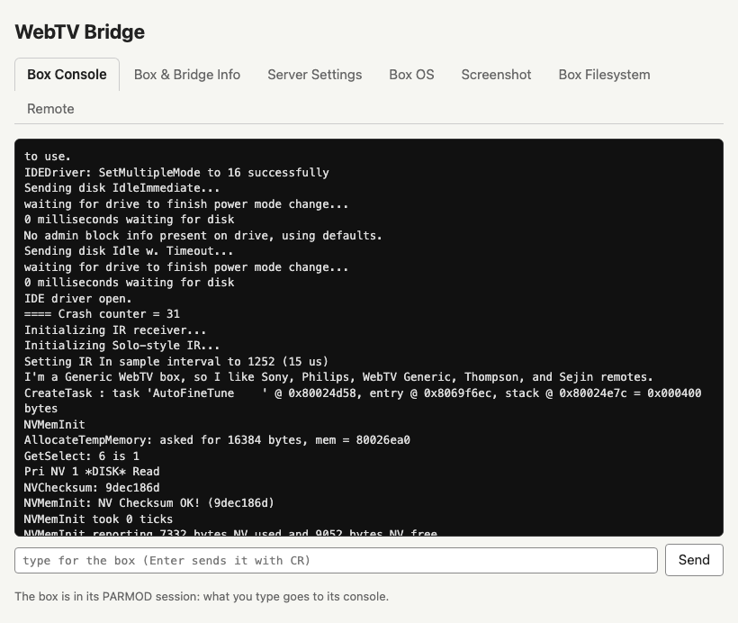

**Box & Bridge Info.** The Bridge's firmware (its build date, the patch table, the board), then what it has seen of the box: the boot ROM's version, build date and builder (from the banner the ROM prints in its diagnostics), whether it started through the debug monitor or the disk's tier-3 area, and the OS build and slot. The box lines appear once the Bridge has met the box. Then the settings, and below them the Bridge's state, refreshed every 2 s: WiFi and address, the WTVP server, uptime; the port's mode and PARMOD counts (sessions, transactions, refusals, attentions); box resets seen; the modem, PPP and open connections; the start-up's phase and the OS it found.

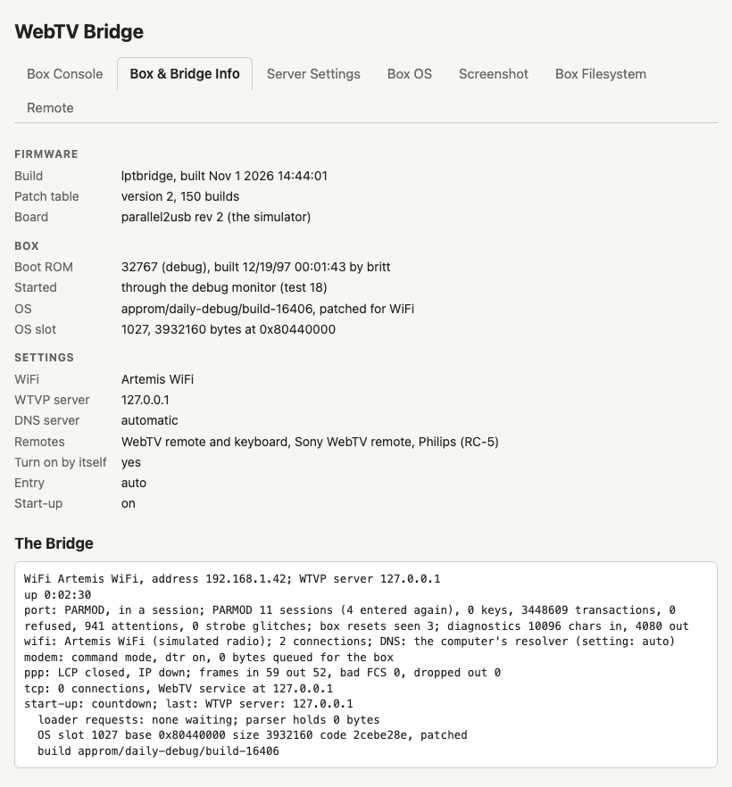

**Server Settings.** The WTVP server: where the Bridge sends the box's WebTV service connections, a name or an address, blank for wherever the box asks. It's the same setting as Settings → WTVP server on the TV; saving it here takes effect at once and the WebTV Bridge screen shows the new one. The DNS server: the server the Bridge looks names up with. Blank means automatic: the router's, or 8.8.8.8 when it gives none. Both are saved at once.

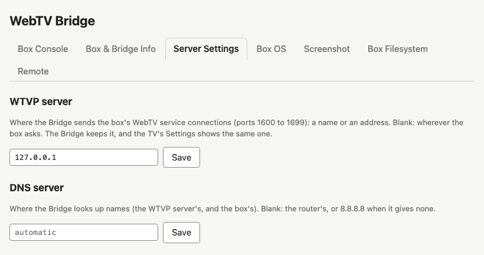

**Box OS.** **Save this OS** downloads the OS image exactly as it is on the disk. **Install another OS** uploads an `_approm.o` into the other slot; the box boots it from then on.

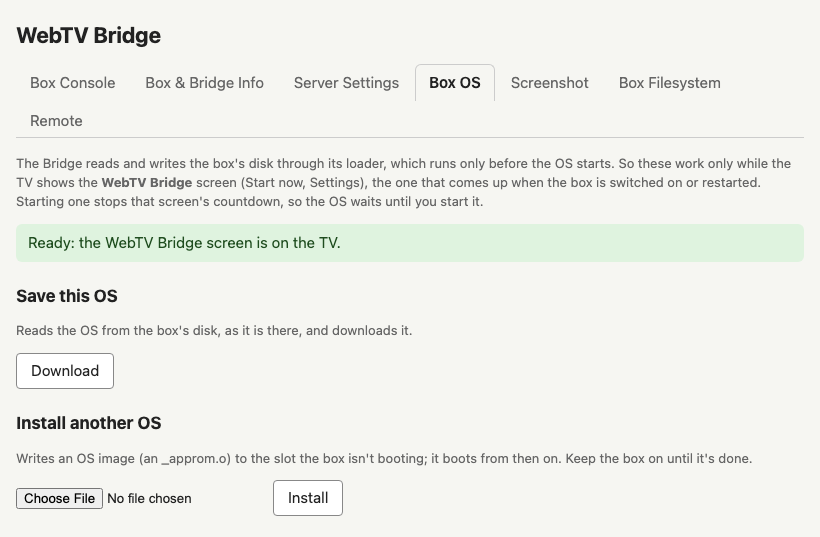

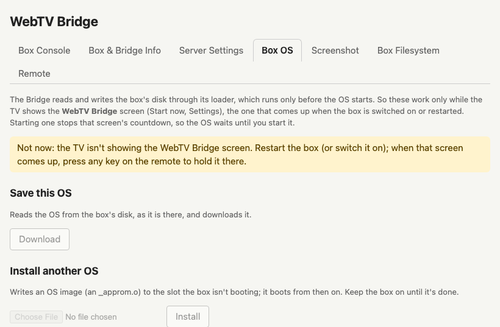

**Screenshot.** Grabs the picture the box is putting on the TV, at any time: while the OS runs, and on the WebTV Bridge screen. Save it as a PNG, or as YUV bytes (Y Cb Y Cr).

- **The OS's screens** aren't a framebuffer. The SOLO's compositor builds them as the TV is drawn: a y-map divides the screen into bands, and each band is a list of small cels, each drawing a strip of some texture in RAM. Nothing in memory holds the finished picture. So the page reads the y-map, the cels and the textures they point at, and composites them with the emulator's own compositor code.
- **How it finds what to read:** it runs the compositor over what it has read so far and notes everything it touched that it doesn't have yet. It reads that and runs again, until nothing new turns up: the y-map, then the cels, then their textures. One screen is about 500 KB.
- **Through the running OS:** the OS reads its own memory for the Bridge, 64 bytes at a time over the parallel port's control channel (below). Something moving on the screen during the read may tear.
- **On the WebTV Bridge screen:** the Bridge's loader reads the framebuffer directly, and the YUV file is exactly what is in memory. For the OS's screens it is converted back from the composited picture.

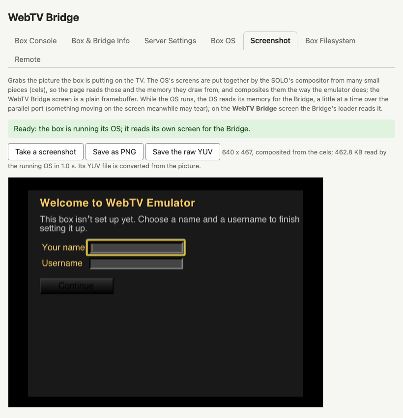

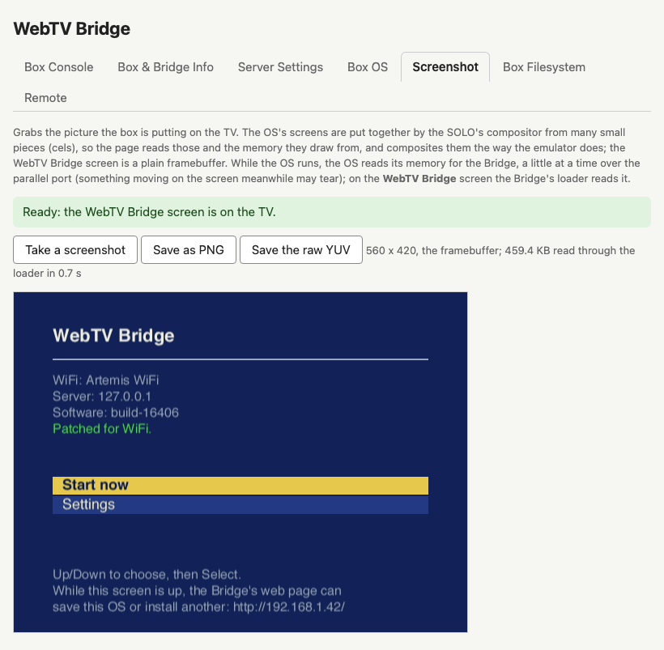

**Box Filesystem.** Read the disk lists its partitions (from the partition table at LBA 42504) and, under the boot partition, the fixed areas the boot ROM and the Bridge use: NV storage and its copy, the two OS slots, the select block, the tier-3 area, the partition table. Each can be downloaded, or replaced from a file after a confirmation. The FAT partitions (browser, jack, DiskCache and so on) open into a file browser: download a file, upload files (a file of the same name is replaced, after asking), make a folder, delete a file or an empty folder. Long names are kept, with a short 8.3 name beside them as FAT wants. The page itself does the filesystem work; the Bridge only reads and writes sectors. Writes go straight to the box's disk, so download a partition first to keep a copy.

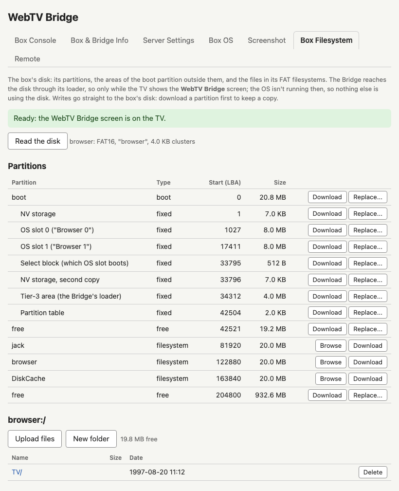

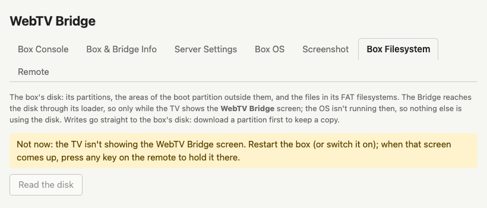

**Remote.** The WebTV remote's buttons (Power, Home, Back, Options, Recent, the arrows and Go, Scroll, Info, View, the digits), **Capture this computer's keyboard** (your keys go to the box as the IR keyboard's, pressed and let go), a box that types text key by key, and a **monkey**: random presses at a set rate, navigation alone or with typing, for stress testing while you watch the Box Console. On the WebTV Bridge screen the Bridge takes the keys itself. While the OS runs they go over the parallel port into the OS's IR input ring, exactly where its IR decoders put a key from the receiver, with the OS's own clock: from there it handles them as real keys (repeat, Shift, the remote's held buttons). That works on the 114 builds whose ring the patch knows (16406, 7181 and the rest of 2.x); the 3xxx and 2046-era builds lay it out differently and take none.

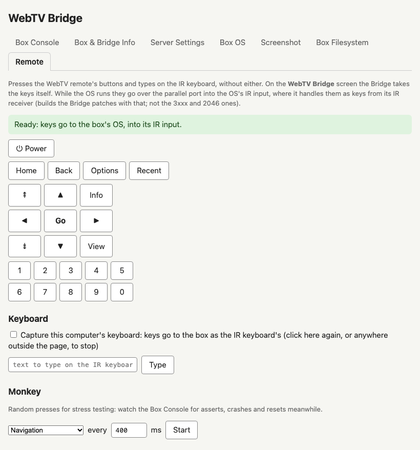

**Reading the box's memory while the OS runs.** The Bridge's loader is gone once the OS starts. So the OS patch's own driver reads memory for the Bridge on PARMOD's control channel. The Bridge hands it an address as four reply bytes, then a status byte with bit 6 set. The OS's pump answers on CTRL\_OUT with 16 words of RAM, or one word of the SOLO's registers. It reads only RAM and those registers, so no address can crash it. While a screenshot is in progress, the Bridge keeps up to 2 KB of requests queued and pulses nAck so the OS keeps pumping. The routine adds 296 bytes to the patch; all 179 patchable builds still patch.

**The filesystem stays on the WebTV Bridge screen.** The running OS keeps the filesystem's state in memory and owns the disk. Writing underneath it would corrupt the disk, and reads could be stale.

The same console is on TCP port 2323 for a terminal: `nc <address> 2323`.

## What the user sees

### Plugging it in

The Bridge goes on the box's parallel port and takes power from USB: a phone charger, or a computer when you want its serial console. Switch the box on. The boot ROM's diagnostics turn the TV magenta; the Bridge sets it back to black within a second (0.8 s on a debug boot ROM), and the Bridge's own screens follow.

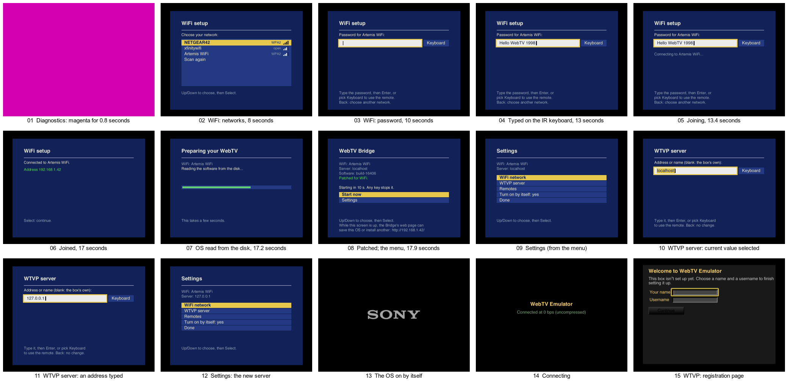

The whole start-up, as the emulated TV shows it with the real firmware on the emulated port (boot ROM 3475, a fresh Bridge, build 16406; emulated seconds from power-on). The Bridge's screens are in the boot ROM's own fonts. Frames 9–12 (Settings and the WTVP server) come from a later power cycle in the same run, so they carry no times. Frames 13–15 are the OS's own screens, from an earlier run with build 16423. Full-size frames are in `out/picosim/`.

### The first time: WiFi on the TV

The Bridge scans and lists the networks it can see. Pick one with the remote; type its password on the IR keyboard or with the on-screen keyboard. The Bridge joins, shows its address, and saves the network.

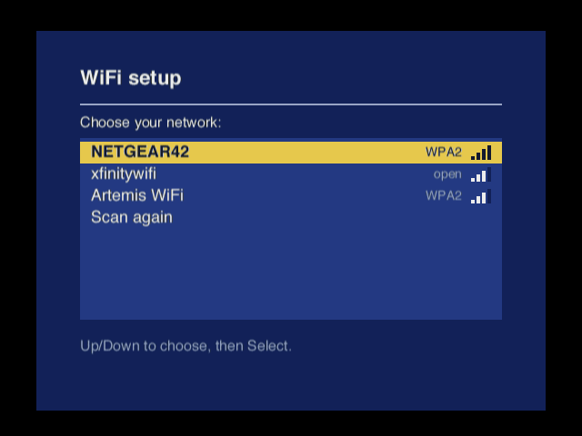

**The networks, 8 seconds after power-on.** The loader is running; the Bridge draws the list through it.

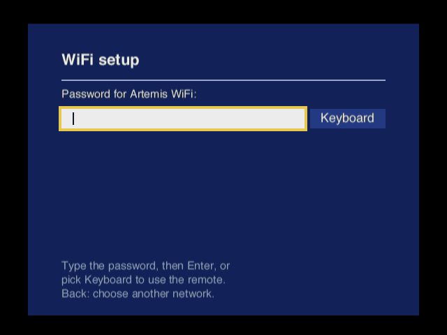

**The password, typed, at 13 seconds.** Then joining (13.4 s) and joined, with the address (17 seconds).

### Every start: the Bridge's menu

The Bridge reads the OS from the disk and patches it (0.2 s for 16423), then shows the **WebTV Bridge** screen with a 10-second countdown. Any key stops the countdown.

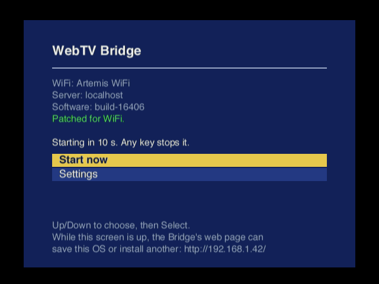

- **Start now** starts the OS. A build the patch table doesn't know gets "Start without WiFi" instead.
- **Save this OS and Install another OS** are on the Bridge's web page, not in the menu. Under the menu the screen says so, with the page's address; both work while this screen is up.
- **Settings:** the WiFi network, the WTVP server, the remotes the OS listens to, and whether it turns on by itself.

### Settings: WiFi, server, remotes, power

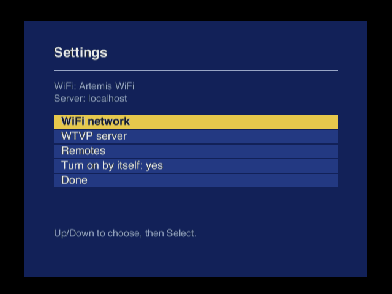

**Settings** shows what is set and lists each setting. **WTVP server** takes an address or a name. The box needs a WebTV service for everything, web pages included, because WebTV fetches pages through its service. Its software connects to WebTV's own servers, which are gone, so in practice this is set to one you can reach: minisrv on a computer on your network, or a public one. Blank leaves the box's own address alone, which is useful only with a build or TellyScript that already points at a live service. The current value comes up selected, so the first key typed replaces it, and **Keyboard** opens the on-screen keyboard for the remote. Back leaves it unchanged.

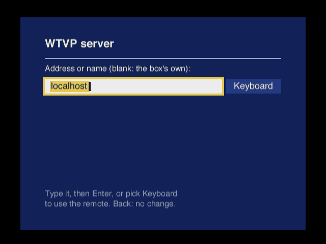

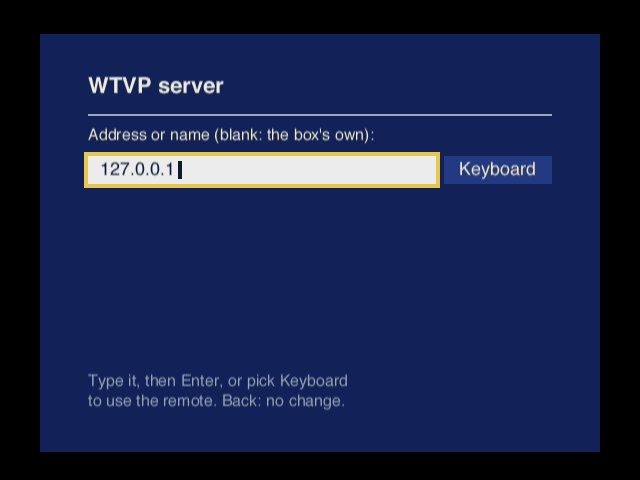

The Bridge sends every connection to the WTVP ports (1600–1699) to that server, so the OS doesn't need to know about it. The same setting is the console's `service` command.

A name is looked up through the WiFi network's DNS server, the one the router hands out with the Bridge's address (DHCP), or 8.8.8.8 when the router gives none. Another server can be set on the serial console (dns) or the web page. A `.local` name needs mDNS, which the Bridge doesn't do yet: `minisrv.local` above resolved only because the emulator uses the computer's own resolver.

**Remotes** (added 2026-10-31) sets which remotes the OS decodes besides the WebTV remote and the IR keyboard, which always work: Sony's WebTV remote (20-bit SIRC) and Philips RC-5 remotes. The OS picks its decoders by the box's maker, and a box with no maker set takes only the WebTV remote and the keyboard. A development box with no maker set, for example, says "I'm a n Unknown box, so I like WebTV Generic and Sejin remotes." and ignores a Sony WebTV remote until Remotes turns it on. Both are ticked by default. Untick Philips if the TV's own remote is RC-5, or its buttons reach the WebTV too. The Bridge's own screens always take the Sony remote, so it can always get back here.

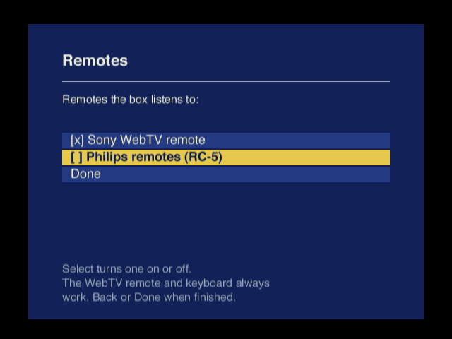

**Turn on by itself** (default yes): the OS powers on at once instead of waiting in standby for the power key. Select switches it.

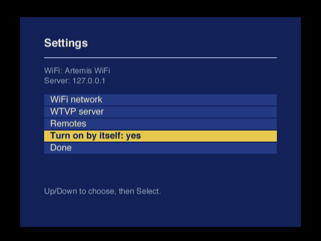

Both reach the OS when it is started: the Bridge writes one word for each into the patched copy in RAM, moves the code checksum to match, and checks it as the boot ROM will. A change made in Settings applies at that same start. The serial console has them too: `remotes [sony] [philips]` and `autopower on|off`.

### Then the box as it always was

Then the box is a WebTV again: it powers on by itself (or waits for the power button, if Settings says so), its own splash, dialing (to the Bridge), and the service. With WiFi saved, the OS starts 16 s after power-on on 3475 and 12.8 s on 2046. Turning the box off and on from the remote, or an update that restarts the OS, comes back without the countdown.

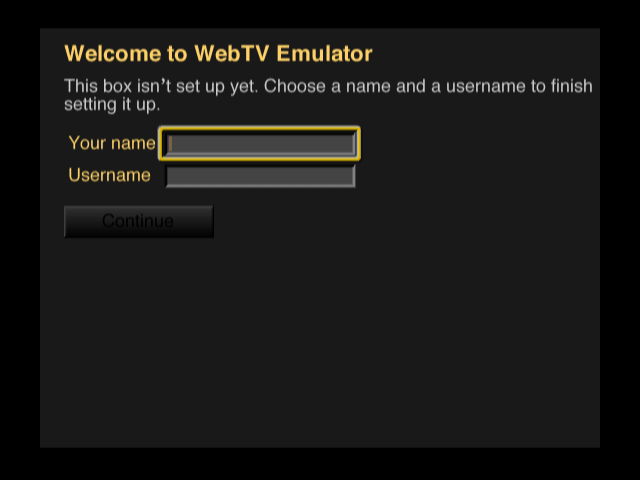

**Online, 57 s:** the registration page from the WebTV service, reached over WiFi.

### The serial console over USB

Plug the Bridge into a computer and open its USB serial port (or the console UART) at 115200. The Bridge's log scrolls there, with the box's console lines as `[pmcon]`, and it takes commands:

| Command | Does |
| --- | --- |
| `status` | the settings, then the same state as the web page |
| `scan` | the WiFi networks in range, with signal and security |
| `wifi "name" password`, then `save` | join a network and keep it |
| `service <host>` / `service none` | the WTVP server; none = where the box asks |
| `dns 1.1.1.1` / `dns auto` | the DNS server; auto (the default) = the router's, or 8.8.8.8 when it gives none |
| `type "text"` | a line to the box's console |
| `remotes [sony] [philips]`, `autopower on/off` | which remotes the OS decodes besides its own; whether it turns on by itself (as in Settings) |
| `entry auto/tier3` | start a debug boot ROM the way a production one must, through the disk's tier-3 area |
| `log 0-3`, `country XX`, `startup on/off`, `reboot` | log detail, WiFi country, skip the start-up (for an OS already patched on its disk), restart the Bridge |
| `pins`, `walk`, `loop 1-5` | bring-up tests of the board's lines |

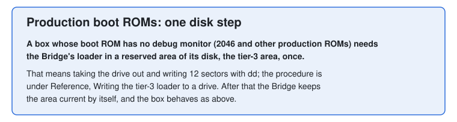

## How it works

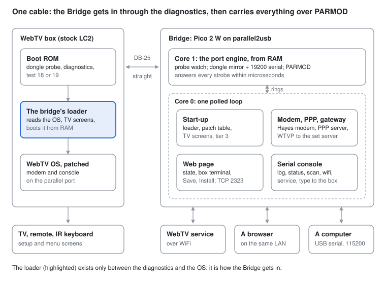

The Bridge has three jobs, in order: get code of its own running in the box, use it to start a patched copy of the box's OS, and then be the box's modem. The first two happen at every start, because the OS on the disk is never changed.

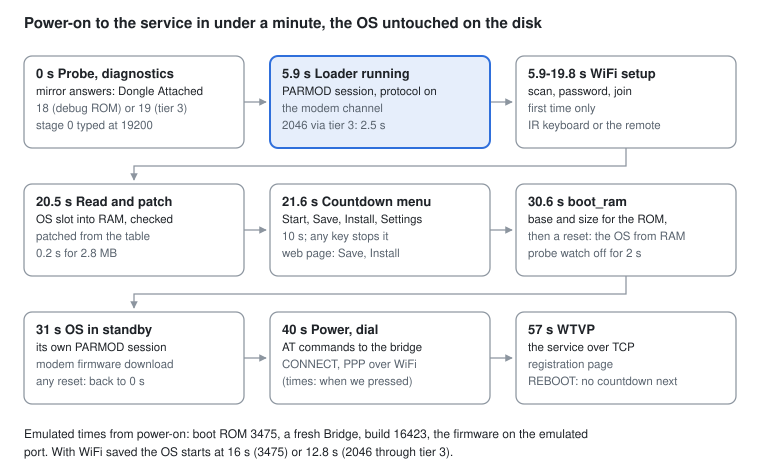

The loader is the hinge: everything before it gets the Bridge's code into the box; everything after it runs over PARMOD.

### Getting in: the dongle and the diagnostics

Every LC2 boot ROM checks for a factory loopback plug (the "dongle") on the parallel port after a reset. It drives D0, D1, D2 and D3 high one at a time and reads the status lines after each, expecting D0 on nAck, D1 on Busy, D2 on PError and D3 on nFault and Select. When they match, it enters its Tier 2 factory diagnostics with their console on the parallel port. The Bridge plays the dongle: core 1 watches for the probe and mirrors D0–D3 onto the status lines in the same pass.

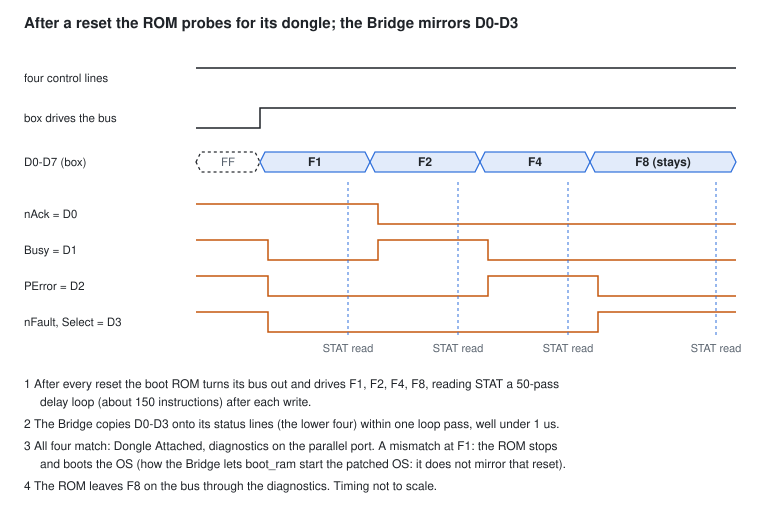

The probe is also how the Bridge sees every reset of the box. It answers the probe when it wants the diagnostics, and lets it pass for the reset that starts the patched OS.

The diagnostics' console is a software serial port at 19200 8N1: the box sends on nSelectIn and receives on D7, which the Bridge drives only while a character goes out. The box listens only inside its character-in routine, so the Bridge sends one character, then waits until both lines have been quiet for 1.5 ms: about 3 ms a character.

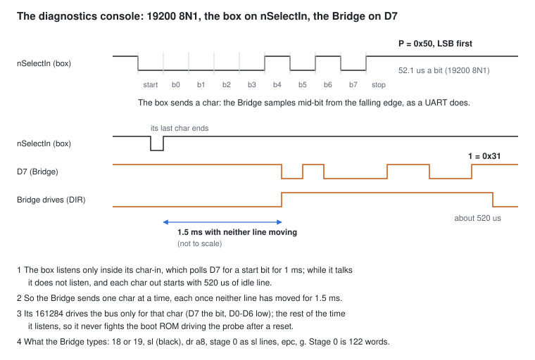

### Getting the loader running

What the diagnostics can do depends on the boot ROM:

| Boot ROM | Way in | Disk written? | Loader running |
| --- | --- | --- | --- |
| Debug (for example 3475, "debug internal, built by britt, 12/19/97") | Test 18 opens the WTV debug monitor (`app>`). The Bridge first writes black into the video's blank colour with one sl (the diagnostics set it magenta), then types `dr a8` (why the box reset), then stage 0 into RAM with `sl` (122 words), sets `epc` and types `g`. At the end of the `g` line the port goes to PARMOD, and stage 0 pulls the 5 KB loader over it. | No | 5.9 s after power-on |
| Production (2046: "non-debug external") | Test 18 answers "Debugger not implemented on non-debug Rom", and no other command writes memory. Test 19 ("Continue to Tier 3 diags") boots the image in the disk's tier-3 area, which is the loader. | Once: the tier-3 area | 2.5 s |

The loader (`src/stockbox/loader.js`, MIPS built by the emulator's assembler) runs uncached and owns the box until the OS starts. It speaks PARMOD, with the Bridge's protocol on the modem channel:

- **The TV:** it starts SOLO video on its own framebuffer and draws rectangles and text. The text is in the boot ROM's own fonts: every LC2 boot ROM carries the OS's 24 font strikes (Roman, Bold, Black and Italic, 12 to 22 point) in its ROM filesystem. The Bridge finds them there, reads their widths so it can lay out each line, and has the loader draw from them in place, then apply the OS's own flicker filter, so the screens look like the WebTV OS. A boot ROM without them gets a plain 5×7 font. The Bridge composes every screen; the loader only draws.
- **The remote and the keyboard:** it passes the IR receiver's raw runs to the Bridge, which decodes them with ports of the OS's own decoders: the WebTV remote, Sony's WebTV remote and the IR keyboard.
- **Memory:** READ and WRITE of RAM, the boot ROM and the SOLO registers, and CALL, pipelined.
- **The disk:** its own IDE routines, called through CALL, read and write sectors.

### Patching the OS in RAM and starting it

**The boot ROM can start an OS from RAM.** Early in its main it checks the OS base and size it keeps at 0xa0000400 + 0x19c / + 0x1a0. If the image there passes the code and ROM-filesystem checksums, it jumps to it without reading the disk. Every boot ROM in the collection keeps them at those offsets.

So the Bridge, through the loader:

1. reads the OS slot the box would boot into RAM;
2. identifies the build by its code checksum, size and ROM-filesystem sum, and applies that build's entry in the patch table;
3. at Start, writes the settings that change the OS (which remotes it decodes; powering on by itself) as one word each, at places the patch table records for every build, and moves the code checksum to match;
4. writes base and size where the boot ROM looks, and resets the box without answering the probe;
5. the boot ROM starts the patched copy. The Bridge ignores the probe for 2 s after that reset.

**The patch table** has 150 builds as runs of changed words, 856 KB in the Pico's flash. It is made by the same patcher that patches an image on disk (`src/lptmodem/`), which works from a build's `symbols.sym` or, without one, finds what it needs in the code by signature (180 of the collection's 181 images patch that way).

**What the patch changes:**

- **The modem driver's bottom half** (InitModem, putchar\_modem, getbuf\_modem, the interrupt handler and the rest) goes to PARMOD's modem channel. The OS's own 4 KB rings, TellyScript, PPP and TCP/IP stay. TellyScript's direct register access sees a small virtual 16550.
- **The debug console** becomes the console channel: a debug build's parallel console (`SetCharIO` flag 0x10) is hooked over; other builds copy `putchar` there.
- **The printer driver** is turned off, so nothing else touches the port.
- **`SafeReset`** first sends REBOOT, so the Bridge knows the OS is restarting itself.

The new code (3,876 bytes on 16423, plus a 428-byte state block) goes into the bodies of the replaced modem functions and the dead printer driver. No new buffers.

**Resets.** Every reset brings the probe, and the Bridge starts over: the diagnostics clear RAM, and the OS's own reboots point the boot ROM back at the disk, so an update or a slot switch boots what the disk holds. After REBOOT the Bridge skips the countdown; the OS is back 5.4 s after the reset on 3475 and 2.7 s on 2046. A crash (a reset with no REBOOT) goes the same way.

### PARMOD: one link for everything

**PARMOD** stands for PARallel MODem: to the box's OS the Bridge is its modem, and the parallel port is the wire. The modem is one of its channels; the debug console and the Bridge's commands are the others.

Every byte moves in one **transaction**. The box sets a 3-bit code on nSelectIn, nInit and nAutoFd that names the channel and the direction, pulses nStrobe, and the Bridge answers on Busy. The SOLO port stays in software mode. Each transaction stands alone, so channels interleave byte by byte and can't corrupt each other.

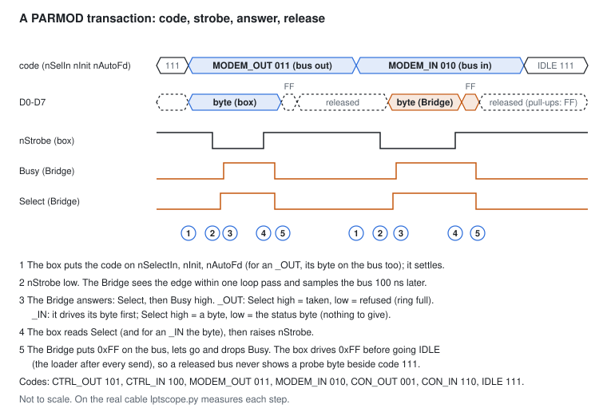

| Code | Name | Data from | Use |
| --- | --- | --- | --- |
| 111 | IDLE | — | between bursts; no strobes |
| 101 | CTRL\_OUT | box | commands, including the entry signature |
| 100 | CTRL\_IN | Bridge | command replies; when there are none, the status byte |
| 011 | MODEM\_OUT | box | bytes to the Bridge's modem |
| 010 | MODEM\_IN | Bridge | bytes from the modem |
| 001 | CON\_OUT | box | console output |
| 110 | CON\_IN | Bridge | console input |
| 000 | — | — | never used |

**A transaction:**

- **Box:** with interrupts off, check Busy is low; write the code with nStrobe high (DIR out and the byte for an `_OUT` code); wait 2 µs if the code changed; take nStrobe low and wait for Busy high (200 µs timeout); read STAT, where Select is the result, and for `_IN` the data; take nStrobe high.
- **Bridge:** at nStrobe low, keep an `_OUT` byte (Select high if taken, low if that channel is full) or drive an `_IN` byte (Select high), or the status byte (Select low) when the channel is empty; raise Busy. At nStrobe high, release the bus, then drop Busy.
- **Bus rule:** the Bridge drives D0–D7 only from nStrobe low on an `_IN` code until it drops Busy; the box only for `_OUT` codes, after seeing Busy low. **Both drive 0xFF before letting go**, so a bus drifting up through the pull-ups can never look like the boot ROM's probe pattern.

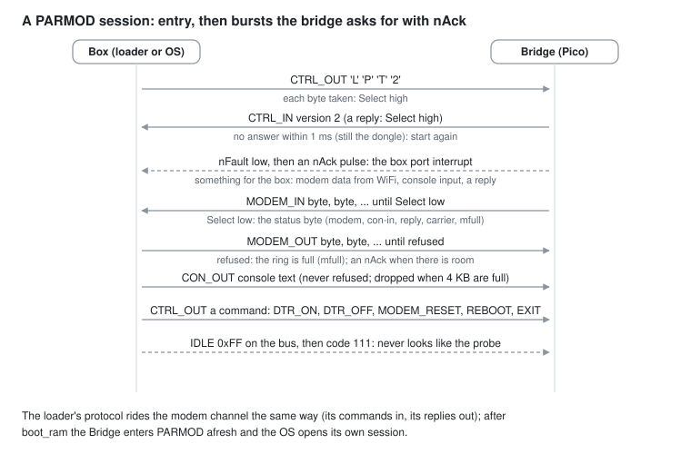

**Entry.** The box sends 'L' 'P' 'T' '2' as four CTRL\_OUT bytes, then reads the protocol version (2) on CTRL\_IN. Entering never touches the modem, so the box can re-enter after a glitch without dropping a call.

**Status lines in a session:** Busy acks the transaction; Select is its result; PError low means the session is up; nFault low means something is waiting for the box; an nAck pulse is attention, the box's port interrupt.

**Status byte:** bit 0 modem bytes waiting, 1 console input waiting, 2 a command reply waiting, 3 carrier, 4 the Bridge's modem input is full, 5 a console client is attached (defined; the firmware doesn't set it yet).

**Commands** (CTRL\_OUT): 0x01 MODEM\_RESET (hang up and flush, from InitModem); 0x02 / 0x03 DTR on / off; 0x05 EXIT; 0x06 REBOOT; 0x07 PEEK, the answer to a memory read the Bridge asked for (status bit 6): a count of words, then the words. 0x04 is the request for a debug build's 1997 ECP transfer, which this Bridge only logs.

**Flow control:** modem output can be refused (the byte stays in the box's ring, and an nAck says when there is room again); console output never is, and the oldest is dropped if the Bridge falls behind. With no Bridge, the box keeps the newest 256 bytes of console output and tries to enter once a second.

**Speed:** about 2–3 µs a byte, so 330–500 KB/s for one channel; PPP at 56k needs 7 KB/s. Calculated, not measured: the emulator doesn't charge for bus waits.

### Online: the modem, PPP and the gateway

On core 0, the modem channel goes to a Hayes modem with the commands TellyScript uses (the AT\*\* firmware download, discarded; ATDT; CONNECT; +++; hang-up on DTR). Behind it is a PPP server: the box is 10.0.0.2, the gateway and DNS 10.0.0.1. The gateway answers ping, resolves names over WiFi, and splices each of the box's TCP connections onto one of its own, with back-pressure both ways. Connections to the WTVP ports go to the WTVP server from Settings.

### The tier-3 area and keeping it current

**How test 19 works.** It reads the tier-3 area (LBA 34312, 8192 sectors, 4 MB) to RAM at 0x80400000 and checks it as it checks an OS: header code checksum, ROM filesystem or "NoFS", and bit 3 of the header's flags, the tier-3 mark. If it passes, the ROM jumps to it; if not, the box boots its OS as usual, unpatched.

**What goes there** (`src/stockbox/tier3.js`, 6 KB): an OS-style header with the tier-3 flag, a 13-instruction stub that copies the loader down to 0xa0300000 (out of the way of the OS, which the Bridge later reads to 0x80400000), and the loader.

**Where it sits.** The area ends exactly where the OS's partition table starts (LBA 42504), outside both OS slots and every partition. On the project disk it holds an old partition table and a fill pattern, which nothing reads. We found no tier-3 diagnostics anywhere: none of the collection's 207 images has the flag, and the project disk's only OS-style headers are its two slots and an older image at LBA 512. A disk from a shipped production box is the place to look; the procedure saves whatever is there.

**Keeping it current.** After every tier-3 start the Bridge compares the area (test 19 has just copied it to RAM) with its own image. If they differ, the loader running is an older one, so the Bridge doesn't call into it: it uploads an updater (its own loader, built to run at 0xa0500000) and the new image, has the updater write the area and read it back, checks it, and resets the box. About 2.6 s, once per update. If anything fails, the box boots its own OS, unpatched.

## Hardware

The board is Tom Verbeure's parallel2usb, used as is with a Pico 2 W in place of the Pico: design files in [tomverbeure/fake\_parallel\_printer](https://github.com/tomverbeure/fake_parallel_printer) (KiCad), and his [write-up of the hardware](https://tomverbeure.github.io/2023/01/24/Fake-Parallel-Printer-Capture-Tool-HW.html). The cable is straight through, and every signal lands where the firmware expects it. Sources: the LC2 schematic (rev 7.0, sheets 26–27) and the parallel2usb v2 schematic (2023-01-16).

| DB-25 pin | Signal | Box (J1501) | Adapter (74LVC161284) | Pico GPIO (rev 2) | J2 pin |
| --- | --- | --- | --- | --- | --- |
| 1 | nStrobe | PPR\_STB\_N, 22 Ω series | C17 → A17 | GP11 | 19 |
| 2–9 | D0–D7 | PPR\_DATA<0..7>, 22 Ω series | B8..B1 ↔ A8..A1 | GP3–GP10 | 17, 15, 13, 11, 10, 9, 8, 7 |
| 10 | nAck | DRV\_ACK\_N | A12 → Y12 | GP13 | 6 |
| 11 | Busy | DRV\_BUSY | A11 → Y11 | GP14 | 5 |
| 12 | PError | DRV\_ERROR | A10 → Y10 | GP15 | 4 |
| 13 | Select | DRV\_SELECT | A9 → Y9 | GP18 | 3 |
| 14 | nAutoFd | PPR\_AUTOFD\_N, 22 Ω series | C16 → A16 | GP0 | 18 |
| 15 | nFault | DRV\_FAULT\_N | A13 → Y13 | GP12 | 16 |
| 16 | nInit | PPR\_INIT\_N, 22 Ω series | C15 → A15 | GP1 | 14 |
| 17 | nSelectIn | PPR\_SELIN\_N, 22 Ω series | C14 → A14 | GP2 | 12 |
| 18–25 | GND | GND | GND | — | 20 |

- **Box:** the SOLO's pins go through two 74FST3384 bus switches; every line has a 1.2 kΩ pull-up to +5 V and 470 pF to ground. PP\_DIR isn't used on the board: the data direction is set inside the SOLO (CTRL bit 4 set = the box drives).
- **Adapter:** 22 Ω in series on all 17 lines; 1.4 kΩ pull-ups inside the 161284; GP28 strapped to ground on rev 2 (the firmware reads it and handles rev 1 too). GP21 is the console UART's RX, so leave Tom's "diagnostics" jumper off.
- **Together:** about 650 Ω of pull-up and 470–570 pF per line, so a released line rises with a time constant of about 0.35 µs. That is why the box waits 2 µs after a code change, and why both sides drive 0xFF before releasing the bus.
- **The image** is 1.37 MB of the Pico 2 W's 4 MB, most of it the patch table. Settings live in the last flash sector. Core 1 runs from RAM, so flash writes never stall the port.

## Status

### Verified in the emulator

With the firmware's own code on the emulated port (`run.mjs --pico`; `tools/bridgesim.mjs` runs the scenarios):

| Scenario | 3475 (debug) | 2046 (production, tier 3) |
| --- | --- | --- |
| First power-up: WiFi on the TV, OS read and patched, countdown, started from RAM, online | ✓ | ✓ |
| Power-off reboot: REBOOT, re-patched, no countdown, online | ✓ | ✓ |
| Reset without notice (a crash): caught, re-patched, online | ✓ | ✓ |
| Power cycle: countdown stopped, WTVP server typed, online | ✓ | ✓ |
| Save this OS: identical to the disk's image | ✓ | ✓ |
| Install another OS: other slot, online, boots it after a power cycle | ✓ | ✓ |

**The web page's new tabs** (2026-11-01, boot ROM 3475 only so far):

- **With the WebTV Bridge screen up:** a screenshot equal byte for byte to the framebuffer in the box's RAM; the WTVP server saved from the page and read back; a 70,000-byte file written into the browser partition through the Bridge, found on the emulated disk exactly where and as written, read back, then deleted. The screen stayed up throughout.
- **With the OS running (build 7181):** a screenshot composited from 463 KB of memory, read by the OS over PARMOD in 1.1 emulated seconds, once the screen is still: 100% of its pixels equal the emulator's own picture. (Taken while the Sony splash was still fading in, about 98% match: the screen changes during the read.) Taken straight from the emulator's memory on a still screen, the composite is 99.93% identical.
- **The FAT writing** was also checked on a copy of the test disk with macOS's own fsck, and by mounting it.

Also verified: the web page's state, terminal (a debug build's boot log streams in, typed lines reach the shell) and Save and Install; the serial console's `status`, `scan` and `help`; the tier-3 self-update, against a loader whose routines sit 256 bytes from the firmware's; the PARMOD stress test (the box's real MIPS on the emulated CPU, 40 seeds, \~8 M bytes checked); the board-level port test (`pico/host`, both board revisions); and `tools/saleae/lptscope.py` decoding the emulated cable (`--pico-trace`).

### On a real box (2026-10-31)

**The whole chain works on hardware.** On a development LC2 (16 MB, 16406 daily-debug on a CF card), with minisrv on a computer on the same WiFi:

- the dongle mirror gets the loader in;
- the loader reads the OS in about 10 s and the Bridge patches it;
- `boot_ram` starts it, and the OS opens its PARMOD session, its console on the Bridge's log as `[pmcon]`;
- TellyScript downloads the modem firmware (1857 + 131074 bytes);
- PPP comes up (PAP "wtv\_303030000", the box 10.0.0.2);
- minisrv registers the box and logs it in, with no bad frames.

On its first start the OS reformatted a 20 MB DiskCache partition on the card (the image from before is kept).

**What it took.** Four things only the hardware showed, each now fixed:

- **A glitch on nStrobe cost a link byte**, and the loader then waited forever ("Preparing" stuck at about 1/8). The Bridge now re-checks nStrobe after its sample delay and sets up the data before Busy. It also says so on its console when the loader hasn't answered in 10 s.
- **`boot_ram`'s CALL was thrown away.** The hand-over to the OS came 50 ms after Start, while the loader was still drawing. The Bridge now waits until the CALL has gone out.
- **"FENCE ERROR! cause : J2Write".** The OS points the SOLO's J2 write fence at its whole image, and the driver's state sat inside it. The state now lives in the free filler after the code, and the fence stops just below it.
- **Doubled and lost modem bytes** ("ppp: checksum error"; logging in took 30 s). An OS interrupt between reading the port and checking the timer made a good wait look timed out, so the driver sent a byte again. It now re-reads the port before giving up. The Bridge hex-dumps any frame with a bad checksum, which is how the doubled byte showed.

The emulator models none of these: no fences, no interrupt latency, no glitches.

**What else it showed:**

- The OS started in standby and waited for the power key. Fixed: Settings, Turn on by itself.
- A Sony WebTV remote did nothing. The box has no maker set, so the OS turned the Sony decoder off. Fixed: Settings, Remotes.

### On a real box (2026-11-01)

- **Home, mail and browsing work.** With minisrv patched (`services/minisrv-no-ssl-certs.patch`), the box goes past `wtv-home:/splash` to Home. The assertion there was the debug OS, not the Bridge: `RootList::Idle` asserts `strcmp(url, fResource.GetURL())==0` because each of minisrv's SSL certificate headers empties the OS's root list until the first page has drawn.
- **Every reset is caught now.** The real boot ROM's dongle probe (nStrobe and nAutoFd high, nInit and nSelectIn low, 0x00, 0x51, 0x52, 0x54 about 10 µs apart, no strobe) shares its lines with PARMOD's console code, so the Bridge counts unstrobed data changes: PARMOD changes the data at most once a strobe, the probe twice or more. A power pull with the OS online: probe caught, re-armed, patched and online again 62 s after power came back. And an OS that starts over inside a session (out of its debugger) now finds the modem hung up.
- **The Bridge's screens no longer blink:** text is drawn in a back buffer in the loader and copied to the screen whole; the progress bar draws its green and grey parts side by side.
- **Keys from the web page work** on the WebTV Bridge screen and in the running 16406, and the Remote tab's monkey has run against it.
- **Throughput:** about 12 KB/s of modem data, a 1 s PPP round trip.

**The web page, on the real box** (the Remote tab's monkey had sent 1,726 keys):

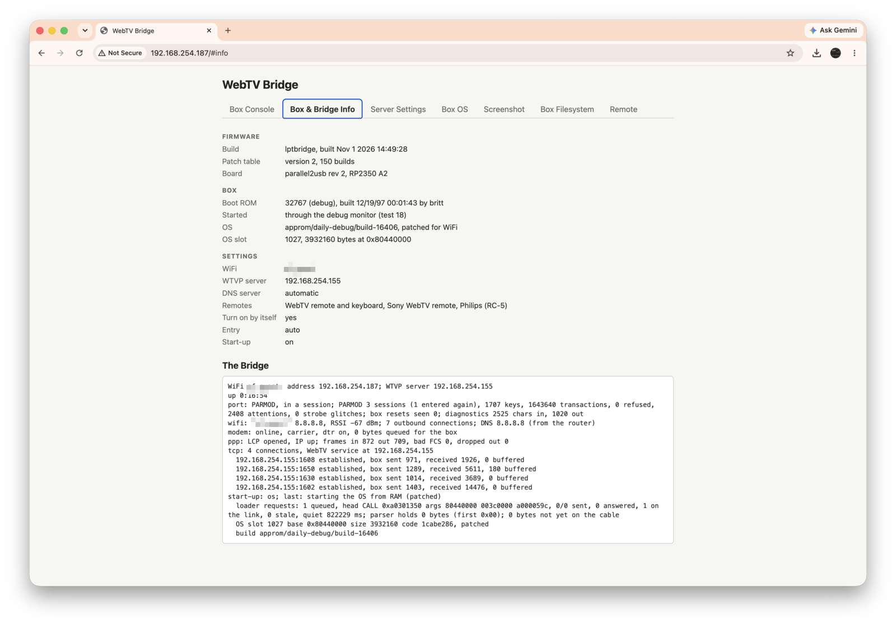
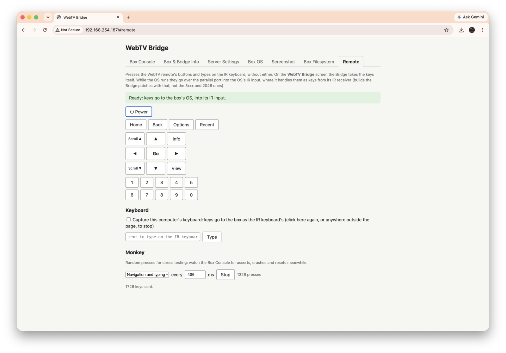

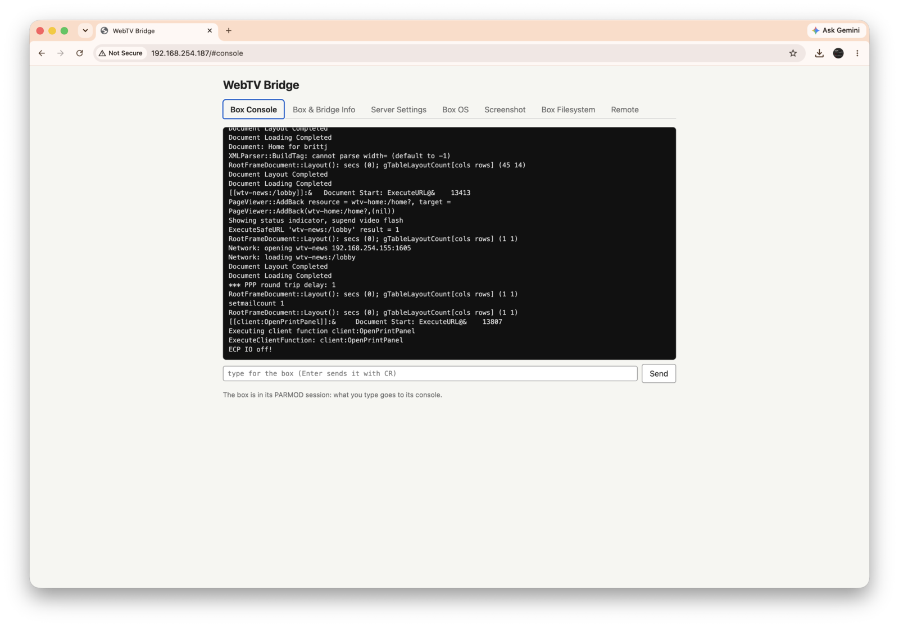
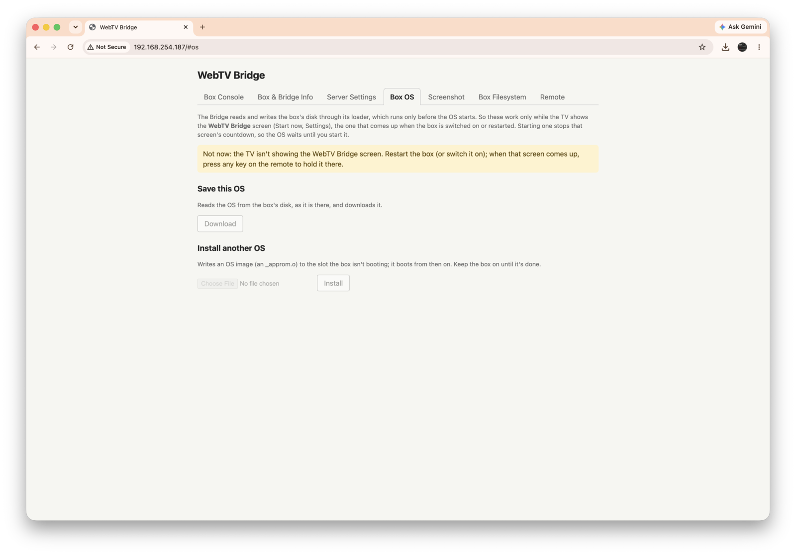

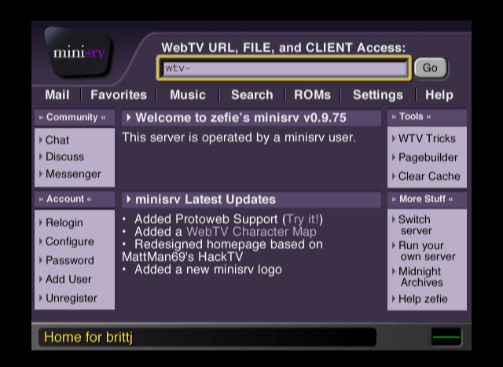

**Still open:**

- **Print does nothing now** (fixed 2026-11-01, found by the Remote tab's monkey). With the Bridge on the printer port there's no printer, and 16406 crashed when you pressed Print: the panel's Print button (`client:ShowPrintWindow`) loads `PrintSystem.mod` and, on a disk without it, calls into it anyway. The patch now makes `ShowPrintWindow` return at once. It had looked like a silent hang on the real box, because the Print panel first turns the parallel-port console off ("ECP IO off!"), so the crash went to the serial port; the patch also keeps the console on the Bridge on debug builds now (`SetCharIO` keeps flag 0x10, as production builds already did), so a crash shows on the Box Console tab.
- **The IDE driver floods the console** with "Forcing power change" and "Sending disk IdleImmediate".
- **WiFi joins:**
  - a second join can falsely succeed;
  - 20 s is too short for some networks;
  - the status line shows the wrong DNS server.
- **The link delays** are generous (1 µs) and can be trimmed.

### Not yet

Not yet tried on hardware:

- a production box (2046) and its tier-3 area;
- a long run online;
- Save and Install from the web page, and Box Filesystem;
- a Sony WebTV remote with the new settings.

Still unmeasured: a SOLO register access's real time, and the ATA timing.

## Bring-up plan

- [x] **The board alone.** `loop 1` to `loop 5` with jumpers on J2, then `walk` captured with the Saleae (`lptscope.py capture --send walk`): every line, its polarity and DIR.
- [x] **The probe and the mirror on a real box.** The PIO mirror gets in at power-on (2026-10-31), and since 2026-11-01 the Bridge also catches the real ROM's probe after the OS is running (a power pull, a crash), so every reset brings the box back through the Bridge.
- [x] **The diagnostics console.** The same decode shows the ROM's banner and what the Bridge types; the TV goes magenta, then shows the Bridge's screens.
- [x] **A box with a debug boot ROM.** The whole start-up: loader, WiFi on the TV, read, patch, countdown, the OS from RAM, online. The OS has to be one the patch table covers; the builds on the project disk image aren't, so install one first from the web page (16406, for example).
- [ ] **A production box (2046).** Write the tier-3 area once (Reference), then the same start-up.
- [ ] **Long runs.** An hour online; Save and Install and Box Filesystem from the web page. (Done on hardware: power pulls and restarts with the OS online, the web terminal on a debug build, Screenshot, and keys from the Remote tab, including a 1,700-key monkey run.)

## Open decisions

- **The tier-3 write on production-ROM boxes.** It is a reserved diagnostics area, not the OS, and the old contents are saved first. The alternative is patching the OS on the disk (`lptdisk.mjs --patch`), which needs no start-up but changes the OS, which the Bridge is designed to avoid.
- **A password for the web page and port 2323.** The box's console is a root shell on a debug build, and its debugger can write the disk. Today both are open to anyone on the LAN, over plain HTTP. A password set from the serial console would close that.
- **An emulator quirk to keep in mind:** a power press 30 s or more after the OS starts never dials, with or without the Bridge. It is the emulator, not the Bridge.

## Reference

### Writing the tier-3 loader to a drive (macOS)

Image the whole drive first, let `lptdisk` write the loader into the copy (it finds the drive's byte order from the OS slots, checks what it wrote, and saves the old area), test the copy in the emulator, and only then write the 12 changed sectors back. Run end to end on a clone of the project disk standing in for the drive: the written drive matched `lptdisk`'s output byte for byte, a 2046 box booted the loader from it, and the undo step restored the original exactly.

1. **Connect the drive** with a USB-to-IDE adapter (40-pin for 3.5-inch, 44-pin for 2.5-inch; jumper the drive to master). If macOS says the disk is not readable, choose **Ignore**, never Initialize.
2. **Find it:** `diskutil list` shows an external, physical disk of the drive's size with no volumes macOS knows; below it is `/dev/disk4`. Check the number twice: a wrong one overwrites another disk. `diskutil info /dev/disk4` shows its model and size.
3. **Unmount it:** `diskutil unmountDisk /dev/disk4`.
4. **Image the whole drive** (your backup): `sudo dd if=/dev/rdisk4 of=webtv-disk.img bs=1m`. I/O errors may mean the drive is ATA-locked: stop and check it on Linux with `hdparm -I`.
5. **Write the loader into a copy:** `node tools/lptdisk.mjs webtv-disk.img --tier3 -o webtv-disk-t3.img`. It saves the area as it was to `webtv-disk-t3.img.tier3-backup.bin` (4 MB), writes the 6 KB image at LBA 34312 and reads it back.
6. **Try it in the emulator:** `node tools/run.mjs --rom <the box's boot ROM> --disk webtv-disk-t3.img --pico --pico-settings bridge.settings --cycles 2200000000`. The log should show `test 19, the tier-3 loader`, then `loader running`.
7. **Write the 12 sectors:** `sudo dd if=webtv-disk-t3.img of=/dev/rdisk4 bs=512 skip=34312 seek=34312 count=12`.
8. **Check:** `sudo dd if=/dev/rdisk4 bs=512 skip=34312 count=12 | cmp - <(dd if=webtv-disk-t3.img bs=512 skip=34312 count=12)` prints nothing when the drive matches.
9. **Put the drive back,** Bridge on the port, and switch on: the Bridge's screens within about 3 seconds.

**To undo:** `sudo dd if=webtv-disk-t3.img.tier3-backup.bin of=/dev/rdisk4 bs=512 seek=34312`. Keep `webtv-disk.img` too: the drive as it came out of the box.

### Code and tools

| Where | What |
| --- | --- |
| `pico/` ([`pico/README.md`](../pico/README.md)) | The firmware: `port.c` (core 1), `portglue.c`, `sb/` (the start-up), `modem.c`, `ppp.c`, `gw.c`, `web.c`, `console.c` |
| `pico/sim/`, `src/machine/picosim.js` | The firmware built to WebAssembly and put on the emulated port: `run.mjs --pico` (its web page on 127.0.0.1:8080) |
| `src/stockbox/` | The loader, stage 0, the tier-3 image, the protocol and the patch table (the start-up itself is C only, in sb/); `tools/picogen.mjs` builds the firmware's copies |
| `src/lptmodem/` | The OS patch (`patch.js`, `driver.js`, `parmod.js`), signatures (`sigs.js`) |
| `tools/lptpatch.mjs`, `lptdisk.mjs`, `lptpatchtable.mjs` | Patch one image; patch or tier-3 a disk image; build the patch table |
| `tools/bridgesim.mjs` | Nine scenarios, run by the firmware itself on the emulated port: the start-up, resets, settings, the web page (screenshots, the disk, Save and Install, keys) |
| `tools/saleae/lptscope.py` | Capture the cable with a Saleae and decode PARMOD, the probe and the diagnostics console |
| [`WEBTV_LPT_BRIDGE.md`](../WEBTV_LPT_BRIDGE.md) | The full spec |

### Where this started

This doc began on 2026-10-25 as a plan to load a patched OS through a debug build's 1997 ECP download, typed at the debug shell over the serial header. The Bridge needs none of that now. That work (the 1997 parallel console and ECP download, Debug Terminal Setup's secret code, how the OS shares the port) is in the spec, §3.7, and in this doc's history.

### Appendix

Commented assembler listings of the OS patch (for build 16423), stage 0, the loader and the tier-3 stub: [appendix.md](appendix.md).
